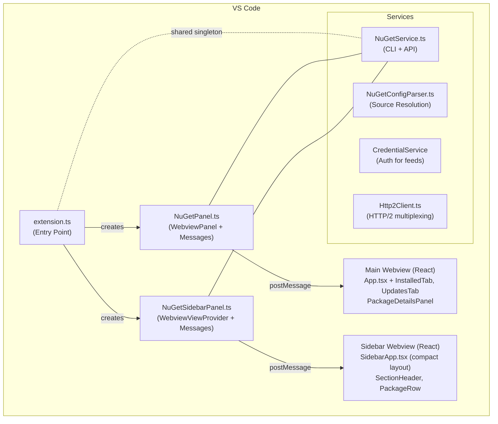
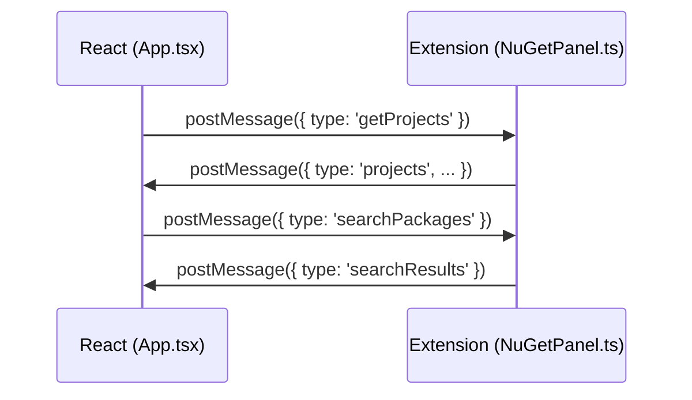
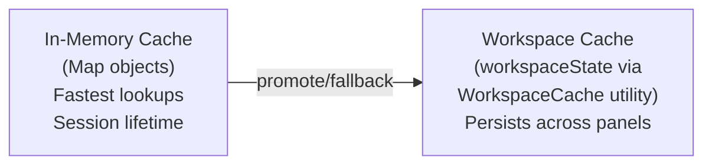
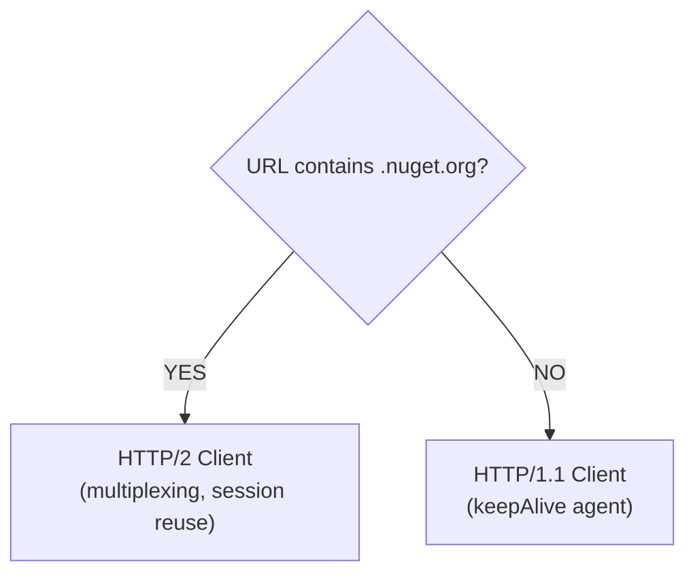
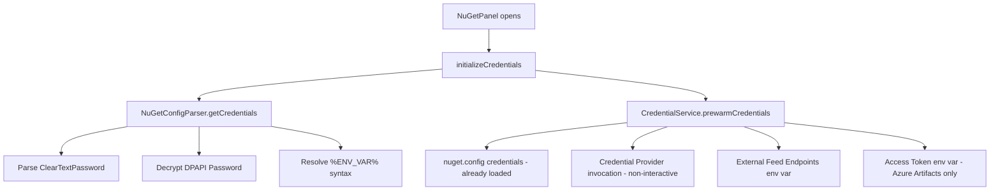

# Architecture

This document describes the technical architecture of the nUIget VS Code extension.

> **Two architectures live in this repository until the 2.0 flip (plan item P8).** The first section below
> describes the code that is being built on the `labs/2.0` branch. Every later section whose heading carries the
> 1.x marker describes the shipping 1.18 code and is deleted together with it. Write 2.0 documentation only in
> the first section.

## 2.0 Architecture (in progress)

nUIget 2.0 is a re-architecture on audited contracts: a platform-agnostic core (`src/core`: the CLI runner, the
project model with its static inspection, MSBuild evaluation and edit gate, package sources and credentials, the
feed clients over one HTTP transport, the query coordinator and the Catalog of reads, the operation queue and
workflows), a typed protocol between host and webviews (`src/protocol`), a host layer that adapts VS Code to the
core (`src/host`), a composition root (`src/extension.next.ts`), and one shared webview code base for the main
panel and the sidebar (`src/webview/{shared,main,sidebar-next}`). It is built next to 1.x with
`node esbuild.mjs --v2` and replaces it in one step at the flip (plan item P8.1); the sections below describe the
finished tree, and the module map names the item that brought each part.

### Decisions and plans

| Document | Subject |
| --- | --- |
| [Execution plan](docs/plans/2026-10-11-nuiget-2.0-execution-plan.md) | Decisions D1–D13, work items, gates |
| [Item tracker](docs/plans/STATUS.md) | State of every work item |
| [ADR-000](docs/adr/000-release-and-compatibility-policy.md) | Release and compatibility policy: clean break, .NET SDK 10 floor, VS Code 1.85 / Node 18 baseline |
| [ADR-001](docs/adr/001-session-store.md) | Host-owned session state (`SessionStore`) |
| [ADR-002](docs/adr/002-query-coordinator.md) | Resource queries, generations and invalidation (`QueryCoordinator`) |
| [ADR-003](docs/adr/003-operation-queue-and-dotnet-runner.md) | Operation queue outcomes and shell-free CLI execution |
| [ADR-004](docs/adr/004-project-model.md) | Three-tier project model and Central Package Management; [SDK probes](docs/adr/004-sdk-probes.md) |
| [ADR-005](docs/adr/005-execution-context-and-outbound-policy.md) | Project execution context and outbound request policy |
| [ADR-006](docs/adr/006-icons-and-csp.md) | Host-side icon resolution and webview CSP |
| [ADR-007](docs/adr/007-protocol.md) | Typed envelope protocol for webview ↔ host |
| [ADR-008](docs/adr/008-webview-architecture.md) | Webview architecture: shared slices, primitives, two entry points |
| [UX interaction model](docs/ux/interaction-model.md) | Keyboard, focus and state behaviour of the 2.0 UI |

### Protocol and contracts

`src/protocol/**` is the single contract between the host and both webviews (ADR-007). Nothing else crosses
`postMessage`.

| File | Content |
| --- | --- |
| `domain.ts` | Data types both sides share: projects, packages, sources, session, resource keys, operation outcomes |
| `messages.ts` | `RequestMap` (44 requests, each with `payload`, `result` and an optional stream `chunk`) and `EventMap` (11 events) |
| `envelope.ts` | The shapes on the wire (`request`, `cancel`, `stream`, `response`, `event`), their factories and `ProtocolRequestError` |
| `guards.ts` | Runtime validation in both directions: `parseInbound` for the host, `parseOutbound` for a webview |

A webview sends a request with an `id`. The host answers that `id` with exactly one response, which is either
a result or an error, and may send stream chunks before it. A result that was read from a cached resource
carries the `generation` of that resource on the response envelope, so a webview can discard a result that an
invalidation has overtaken (ADR-002, ADR-008). Events go from the host to the webviews without an `id`. The
two parse functions return `undefined` for anything that is not a valid envelope, so neither side switches on
an unchecked `type`.

The type names exist only at compile time, so `guards.ts` lists them again for the runtime check. Each list is
a record checked with `satisfies Record<RequestType, true>` (or `EventType`): the compiler rejects a list that
lacks a type of the map or names one the map does not have.

`src/core/contracts.ts` holds the interfaces the core modules implement or consume, grouped by decision record:
platform adapters (`KeyValueStore`, `Logger`, `Event`), `SessionStore` (ADR-001), `QueryCoordinator` (ADR-002),
`OperationQueue` and `DotnetRunner` (ADR-003), the project model with `ProjectMutator` (ADR-004), and
`Transport`, credentials, sources and the outbound policy (ADR-005). It imports types from
`src/protocol/domain.ts` only.
`KeyValueStore.update` returns `PromiseLike` instead of `Thenable`, a global that only the VS Code declarations
provide, so the file does not depend on them.

The reference [`docs/protocol.md`](docs/protocol.md) is generated from `messages.ts` by
`npm run docs:protocol` (`scripts/gen-protocol-docs.mjs`, which reads the two maps through the TypeScript
compiler API). `npm run docs:protocol:check` regenerates it in memory and fails when the committed file
differs; the Lint job of CI runs it.

These files are frozen (plan decision D6): they change only in a plan item that names them.

### Module map


| Path | Role | Since |
| --- | --- | --- |
| `src/protocol/**` | Message and domain types shared by host and webviews | P1.1a, P1.1b |
| `src/core/contracts.ts` | Interfaces of the core modules | P1.1a, P1.1b |
| `src/core/util/**` | Leaf helpers of the core: `Emitter` and `toDisposable` (`events.ts`), `batchedPromiseAll` and `raceFirst` (`concurrency.ts`), `fileExists`, `readTextIfExists` and `findUp` (`fs.ts`), `normalizeProjectPath`, `isPathInside` and `fromMsBuildPath` (`paths.ts`), `topologicalSortByDependency` (`topo.ts`) | P1.2 |
| `src/core/versioning/**` | NuGet versions and version specifications as separate types: `parseVersion`, `compare`, `normalize`, `selectLatest` (`NuGetVersion.ts`); `parseVersionSpec`, `satisfies`, `resolveFloating`, `isUpdateCandidate`, `effectiveInstalledVersion`, `toDomainSpec` (`VersionRange.ts`). Parsing never coerces: text that is not a version is `undefined`, never `0.0.0`. An exact pin such as `[1.0.0]` is not an update candidate. `CONFORMANCE.md` is the conformance table against NuGet's package-versioning rules (normalization, precedence, what is not a version); `conformance.test.ts` runs every row of it and checks the laws (idempotent `normalize`, a total order, equality as normalized text ignoring case, metadata ignored, sorted output) on versions from a seeded generator | P1.3, P6.5 |
| `src/core/cache/**` | Cache for data fetched from feeds. `CachePolicy.ts` is the one table of lifetimes, key builders (`cacheKeys`) and clear scopes; `invalidationToCacheScopes` maps an invalidation of query resources (ADR-002) to the scopes and packages to drop. `TieredCache` puts an LRU memory tier in front of an optional persistent store, which is limited to 500 entries and 8 MiB of serialized entries; over the limit it evicts expired entries, then the soonest to expire, then the oldest permanent ones, and an entry larger than the whole budget stays in memory only. `clearPackages` drops the version lists and metadata of named packages; icons and READMEs are keyed by exact version and are never dropped by an invalidation `orphanedStoreKeys(store)` lists the keys under the cache's prefix that its index does not name, so the host can remove what 1.x's `WorkspaceCache` left under the same prefix (P7.1). | P1.4 |
| `src/core/logging/**` | Credential redaction for everything that reaches a log. `redact(text)` removes URL userinfo (a password pair or a lone token), secret query parameters, `Authorization`, `Proxy-Authorization`, `Cookie` and API key headers, `--password` and `--api-key` values (quoted values whole), `nuget.config` credentials, JSON Web Tokens and GitHub and nuget.org tokens. `redactArgv(argv)` replaces the value after a secret option by position, so a secret with spaces cannot leak. Both prefer redacting too much. They are functions, not a logger: a module that logs calls them itself | P1.5 |
| `src/core/cli/**` | The only module that starts processes (ADR-003). `DefaultDotnetRunner` spawns `dotnet` with an argv array and no shell, with a fixed environment that a caller cannot override (`DOTNET_CLI_UI_LANGUAGE=en`, `DOTNET_NOLOGO`, `NO_COLOR`, `TERM=dumb` and others), output caps, a timeout that escalates from SIGTERM to SIGKILL, and cancellation; success is exit code 0. `sdkVersion(cwd)` probes the SDK a directory resolves and caches a definitive answer (a version, or a non-zero exit) but never a transient one (not started, timed out, cancelled, unreadable output). `sdk.ts` maps a version to `SdkInfo`: `supported` from major 10 on, and the Central Package Management capability as `verified` only for a major that has a tracked probe fixture. The fixtures (`__fixtures__/sdk-probes/<sdk>.json`) are written by `scripts/probe-sdk.mjs`, which runs the `package add`/`remove`/`restore` rows on the CPM input in `__fixtures__/sdk-probes/cpm` (each in a fresh copy, diffs against the pristine files), the properties run and one `-getItem:PackageReference;PackageVersion` run per target framework on that input and on `src/core/project/__fixtures__/multitfm`, and derives the verdict from the rows; the CI job `SDK probe` re-runs it on the newest SDK 10 with `--check` and fails when exit codes, diffs, evaluations or verdict differ from the tracked fixture. `commands.ts` builds argv for the noun-first `dotnet package add/remove`, `restore`, `package search`, `msbuild -getItem/-getProperty` and `nuget … source`; `addPackageArgs` refuses `--no-restore` for a Central Package Management project. `validate.ts` rejects what the CLI would misread; `powershell.ts` runs a script through `-EncodedCommand` on Windows | P1.6 |
| `src/core/http/ssrf.ts` | Pure helpers for following redirects safely (ADR-005); no I/O. `classifyAddress` puts an IP literal into `public`, `private`, `loopback`, `link-local`, `unspecified`, `multicast` or `reserved`, and looks at the IPv4 address inside IPv4-mapped, NAT64 and 6to4 IPv6 addresses. `isSafeRedirectTarget` refuses a downgrade from HTTPS, every scheme but http and https, `localhost` names and every IP literal that is not public, except when the target is the host already being talked to (a private feed may redirect to itself). `resolveRedirect` turns a status and a `Location` into the next request: 301, 302, 303, 307 and 308 are followed, a 303 is re-issued as GET, and the `Authorization` value goes to the same origin only. `redactUrl` removes credentials from a URL for logs. `index.ts` exports these and nothing else | P1.9 |
| `src/core/http/Transport.ts` | `NodeTransport`, the only module of the 2.0 core that opens sockets (ADR-005, `docs/adr/005-proxy-matrix.md`): HTTP/1.1 through `http`/`https` request functions with no agent of its own, so that the extension host's proxy patch applies; HTTP/2 for allow-listed origins while the injected proxy predicate is false, with a connection-level failure downgrading the origin for the instance's life and `reset()` to start over; five redirects re-validated with `ssrf.ts` and by resolved address under the request's deadline; size cap, gzip/deflate, and redirect, error and HEAD bodies never read | P4.2 |
| `src/core/feeds/**` | The NuGet V3 feed clients (ADR-005): `serviceIndex.ts` (endpoints per source, 10 min success cache, one shared discovery per source that a cancelling caller does not cut short, failures into `SourceHealth` for 120 s), `health.ts` (the tracker and the re-probing monitor), `flatContainer.ts` (version index, nuspec, size, download, and an icon result of `found`, `missing` or `failed`), `relevance.ts` (search ranking across feeds), `wire.ts` (wire shapes and helpers), `icons.ts` (`DefaultIconResolver`: one shared resolution per package version that runs until its last caller gives up, a miss cached for 24 h only when a feed answered, never after a failure; `TieredCacheIconCache` puts icons into the persistent tier's byte budget; `toImageDataUri` checks size and image type), `readme.ts` (README through the feed's template or the package archive, entries bounded by their declared size), `readmeImage.ts` (`ReadmeImageFetcher`: README images as `data:` URIs, https and public hosts only on the first hop, the source credential only to the source's own origin, found images in a 64-entry LRU), `nuspec.ts` (`parseNuspec`: a DOCTYPE is refused, empty dependency groups kept, the license only from an expression; `nuspecToMetadata`), `offline.ts` (`OfflineMetadataReader`: metadata from the global-packages folder, whose resolver the composition root injects, marked `offline` and never cached), `search.ts` (`DefaultSearchClient`: the V3 search service of each source and `dotnet package search --format json` for the rest, merged by id with the first-listed source winning, ranked by relevance only when two or more origins answered, `sourcesUnavailable` when a source did not answer; a free-text query goes to every source handed in, a query that names a package id only where the outbound policy allows it; quick search through the autocomplete service where a source has one; no default source and no remote `iconUrl`), `registration.ts` (`DefaultRegistrationClient`: listed-only versions from the search service or the registration index without unlisted entries, every version from the flat-container index, metadata from the registration leaf or index; `[]` for an unknown package, `undefined` for a source that could not answer; the policy asked first), `vulnerability.ts` (`DefaultVulnerabilityClient`: each source's `VulnerabilityInfo` data downloaded once, compressed and under a 64 MiB cap, shared by concurrent callers and kept for the policy's TTL only when the index and every page loaded; `sourcesUnavailable` otherwise), `updates.ts` (`DefaultUpdateChecker`: candidates by `isUpdateCandidate`, compared against the effective installed version, every allowed source awaited and the newest version across them taken, bare rows, `sourcesUnavailable` when an allowed source could not answer), `enricher.ts` (`DefaultMetadataEnricher`: verification, authors and description from the first allowed source that knows the id, the icon as a data URI, vulnerabilities from every source's data and absent when unknown), `metadataResolver.ts` (`DefaultMetadataResolver`: registration, nuspec, then search per allowed source, offline from the global-packages folder when none answered; versions as a union with `sourcesUnavailable`; no cache, so no metadata bleeds between sources) | P4.3–P4.8 |
| `src/core/ops/PackageWorkflows.ts` | Orchestration of install, update, remove and restore over the CLI runner (ADR-003); no VS Code API and no messaging. Every reference edit first passes one admission gate: `contextFor(projectPath)` (the host's chain-less execution context, memoized per project for one operation) and `mutator.canMutate(context, request)` (D7, D13). A context that cannot be built, a mutator that throws and a refusal end the edit with that message; nothing is spawned for a refused request. The command is built from the decision's `isCpm` alone (N51): a non-CPM add runs with `--no-restore`, a Central Package Management add without it (its implicit restore runs whatever the restore toggle says). For an admitted CPM `install` or `update` the workflow takes `previewCpmImpact` before the edit (a failing preview refuses it); the other projects that share the central entry are `affectedProjects` of the outcome and are restored once after the edited project (bulk: after all edited projects, each once), under the same toggle and abort rules; a single edit reports the restores as one step, the edited project's failure first and each failure prefixed with its project's file name. Restores are never gated. The edit (`dotnet package add` or `dotnet package remove`) and the restore are separate steps with separate results: a failed restore after a successful edit is `partial`, and an abort between the two yields `cancelled` with the edit reported as done and the restore as skipped when a restore was wanted; with the restore switched off the operation is `completed`, because nothing remained to cancel. Bulk workflows order projects and packages by dependency, continue past a refused or failed request, restore each changed project once after all edits, and end `cancelled`, `completed`, `failed` or `partial`. Every progress report names the kind, the projects and the packages. Command lines, output and error texts are redacted before they reach `onCommand`, an outcome or the log | P1.10, P6.3b |
| `src/core/ops/OperationQueue.ts` | `DefaultOperationQueue` (ADR-003). One top-level workflow runs at a time, in submission order; five may wait behind it. `submit(label, run, rejected)` decides admission synchronously and returns a ticket with an `opId`, `admitted`, `cancel()` and a `completion` that resolves exactly once and never rejects: with the workflow's outcome, with `rejected(reason, opId)` when the queue is full or disposed, with `failed` when `run` threw, or with `cancelled` when the ticket was cancelled before the workflow started. The queue builds the last two from the caller's `rejected` outcome and replaces `status` and `message`. A workflow submitted to an idle queue starts on a microtask, so a progress listener attached right after `submit` sees the first report; `onProgress` carries every report with its `opId`, and none after the outcome. The ticket is settled and the slot freed in the same turn, so whoever awaits `completion` sees the queue without that workflow. `cancel()` on the running workflow only aborts its signal. `index.ts` exports the queue and the workflows | P2.1 |
| `src/core/project/{xml,discovery,assets,central,references}.ts` | The file-reading part of the project model (ADR-004 tier 1), without the inspector. `xml.ts` parses MSBuild XML after validating it (`XmlParseError` with file and line), reads attributes whatever their case, and takes the last definition of a property. `discovery.ts` finds project files with one search, attributes each to its deepest workspace folder, and classifies a project from its text as `sdk-style`, `legacy`, `packages-config` or `unknown`. `assets.ts` reads `obj/project.assets.json` and `packages.lock.json` through `AssetsReader` (parsed once while the file is unchanged, for 30 s, five documents at most): resolved versions for the project and per target framework, package dependencies, and transitive packages with their top-level roots, found by a search that is safe on cyclic graphs; a missing or unreadable file is reported as a category, never as an error text. `central.ts` finds the nearest `Directory.Packages.props` below a stop directory and reads its `PackageVersion` entries; conditions are not evaluated, an entry that depends on one is marked `conditioned`. `references.ts` lists the projects a project references (`ProjectReference`, with backslash paths converted on every platform) and builds the map project → referenced projects, with normalized paths, that orders multi-project operations. Fixtures, including a tracked `obj/`, are under `__fixtures__/` | P2.2, P2.3 |
| `src/core/project/inspector.ts` | `StaticProjectInspector` (ADR-004 tier 1): what a project references, read without MSBuild from the project file, the nearest `Directory.Build.props` and the nearest `Directory.Packages.props`. Every row says where its version comes from: `project`, `props`, `central`, `central-override`, or `unresolved` with an empty version when deciding would need evaluation (a `$(Property)`, a condition other than `'$(TargetFramework)' == 'x'`, a conditioned or missing central entry, a guarded `Update` that covers a reference only partly). A plain framework condition limits a row to that framework; rows that differ only in framework are merged, and a row that covers every declared framework has no limit. `resolvedVersion` comes from the restore output for the row's framework. The answer is always `provisional` and `inspect` never rejects: a `packages.config` project, a project that is not SDK-style, a missing file, and a project or props file that cannot be read or parsed are reported as `unsupported` with a reason, the last one so that a broken `Directory.Packages.props` cannot make a CPM project look like an ordinary one. `index.ts` exports the six modules by name | P2.4 |
| `src/core/project/{context,revision}.ts` | `ProjectContextProvider` builds the `ProjectExecutionContext` of a project (ADR-005): the SDK that applies in its directory, the `nuget.config` chain as `dotnet nuget config paths` reports it (nearest first), the URLs of the sources enabled for that directory, and a revision. A project whose SDK is below 10 comes back with `unsupported: 'sdk-too-old'` and a complete context, because it stays readable (D13). The revision is a short hash over path, modification time and size of the project, the nearest `Directory.Build.props`, `Directory.Build.targets` and `Directory.Packages.props`, the nearest `global.json` and the config files; it changes when one of them changes, appears or disappears, and it keys the evaluator cache (ADR-004). `get(projectPath, workspaceFolder, { configChain: false })` builds the context of a mutation decision: no `dotnet nuget config paths`, `configFiles` empty, a revision over the project's own files; such a context never reaches `FeedContexts.register` or the evaluator | P2.5 |
| `src/core/project/{evaluator,rows}.ts` | `MsBuildProjectEvaluator` (ADR-004 tier 2): one combined run of the four properties (`TargetFramework`, `TargetFrameworks`, `ManagePackageVersionsCentrally`, `CentralPackageVersionOverrideEnabled`, always the four: `-getProperty` with one name prints a bare value) and the `PackageReference` and `PackageVersion` items with no global property; when `TargetFrameworks` is empty its items are the result (a single-framework project costs one run, P7.2c), and when it is set they are the outer build's, lacking the conditional and SDK-implicit references, so one `-getItem:PackageReference,PackageVersion -p:TargetFramework=<tfm>` run per target framework follows; all through `DotnetRunner.run` with `msbuildGetArgs` in the project directory; the JSON is read from the first line that starts with `{`. Each item becomes a row in the inspector's order of decisions: a property in a version is `unresolved`; under CPM `VersionOverride` is `central-override` while overrides are enabled (`""` counts as enabled), else `unresolved`; a `Version` is `project`, or `props` with `definedIn` when `DefiningProjectFullPath` is not the project (an SDK-injected reference is `props`, `isImplicit`, with the SDK's file); otherwise the `PackageVersion` item of the same id is `central`, else `unresolved`. Rows are merged across frameworks by id, version, declaration and implicitness, and `targetFrameworks` is set only where a row is missing from some framework; `centralPropsPath` comes from the `PackageVersion` items, else the nearest `Directory.Packages.props`. Successes are cached per project (normalized path) and revision, one shared promise per revision; the runs are bound to no caller's signal, because the coordinator aborts a stale computation and the next computation of the same revision joins the promise in flight instead of restarting the runs (each run is bounded by its timeout; a caller already cancelled starts nothing, N79); a failure (non-zero exit, timeout, cancellation, no JSON: `EvaluationError`, logged redacted) is never cached. No `resolvedVersion`: the Catalog keeps the inspection's. `rows.ts` holds `resolvedRow` and `unresolvedRow`, used by both tiers. The tests replay the `evaluations` of the SDK probe fixture (P6.1); a gated test evaluates the multi-target fixture with the real SDK `cachedFidelity(projectPath)` is declared in `src/core/contracts.ts:323` and implemented, but nothing consumes it; P8.2 may delete it behind the sentinel. | P6.2a |
| `src/core/project/mutator.ts` | `DefaultProjectMutator` (ADR-004 tier 3; deps: the inspector, `isDirty(file)`, `discoverProjects()`). `canMutate(context, request)` decides in this order: no SDK in the context, an SDK below 10, unsaved changes of the project file, a project the inspection reports unsupported; a `remove` is then admitted (whatever the provenance and the props file's state); an `install` or `update` of an `unresolved` row, or of an id that overrides the central version in some target frameworks only, is refused, while an id whose every row overrides is admitted as a CPM edit and `previewCpmImpact` answers `undefined` for it (the add rewrites the override and leaves the props file, probe row `add-override`, N74); a non-CPM edit is admitted; a CPM edit needs a verified CPM-aware SDK (`cpmAwareAddProvenance === 'verified'`, read only here), a version, the props file and no unsaved changes in it. `ok: true` carries `isCpm`. `previewCpmImpact` reads the central entry and lists every discovered project that imports the same props file (paths compared normalized) and references the package through it, the requesting one included. The mutator writes no file and caches nothing | P6.3a |
| `src/core/sources/**` | Package sources and the outbound rule (ADR-005). Two things are true about sources and they come from different places. Name, address and enabled state of the sources of a project directory come from the dotnet CLI (`DotnetSourceProvider`: `dotnet nuget list source` with that directory as working directory), which applies the config chain, `<clear />` and disabled sources itself; a listing is kept per directory until it is invalidated or a source is added, removed, enabled or disabled, and a failed listing is an error, not an empty list. What the CLI does not print comes from the files: `NuGetConfigReader` parses one `nuget.config` in document order (credentials with `%VAR%` and DPAPI on Windows, with the entropy `NuGet` that NuGet uses, package source mapping, the place of each `<clear />`), and `mergeConfigChain` merges a chain from the farthest file to the nearest, where an entry replaces an earlier one of the same key whole and `<clear />` discards everything before it. `DefaultOutboundPolicy` decides which sources may be asked about a package id: enabled ones only, and with a mapping only those that declare the winning pattern (an exact id over any prefix, a longer prefix over a shorter one, `*` last); when those are disabled or absent the id is sent nowhere. No source is recognized by its address | P2.6 |
| `src/core/credentials/**` | `DefaultCredentialProvider` answers the `Authorization` header for a source URL (ADR-005) from three places, in this order: the environment (the external feed endpoints variable, then the access token for Azure Artifacts), the `nuget.config` chain (clear text, or DPAPI on Windows; when decryption fails the next step runs, and a decryption that times out is transient like a plugin timeout; the encrypted text is never sent), and the Azure Artifacts Credential Provider, run as the cross-platform plugin through the dotnet runner with the URL as one argument. `nuget.config` credentials are keyed by source name, so a URL is joined to its source first (`credentialForUrl`). A header is kept for 30 minutes and "none" for 5; what could not be found out (a timeout, a failed start) is not kept. Hosts are recognized by host name. Nothing secret is logged, and the output of the plugin is never logged at all | P2.7 |
| `src/core/catalog/**` | `Catalog`, the use cases both hosts call for reads ([ADR-009](docs/adr/009-catalog.md)). Every cacheable read is one `QueryCoordinator.query` under the `resourceKeys` key of its request, so the main panel and the sidebar share one computation. `installed(projectPath)` resolves with `{ result, upgrade? }`: the provisional result of the static inspection at once, and, when an evaluation has started, the authoritative result through `upgrade`, which is also what the coordinator caches for later readers. The computation streams the provisional result as the chunk `{ kind: 'provisional', result }` of `installed/get` (the request's only chunk; a cache hit and a joiner get none) and evaluates every supported project whose context could be built (`MsBuildProjectEvaluator`, cached by revision); the evaluated row is complete and wins, and only `resolvedVersion` is kept from the inspection. A failed evaluation answers the provisional result, which the coordinator keeps until the next invalidation of the key. Lite metadata stays outside `installed/get`: the views ask `transitive/metadata` for the rows they show. A project whose SDK is below 10 keeps its packages and is marked `unsupported`; a context that cannot be built is logged and does not hide the package list. The all-projects reads are fan-outs over the per-project resources that emit the protocol's chunk types. A handle whose generation is superseded is released and the query asked again, three times at most. `invalidate(scope, reason)` is the single entry for invalidation. No directory is taken from `process.cwd()`. The feed reads (`updates`, `allProjectsUpdates`, `transitiveMetadata`, `search`, `quickSearch`, `versions`, `metadata`, `readme`, `readmeImage`, `prewarm`, `sourceHealth`) resolve their sources, policy and credentials from `FeedContexts`, one feed context per effective `nuget.config` chain (sources, merged config, `DefaultOutboundPolicy`, policy-bound clients from `createFeedClients().forPolicy`), reached through `ProjectContextProvider.get` for a project and through the directory the host names otherwise; the `installed` computation hands the chain of its own walk to `FeedContexts.register`, so a feed read of that directory walks nothing, and a directory's chain is kept until `invalidate`. `allProjectsInstalled` follows each project's chunk with a `metadata` chunk of its rows' lite metadata (live vulnerabilities); `sourceHealth()` lists the failed sources. `versions` and `metadata` are fan-outs over one coordinator resource per allowed source (`resourceKeys.versions(id, source.url, …)`, `resourceKeys.metadata(id, version, source.url)`; the `'all'` keys are never written, N70). An incomplete answer (`sourcesUnavailable`, offline or no metadata) is delivered but not cached: its compute throws `IncompleteResultError(value)`, which `queryWithRetry` unwraps with the handle's generation. `updates` streams bare rows and answers them enriched without vulnerability data (`searchEnricher`); `transitiveMetadata` enriches with live vulnerabilities; `invalidate` of sources or workspace also clears the feed contexts and resets the shared feed clients A search that names no `take` returns 20, the contributed default of `nuiget.searchResultLimit` (P7.5a; the host always passes one). | P2.8 |
| `src/core/session/**` | `DefaultSessionStore`, the only writer of the shared session state (selected project, selected source, prerelease and restore switches; ADR-001). An intent is normalized against the project and source lists of the last `reconcile`, committed in memory at once with a higher `rev`, broadcast, and then persisted in revision order; a failed write is logged and does not undo the change. The host calls `reconcile` whenever the project list or the source list changes, which includes a change of the selected project, because sources resolve per project directory | P1.7 |
| `src/core/queries/QueryCoordinator.ts` | `DefaultQueryCoordinator` (ADR-002). A resource key has a generation that every invalidation raises. `query(key, compute)` joins the computation that is running for the current generation, answers from the cache when the cached value is of that generation, and otherwise starts one; streamed chunks reach every subscriber that has not released its handle. An invalidation during a computation aborts its signal and rejects its handles with `StaleQueryError`, and the late result is never cached. If a subscriber is still there, the recompute for the new generation starts at once, so a consumer that asks again joins it; the old handles keep it alive only until a consumer joins, it settles, or the next invalidation. Invalidations of one tick are merged into one `onDidInvalidate` event that lists every affected key with its new generation; the event's own `generation` only numbers the events. Values are kept for the 200 most recently used keys | P1.8 |
| `src/core/queries/scopes.ts` | The two tables of ADR-002 as pure functions: `scopeMatchesKey` says whether an invalidation scope reaches a resource key, `mergeScopes` combines two pending scopes into one that reaches at least what both reach. Project paths are compared after `normalizeProjectPath`, so spelling differences on Windows do not hide a match; package ids compare case-insensitively | P1.7 |
| `src/host/**` | Adapts VS Code to the core (ADR-007); no business logic. `WebviewHost` is the base of both surfaces: it decodes an inbound envelope with the protocol guards, calls the handler registered for its type and posts exactly one terminal response per request id, an error envelope included (`unsupported` for a type nobody registered, `failed` for a thrown error, the code of a `HostRequestError`). A handler whose result is a coordinator resource sets `ctx.generation`, and the base puts it on the ok envelope (ADR-007); an error response and a chunk never carry one. A request's `AbortSignal` is aborted with a reason: `cancelled` when the webview sent a cancel envelope, `disposed` when the surface went away, and nothing is posted to a disposed surface. An error whose `code` is `not-yet-available` (a Catalog read that waits for the feeds, ADR-009) is answered as `unsupported`. `handlers.ts` registers the handlers both surfaces share (`registerSharedHandlers`): reads call one Catalog method and forward its chunks unchanged; `operations` has one typed submit function per `ops/*` request, which validates the payload (a real project, a non-empty batch), takes the restore switch as it is at submission and hands the workflow to the `OperationQueue`; `awaitTicket` ties the ticket to the request (opening chunk `queued` or `rejected` with the ticket's `opId`, progress of that operation as chunks, a webview cancel cancels the ticket, a disposed surface does not), and `settleOperation` announces the outcome to every surface and invalidates what it changed. A forced restore of `transitive/get` is such a ticket too. `sourceDirectory` decides where sources are resolved: the directory of the selected project, else the first workspace folder, else a `not-found` error. `services.ts` holds `HostServices` (what the composition root hands to both hosts), `readExtensionConfig` (the one reader of the `nuiget` settings), `renderWebviewHtml` (the Content Security Policy of ADR-006 with a script nonce of 16 random bytes per render) and `createWorkflowDeps` (the dependencies of `PackageWorkflows`, with the answer to "is this a Central Package Management project" kept per project while an operation runs). `MainPanelHost` and `SidebarHost` attach the webviews, forward session, configuration, operation and invalidation events, and the sidebar turns a context-menu choice into a typed operation; before a single install or update that names a version it asks `mutator.previewCpmImpact` over `contextFor`, and when the package has a central entry it confirms the central change in a VS Code modal that lists the projects it reaches (nothing is submitted on Cancel; a failed preview leaves the decision to the gate). `handlers.ts` answers `cpm/preview` (P6.4a) with that preview, or `null`, for the main panel's dialog. `HostServices.contextFor(projectPath)` is the chain-less execution context of a preview outside an operation; `pickers.ts` has the quick picks; `legacyState.ts` sweeps the 1.x storage at activation (P7.1) Install from the sidebar's browse under All Projects leaves out the picked projects where the package has a central entry or whose preview fails, and names them (N76, P7.5a). | P2.9 |
| `src/extension.next.ts` | 2.0 composition root: it assembles and holds no business logic. `activate` calls `activateWith(context, overrides)`, whose overrides (`spawn`, `resolveExecutable`, `transport`) exist for tests and which returns `{ services, ready }`. Composition order: the output channel and one `redactingLogger` over it, which is the only `Logger` the core and both surfaces get (every message, string argument and error passes `redact`); `sweepLegacyState` (`src/host/legacyState.ts`), which removes the eight 1.x `nuget.*` keys, `nuiget.sdkVersionCache` and the `nuiget.cache.*` entries the `TieredCache` index does not list, migrating nothing (ADR-000, P7.1); `DefaultDotnetRunner` with its SDK cache hydrated from `globalState` under `nuiget.sdkVersionCache.v2`; a `TieredCache` over `workspaceState`; `DotnetSourceProvider`; `AssetsReader`, `StaticProjectInspector` and `ProjectContextProvider` sharing one `stopDirs` array that a workspace-folder change refills in place; `DefaultQueryCoordinator`; `DefaultSessionStore`; `DefaultOperationQueue`; the feeds: a `NodeTransport` (unless overridden) whose proxy predicate is `proxyConfigured()` (`http.proxySupport` not `off` and `http.proxy` or a proxy environment variable set, read on every call; an `http` setting change calls `transport.reset()`), a `NuGetConfigReader`, one shared `DefaultCredentialProvider` whose `nuget.config` credentials come from the registered feed contexts, one shared `DefaultServiceIndexClient`, `createFeedClients` and `FeedContexts`; one `SourceHealthTracker` shared by the service index and a health monitor (`startHealthMonitor`) that runs no `dotnet`: it probes the sources of the chains reads registered (`FeedContexts.registered()`), is restarted by `onDidRegister` and by a sources or workspace invalidation, and its changes reach both surfaces as `sources/health` without invalidating anything; the `Catalog`; `PackageWorkflows` over `createWorkflowDeps`; `HostServices` (`onOperationProgress` is `queue.onProgress`; `workspaceFolderFor` answers the deepest workspace folder that contains a path); the `SidebarHost` view provider. Every coordinator invalidation is forwarded unchanged to the sidebar and to the open main panel. `refreshProjectsAndSession` discovers the projects, announces them, sets `nuiget.hasProjectFiles`, lists the enabled sources of the project the store will keep or pick, and skips the reconcile when the selection moved during the listing (the coalesced rerun does it); otherwise it calls `session.reconcile`; it runs at activation, after an invalidation of scope `workspace`, `project` or `sources`, and when the selected project differs from the one last reconciled for (ADR-001: another project is another source list). Runs never overlap: requests during a run cause one more run. A source listing that fails is not an empty list: the last list of that directory, or else only the selected source, is passed on, so the selection survives. Six file watchers, debounced, invalidate after the queue is idle: project files and `packages.lock.json` (scope `project`), `Directory.{Build,Packages}.{props,targets}` and `global.json` (scope `workspace`; `global.json` also clears the SDK cache), `nuget.config` (scope `sources`), `obj/project.assets.json` (scope `project`, reason `restore`). One status bar item shows the queue. It registers exactly the 12 contributed commands. `MsBuildProjectEvaluator` (P6.2b) is composed with the runner, the shared `stopDirs` and the logger and handed to the `Catalog`. `DefaultProjectMutator` (P6.3b) is composed with the inspector, an `isDirty` adapter over `vscode.workspace.textDocuments` (file documents with unsaved changes, paths compared normalized) and `catalog.projects()` as its project list; it is `HostServices.mutator` and reaches the workflows through `createWorkflowDeps` with the context provider and `workspaceFolderFor`. | P2.10 |
| `src/webview/shared/**` | The code both webviews share (ADR-008): `tokens.css` (the only colour literals, aliases of `--vscode-*`), `primitives/` (`Listbox`, `Row`, `Dialog`, `ConfirmDialog`, `Popover`, `Tabs`, `Toolbar`, `SectionHeader`, `Sash` and the smaller ones, the icons, the layer stack `layers.ts` and `primitives.css`), `bus/` (the message bus over the protocol, stale answers dropped by id and generation), `store/` (the slices `session`, `projects`, `installed`, `transitive`, `updates`, `allProjects`, `search`, `details`, `sources`, `config`, `ops` and `useResource`), `installed/rules.ts`, `search/SearchBox.tsx` and `allProjects/folderGroups.tsx` | P3.1–P3.3, P5.1, P5.2 |
| `src/webview/sidebar-next/**` | The 2.0 sidebar: the search box with `@installed`/`@updates` and browse, the Installed and Updates sections with the split sash kept in the view's state, the actions menu through the host's QuickPick, Ctrl+Enter to the full view, and All Projects sections; "Sidebar slice" below | P3.4, P5.5–P5.10 |
| `src/webview/main/**` | The 2.0 main panel: `MainShell` (header, unified search, tab bar, split layout) and the features under `features/`: `installed`, `updates`, `search`, `details` and `sources`; All Projects is a mode of the Installed and Updates tabs | P5.3–P5.9 |

Import rules between these layers, and between 2.0 and 1.x code, are in
[`.github/instructions/core-boundaries.instructions.md`](.github/instructions/core-boundaries.instructions.md).
`eslint.config.mjs` enforces them with one fence per layer; `LEGACY_IMPORT_ALLOWLIST` there is the only way a
2.0 file may import 1.x code, and `src/test/lint/allowlist.test.ts` fails for an entry that is no longer needed.

### Operation outcomes

Every operation ends in exactly one outcome ([ADR-003](docs/adr/003-operation-queue-and-dotnet-runner.md)):
the ticket's `completion` resolves once and never rejects, and the host answers the request with it and
announces it to both surfaces as `ops/completed`. The statuses (`OperationStatus`, `src/protocol/domain.ts`):

| Status | Produced by | Meaning |
| --- | --- | --- |
| `queued`, `running`, `restoring` | progress only (`ops/progress`, the opening chunk) | Never the status of an outcome |
| `completed` | `PackageWorkflows` | The edit succeeded; the restore succeeded or was switched off |
| `partial` | `PackageWorkflows` | The edit succeeded and the restore failed; for a bulk operation, some edits or restores failed |
| `failed` | `PackageWorkflows`, or the queue when the workflow threw | The edit failed, was refused (SDK below 10, a Central Package Management add or update) or threw; for a bulk operation, no edit completed |
| `cancelled` | `PackageWorkflows`, or the queue for a ticket cancelled before it started | Cancelled; an edit that already ran is reported as done |
| `rejected` | the queue | Not admitted: one operation runs and five wait, or the queue is disposed |

An `OperationOutcome` reports edit and restore as separate `StepOutcome`s (`ok`, `skipped`, `error`); a
restore the user switched off is `{ ok: true, skipped: true }`. A `BulkOutcome` has one outcome per edit in
`results` and one restore per project in `restores`. Every outcome, a refusal included, has the ticket's `opId`.

### Reading through the Catalog

Hosts read through `Catalog` and nowhere else ([ADR-009](docs/adr/009-catalog.md)). Four reads are resources
of the query coordinator, computed once per generation for both surfaces: the project list (`projects`), the
sources of a directory (`sources:<dir>`), the installed packages of a project (`installed:<path>`) and its
transitive packages (`transitive:<path>`). Each of the four resolves with the generation it was computed for
(`{ value, generation }`; `installed()` has `generation` beside `result`), and the ten handlers whose result
is such a resource put it on the ok response (`projects/list`, `installed/get`, `updates/get`, `transitive/get`,
`sources/list`, `sources/refresh` and the four source mutations), so a webview can compare it with the
generation an invalidation lists for the key. The all-projects reads are fan-outs over those resources and
stream one chunk per project; they are not resources themselves and report no generation. `installed()` resolves with `{ result, upgrade? }`:
the result of the static inspection at once (also streamed as the `provisional` chunk of `installed/get`), and the
evaluated result through `upgrade`, which the host sends as the response (P6.2b). `Catalog.invalidate(scope, reason)` is the single entry for invalidation: it clears the source
listings for the scopes `sources` and `workspace` and then raises the generation of every key the scope reaches.

The feed reads are `updates`, `allProjectsUpdates`, `transitiveMetadata`, `search`, `quickSearch`, `versions`,
`metadata`, `readme`, `readmeImage`, `prewarm` and `sourceHealth` ("Package feeds" below). `updates:<path>|…` is
a resource like the four above and its response carries a generation; `versions` and `metadata` are fan-outs over
one resource per allowed source and carry none; the others run directly.

### Package feeds: transport, policy, caching and health

Everything the 2.0 core asks of a package feed goes through four layers ([ADR-005](docs/adr/005-execution-context-and-outbound-policy.md),
[ADR-006](docs/adr/006-icons-and-csp.md), [ADR-009](docs/adr/009-catalog.md)).

- **Transport** (`src/core/http`). `NodeTransport` is the only HTTP client. It passes no `agent` to
  `http(s).request`, so the extension host's proxy patch applies in every `http.proxySupport` mode
  (`docs/adr/005-proxy-matrix.md`); HTTP/2 is used only for allow-listed origins while the injected proxy predicate
  (`proxyConfigured()` in the root: `http.proxySupport` not `off` and `http.proxy` or a proxy environment variable
  set) is false, and a connection-level HTTP/2 failure downgrades the origin for the instance's lifetime (`reset()`
  on an `http` setting change). Redirects are capped at five and re-validated against private and unresolvable
  targets; bodies have a size cap, gzip is decoded on request, and the credential follows a redirect only to the same
  origin.
- **Feed contexts** (`src/core/catalog/feedContexts.ts`). One context per effective `nuget.config` chain: the sources
  listed for its directory, the merged configuration, a `DefaultOutboundPolicy` built from its package source mapping,
  and the policy-bound clients (`createFeedClients().forPolicy`). A project reaches its chain through the `installed`
  computation's own walk (`FeedContexts.register`); a read without a project names a directory (the host's
  `sourceDirectory`). The service index (with the source health), the credential provider, the flat container, the
  vulnerability data, README extraction, README images and the icon cache are shared by every context.
- **Policy.** A request that carries a package id (`exactMatch` search, `searchById`, `lookup`, versions, metadata,
  nuspec, icons, readme) goes only to the sources the context's policy allows for that id; a free-text query goes to
  every source handed in, and every source's vulnerability data applies to every id (no id is sent). No source is
  special by its address and nothing defaults to nuget.org (`src/core/feeds/policy.test.ts`).
- **Feed clients** (`src/core/feeds`). The service index (endpoints per source, one discovery per source shared by
  concurrent callers, failures into the health tracker for 120 s), the flat container, search (the V3 search service,
  or `dotnet package search --format json` in the read's directory for local feeds and feeds without one; the JSON is
  read after any `info :`/`warn :` lines), registration, vulnerabilities, icons, README and README images, nuspec and
  offline metadata, the update checker (every allowed source awaited, the newest version wins), the enricher and the
  metadata resolver (registration → nuspec → search per allowed source, then the global-packages folder).

**Empty is not unknown.** A source that could not answer is reported, never read as "no result": `search` and
`updates` carry `sourcesUnavailable` (also when a selected source is excluded as unhealthy), `searchById` answers
`failed` apart from `missing`, vulnerability data read in part is unknown (`vulnerabilities` stays absent), and
`package/versions` with no versions from an unreachable source is a `failed` response.

**Caching.** Results the coordinator caches are only complete ones: a compute that ends with `sourcesUnavailable`,
offline metadata or no metadata throws `IncompleteResultError(value)`, and `queryWithRetry` hands the value back with
the handle's generation while the coordinator stores nothing. Versions and metadata are cached per source
(`versions:<id>|<sourceUrl>|…`, `metadata:<id>@<version>|<sourceUrl>`); the `'all'` keys are never written. In the
`TieredCache` (lifetimes in `CachePolicy.ts`, persisted within the 8 MB byte budget): found icons (kept),
known icon misses (24 h, only when a feed answered) and lite lookups (5 min, including "this source does not know
the id"). In memory only: service-index endpoints (10 min), source failures (120 s), vulnerability data (1 h, only
when every page loaded), READMEs (an LRU per package version and source), README images (an LRU of 64 found
images), credentials (30 min, failures 5 min).
`Catalog.invalidate` of a `sources` or `workspace` scope clears the feed contexts and resets every shared feed
client; the metadata resolver, the update checker and search keep no cache of their own.

**Health.** One `SourceHealthTracker` records the failures of every read and of the monitor, and its changes reach
both surfaces as `sources/health`; `sources/list` carries the current failures. A failed source stays listed until a
probe or a read answers from it; the failure TTL only allows the retry (N71). The monitor runs no `dotnet`: it
probes the sources of the chains that reads have registered, re-probes every 120 s while something is down and every
300 s otherwise, and restarts when a chain is registered or the sources are invalidated. A recovered source
invalidates nothing; the webviews ask again for what they showed as unavailable.

### Project execution context

Sources, SDK and configuration belong to a project, not to the workspace
([ADR-005](docs/adr/005-execution-context-and-outbound-policy.md)). `ProjectContextProvider.get(projectPath)`
(`src/core/project/context.ts`) assembles the `ProjectExecutionContext` of a project: the .NET SDK that
applies in its directory (through the runner, so `global.json` is honoured), its `nuget.config` chain as
`dotnet nuget config paths` reports it (nearest first), the URLs of the sources enabled for it, and a
`revision` hash over the project file, the nearest props and targets files, `global.json` and the config files,
which changes when any of them does. An SDK that cannot be detected leaves `sdk` unset and a config chain that
cannot be listed leaves it empty; a source listing that fails rejects, because no sources and unknown sources
are different facts. When the SDK is below 10 the provider answers with the complete context and
`unsupported: { reason: 'sdk-too-old' }`: the project stays readable and its packages are listed, and the
workflows refuse to edit it (plan decision D13).

### Webview tokens and the colour gate

`src/webview/shared/tokens.css` is the one place where the 2.0 webviews define what a size, a duration or a
colour is ([ADR-008](docs/adr/008-webview-architecture.md)). It holds custom properties with the prefix
`--nuiget-` and nothing else: spacing, radius, row heights, icon sizes, the smallest pointer target, a
z-index scale, two durations and an easing, and typography in `em` on the font size of the editor's UI.
Every colour token is an alias of a `--vscode-*` variable, which VS Code sets on a webview for the active
theme, so light and dark themes need no rule of their own. Three blocks cover the rest: the two
high-contrast body classes (borders from `--vscode-contrastBorder`, no shadow), `@media (forced-colors:
active)` with system colour keywords, and `@media (prefers-reduced-motion: reduce)`, which sets both
durations to zero, so that anything timed with the tokens stops moving. The file holds no colour literal;
if one is ever needed, this is where it goes.

Two lint tests in `src/test/lint` keep that true: `webview-tokens.test.ts` checks the shape of the file
(only `--nuiget-*` declarations, `var()` only of `--vscode-*` or `--nuiget-*`, one block per mode, the token
names the primitives rely on), and `webview-colours.test.ts` fails for a hex colour or a colour function in
any other file under `src/webview/{shared,main,sidebar-next}`, tests included.

The theme pass (P5.11) adds what the tokens alone did not settle. VS Code leaves a webview's `body` transparent and
paints the surface behind the iframe; the two roots now paint it themselves, `.nuiget-main` with
`--nuiget-color-bg` (`--vscode-editor-background`) and `.nuiget-sidebar` with `--nuiget-color-bg-sidebar`
(`--vscode-sideBar-background`), both `Canvas` under forced colours, so the document says what its text stands
on. The scrollbars of every scrolling element are `::-webkit-scrollbar` rules in `primitives.css`, 10 px thick like
VS Code's webview defaults and coloured with the `--nuiget-color-scrollbar*` tokens, so that forced colours reach
them; `scrollbar-color` is not available in Chromium 114. A badge's tone colours its border and leaves its text in
the badge foreground, since the info, warning and error colours fall below 4.5:1 on the badge background; for the
same reason the secondary text of a selected or current row (version, description, status) takes the row's
foreground instead of the muted colour. Every
rule that gives the pointer cursor sets `min-height: var(--nuiget-target-min)` (24 px, WCAG 2.5.8), and the sash,
drawn 4 px thin, takes the pointer over a 24 px wide `::after` (`webview-stylesheets.test.ts`).
`webview-css-baseline.test.ts` fails for a CSS feature that Chromium 114, the browser of VS Code 1.85, lacks: a
denylist of 26 features, each with its key in MDN browser-compat-data and the Chromium version that key gives
(finding N64); JavaScript APIs are held by the ES2022 `lib` of `tsconfig.json`. Contrast and target size are
measured where the colours exist: `src/test/ui/v2/theme.ui.test.ts` injects axe-core into the main panel and the
sidebar in VS Code under six built-in themes (Dark and Light Modern, both high-contrast themes, Dark and Light 2026),
with a row selected in each, and requires no `color-contrast` or `target-size` violation, with the contrast rule
having checked text.

`src/webview/shared/primitives/icons.tsx` is the icon set (codicon paths as inline SVG). An icon takes
`size`, `className` and `title` and renders no `style` attribute, which the Content Security Policy would
refuse (ADR-006); without a title it is hidden from assistive technology, with one it is an image with that
name. Every icon is a `/* @__PURE__ */ React.memo(…)` call, so a bundle keeps only the icons it uses
(`src/test/lint/webview-icons-pure.test.ts`; finding N63). The frontend test setup
(`src/test/setup-frontend.ts`) registers the `toHaveNoViolations` matcher of
`jest-axe`, so a component test can end with `expect(await axe(container)).toHaveNoViolations()`.

### Primitives and the listbox contract

`src/webview/shared/primitives/index.ts` exports the building blocks both 2.0 webviews are made of
([ADR-008](docs/adr/008-webview-architecture.md)): `Listbox`, `Row`, `SectionHeader`, `IconButton`, `Badge`,
`LiveStatus`, `EmptyState`, `Skeleton`, `Spinner`, `ProgressBar`, `Banner`, `Sash`, `Dialog`, `ConfirmDialog`,
`Popover`, `Tabs`, `Toolbar`, the icons and `cssVars`. Each has a test with React Testing Library that ends in
an axe run.

**A list is a listbox, and its row buttons are not in it.** The interaction model asks for
`role="listbox"` with `role="option"` rows and for action buttons on a row. A button inside an option is
nested interactive content: axe refuses it (`nested-interactive`, also at `tabIndex={-1}`) and a screen
reader cannot reach it. So a row is three elements:

```text
div.nuiget-row[role="presentation"][data-index][data-testid="package-row-<id>"]     ← measured, placed
├─ div.nuiget-row-option[role="option"][tabIndex 0 | -1][aria-selected][aria-posinset][aria-setsize]
│     [aria-labelledby → id and version][aria-describedby → badges, description, status]
│     [aria-busy][aria-disabled]                                                    ← text only
└─ div.nuiget-row-actions[aria-hidden="true"]                                       ← pointer only
      IconButton[tabIndex -1][data-testid="row-action-<name>"] … or a Spinner while the row is busy
```

The wrapper carries nothing but classes, data attributes and the measuring ref; an `aria-*` attribute on it
would make it an owned child of the listbox that is no option (`aria-required-children`). The actions are
visible on `:hover` and `:focus-within` of the row and hidden with `visibility`, so the row does not move
when the pointer arrives. A click on an action leaves focus on the option. Everything a button does, a key
of the list does too:

| Key | Effect |
|---|---|
| ArrowUp, ArrowDown, Home, End | Move the active row (the one tab stop, roving `tabIndex`); the selection does not change |
| Enter | `onActivate`: the main panel selects the row and shows its details, the sidebar runs its primary action |
| Ctrl+Enter, Cmd+Enter | `onSecondaryActivate` |
| Delete, Cmd+Backspace | `onDelete` (uninstall where it applies) |
| Shift+F10, ContextMenu key, right-click | `onContextMenu` with an anchor: the actions menu of the row |
| Space, Ctrl+click, Cmd+click, a click on the check mark | Only in a multi-selectable list (`selectedIds` given): `onToggleSelected`, the row joins or leaves the bulk set |

A list names its keys in a visually hidden sentence it is described by (`hint`). A disabled option
(`aria-disabled`, for example an unresolved package) keeps focus and the menu and ignores Enter, Ctrl+Enter
and Delete. A list that offers bulk actions passes `selectedIds` (since P5.4): it is then `aria-multiselectable`,
the rows of the set are `aria-selected` and show a check mark (an `aria-hidden` span inside the option, so
nothing in the option can take focus), and `selectedId` becomes the current row, `aria-current`, the one whose
details are shown. Without `selectedIds` nothing of this exists and Space is not handled. Shift ranges, Ctrl+A,
PageUp/PageDown and type-ahead are not handled.

`Listbox` is always virtualized (`@tanstack/react-virtual`): only the rows in view and an overscan are in the
document, every option says its place among all (`aria-posinset`, `aria-setsize`), and the active row stays
mounted when it is scrolled out of view, so focus never falls out of the list. The active row is remembered
by item id. When its item disappears, the row now at its index takes over; when the list empties, the
container around the empty state takes focus. The list never takes focus it did not have.

**Numbers reach the DOM as custom properties.** The Content Security Policy allows no `style` attribute in
markup (ADR-006), and a virtualized row, a progress bar and a split need a number per element. `cssVars()`
is the one way: it hands React's `style` prop (which sets properties through the CSSOM) nothing but
`--nuiget-*` custom properties, and the stylesheet owns the property that uses them
(`transform: translateY(var(--nuiget-virtual-offset))`, `width: var(--nuiget-progress-value)`). `Sash`
renders no style at all: it reports percentages, and its owner puts them on the layout container.

**One stylesheet, one live region.** `primitives/primitives.css` holds the rules of all primitives; every
class starts with `nuiget-`, and every size, colour and duration is a token.
`src/test/lint/webview-stylesheets.test.ts` fails for `!important`, a `px` font size, a duration that is not
a duration token, a reduced-motion rule and an unprefixed class in any 2.0 stylesheet other than
`tokens.css`.
`LiveStatus` is the one `role="status"` region of a surface with the test id `status-live`: outcomes are
announced there, and the same message twice is announced twice. A `Banner` announces itself when it appears
(`role="alert"` for an error) and says its severity in words; a `Skeleton` is decoration and says nothing.

**Layers: dialogs and popovers.** `Dialog` is modal (`role="dialog"` or `alertdialog`, `aria-modal`, named by
its heading): focus moves into it, Tab and Shift+Tab wrap inside it, focus that lands outside is taken back,
Escape closes it, and focus returns to the element that had it. `ConfirmDialog` is the `alertdialog` of
interaction model §5 (bulk update, bulk uninstall, remove source) with the test ids `confirm-dialog`,
`confirm-dialog-confirm` and `confirm-dialog-cancel`; it opens on Cancel. `Popover` is a non-modal dialog
next to an element or at a point (a context menu): Escape or Tab past either end closes it and returns
focus to the anchor, a press outside closes it and leaves focus where the press put it. Both are portalled
to the body, so no `overflow: hidden` parent clips them (finding U9), and register on one stack
(`primitives/layers.ts`): only the topmost layer answers Escape, traps focus or closes on an outside press,
and an Escape it handles does not reach the page. A confirmation opened from a dialog (Remove source over
Source Settings) and a popover inside a dialog therefore close first and alone. A popover is placed by
`placePopover()` (below its anchor, above when there is more room there, moved inside the viewport) and
positioned with `--nuiget-popover-x` and `--nuiget-popover-y` through `cssVars()`; a popover that opens
after a dialog is lifted to the dialog's z-index and stacks above it by document order. A dialog is not
dimmed: no theme variable exists for a scrim; the layer takes the pointer, and the dialog's surface uses
`--nuiget-color-widget-bg` and `-fg` (aliases of `--vscode-editorWidget-*`) with a border.

**Tabs and toolbars have one tab stop.** `Tabs` renders `tablist`, `tab` and one `tabpanel` (the selected
one, which the selected tab controls and names); ArrowLeft, ArrowRight (wrapping), Home and End select and
focus, because a panel shows without delay; a count is part of the tab's name ("Updates 3"). `Toolbar`
(`role="toolbar"`) keeps the tab stop on its enabled controls itself (roving `tabindex` written to the DOM
and kept by a `MutationObserver`), so its children are ordinary buttons; a control that mounts later is no
second stop, and a disabled tab stop hands it to the first control. In a text field Home, End and the arrows
move the caret; an arrow leaves the field at the edge of its text.

jsdom lays nothing out, so a test that renders a `Listbox` installs a layout first
(`installFakeLayout()` in `primitives/testSupport.ts`); without it the real virtualizer has no row in view,
and axe skips its `aria-hidden-focus` rule instead of failing it. `axeRuleOutcome()` lets a test assert that
a rule ran and passed. The virtualizer itself is never mocked. A dialog or popover is not inside the
container that `render()` returns: its tests run `axe(document.body)`, and `installFakeViewport()` gives the
window a size and chosen elements a box for placement.

### Message bus and store slices

`src/webview/shared/bus` and `src/webview/shared/store` are the webview's side of the protocol
([ADR-007](docs/adr/007-protocol.md), [ADR-008](docs/adr/008-webview-architecture.md)). They import
`src/protocol` and nothing of the core.

**Bus.** `createMessageBus(port, source)` (`bus/MessageBus.ts`) takes the way to the host (the object
`acquireVsCodeApi()` returns) and the place where messages arrive (`window`). `request(type, payload,
{ signal, onChunk })` posts a request envelope and resolves with `{ result, generation }` of the ok response,
or rejects with a `ProtocolRequestError` that carries the code of the error response. A request has one
outcome: a response, a chunk or anything else for an id that is not waiting (answered, cancelled, never sent
here) is dropped, as is whatever `parseOutbound` does not accept. Aborting the signal posts a `cancel`
envelope, rejects with `cancelled` at once and forgets the id, so the terminal response the host still sends
finds nobody. `onEvent(type, handler)` returns the function that removes the handler. The bus also remembers,
per resource key, the generation the latest `resources/invalidated` event listed for it
(`listedGeneration(key)`); the event's own `generation` is a sequence number and is not kept.
`useMessageBus()` gives a component the bus of the surface; the entry point creates it.

**`useResource(key, requester)`** (`store/useResource.ts`) keeps one resource of the host current and is the
one place for three rules:

| Rule | Behaviour |
|---|---|
| Ask again when invalidated | A `resources/invalidated` event that names the key in `keys` starts a new request. What is shown stays until the answer (`revalidating`); a list is never blanked. |
| The latest request wins | A new request cancels the one before it, and an answer or failure of an earlier request is not applied. A key change cancels too, and no render shows the data of the previous key. |
| No result behind an invalidation | An ok answer whose `generation` is below the one listed for the same key is not applied. Equal, higher, absent, or a key no event has named: applied. With nothing newer on its way the hook asks once more; a second out-of-date answer for the same listing ends as an error, so loading always ends. |

**Slices.** Each is a reducer with a context of its own (`useSession`, `useProjects`, `useInstalled`,
`useTransitive`, `useAllProjects`, `useUpdates`, `useConfig`, `useSources`, `useSearch`, `useDetails`, `useOps`), so a component
renders for the slice it reads; the functions that change something (`useSessionActions`, `useDetailsActions`,
`useOpsActions`) are in separate contexts and never change. `StoreProvider` mounts all eleven, which is what makes a surface ask `session/get` and `projects/list` when it
starts; the other slices ask when they have something to ask for.

- `session` (ADR-001): `committed` is the last snapshot of the host that was applied, and a snapshot is
  applied only when its `rev` is above that one. `set(intent)` shows the change at once as *pending* and sends
  `session/set`; the intent leaves when its own request is answered, with the committed snapshot under it, or
  is taken back when the request fails. Several intents lie over the committed state oldest first, so the
  answer to an earlier one never shows through a later one.
- `projects`: the answer to `projects/list` (subject to the generation rule for the key `projects`) and every
  `projects/changed` event, which replaces the list as it is. The slice does not ask again on an
  invalidation; the host follows one with the event.
- `installed`: `useResource` for `installed:<path>` of the project the host has **committed** as selected,
  never a pending one; nothing is asked without a project or in all-projects mode. The key is built from the
  path exactly as the snapshot has it, which is how the host names it. Lite metadata is kept by
  lower-cased package id for the project it was asked for. While the request is unanswered, the `provisional` chunk
  of that request is shown as `result` (a chunk of an earlier request or another project never is); the response
  replaces it. The slice asks `transitive/metadata` with the concrete versions of the rows it shows (two-phase,
  ADR-009 d.1): for the provisional list at once and for the response only when its rows differ, and writes the
  answer into the map; another project or other rows cancel the ask, and an error is no metadata (P5.10, P6.2b).
- `transitive` (P5.4): `useResource` for `transitive:<path>` of the committed project, but only after the section
  was opened (`enable()`); another project starts closed again. `restore()` asks the next `transitive/get` with
  `forceRestore`, once. The rows' metadata comes from `transitive/metadata` by `id@version`; when the host cannot
  answer it (`unsupported` until the feeds of P4 exist) the rows show from `transitive/get` alone.
- `allProjects` (P5.4): the stream of `allProjects/installed` while All Projects is committed, one chunk per
  project kept by its path. It is not a `useResource`: the fan-out has no generation and its key is never in
  `resources/invalidated` (ADR-009). The slice asks again when an invalidation names `projects` or any
  `installed:` key, keeps what it shows until the new answer, and applies the chunks and the answer of its
  latest request only. Leaving All Projects resets it and cancels the stream, so a chunk that arrives late for it is
  never shown (harness gate `late allProjects chunk after switching is discarded`, P5.9). Since P5.9 it also streams
  `allProjects/transitive` once `enableTransitive()` was called, sticky while All Projects stays committed (unlike
  `transitive.enable()`, which resets per project); it asks again on an invalidation that names `projects`, an
  `installed:` or a `transitive:` key, with the same latest-request rule. A third stream, `allProjects/updates`, runs
  while All Projects is committed, under the committed prerelease flag; it asks again on a flag change and on an
  invalidation naming `projects` or an `updates:` key (never `installed:`), applies the chunks, icons and answer of its
  latest request only (N11), and asks once more when a source recovers while the answer said `sourcesUnavailable`.
- `updates` (P5.5): `useResource` for `updates:<path>|<prerelease>` of the committed project under the committed
  prerelease flag; another flag is another resource, so a toggle asks again. Nothing is asked without a single
  project. Before the answer the rows are the bare `found` chunks of the latest request; the answer replaces them
  with the enriched rows (icon, authors, verification). `sourcesUnavailable` is kept as a flag, never as an empty
  list. When a `sources/health` event no longer lists a source that the previous one listed and the shown answer
  was unavailable, the slice asks again once after `RECOVERY_DELAY_MS` (300 ms), unless a request went out in the
  meantime: a manual refresh announces `failed: []` and then invalidates, and that invalidation is the one request.
- `config` (P5.6): the extension's settings from every `config/changed` event and, once a consumer calls
  `enable()`, one `config/get` unless an event said them already. Not in ADR-008's enumeration of slices; added with
  its first consumer, the main panel's quick-search. `searchDebounceMode` carries the contributed values
  `quicksearch`, `full` and `off` as they are (N57, closed at P5.13); `src/test/lint/extension-config-settings.test.ts`
  holds `ExtensionConfig` to the contributed settings and that enum.
- `sources` (read part P5.6, mutations P5.8): lazy like `transitive`, but `enable()` is sticky for the surface. Once
  enabled and with a committed session it asks `sources/list` for the committed project's directory; again when the
  committed project changes, on `refresh()`, and when an invalidation has the scope `sources` or names a `sources:`
  key. It is no `useResource`: the key is the project's directory, which the webview does not compute. The latest
  request wins and the shown list stays until the answer; `failed` follows the answer, its `health` chunk and
  `sources/health`. `add`, `remove` (with the declaring `configFile` when known) and `setEnabled` mark the source
  `pending`, show the list each answers with at once and reject with the host's message; the invalidation the host
  sends after a mutation asks the list again. `loadConfigFiles` asks `sources/configFiles` once per call.
- `search` (P5.6): one browse search per surface over the committed source (`sourceUrls` absent for `all`) and
  prerelease flag. A search is keyed by what the user typed, so it is not a coordinator resource: no generation, and
  a new text cancels the request before it. The `metadata` chunk precedes the answer and is merged onto its results
  by `id@version` (`withMetadata`). A committed source or prerelease change asks the shown text again without
  blanking the list; `sourcesUnavailable` is a flag over the results. The slice also owns quick-search:
  `suggest(text)` sends `search/autocomplete` with the enabled sources (every one under `all`, else the selected
  one) and sends nothing while the list is unknown or names none; the latest suggestion wins.
- `details` (P5.7): the package selected in a main-panel list (`select()`: id, version to show first, source, origin
  `installed`/`updates`/`browse`, owning project), the chosen version, and its `package/versions`,
  `package/metadata` and, once the README tab was shown, `package/readme`. Each request follows the selection: the one
  before is cancelled, and an answer whose package or version differs from what was asked is not shown. These answers
  carry no generation (N70); the slice asks again when an invalidation names a `versions:<id>|` or `metadata:<id>@`
  key of the package. Stale selection (interaction model §4): when the committed project changes under an installed or
  update selection, it stays read-only until the new installed list answers, then stays (with the new project) or goes;
  All Projects or no project clears it. A browse selection is never stale.
- `ops`: operations in progress, by operation id, from `ops/progress` (`running`, `restoring`; the host sends
  no `queued` event) and, on the surface that asked, from the call: `run(type, payload)` records the operation
  at once under an id of the surface, with its kind and the projects and packages read from the payload
  (`touchedBy`), moves it under the host's `opId` with the first chunk of the request (the `queued` chunk of an
  operation that waits) and removes both when the request settles (N61). The last outcome comes from
  `ops/completed` with a sequence number for the live region. `isPackageBusy(project, id)` is true on both
  surfaces, whoever started the operation. `run` resolves with the outcome; the surface that asked receives it
  as response and as event, and it counts once (by `opId`).

Tests use `createFakeHost()` (`bus/testSupport.ts`): the real bus over an `EventTarget`, with a record of
what was posted and helpers to make the host answer, fail, stream, broadcast and invalidate.

### Sidebar slice

Sidebar parity (P5.10): a `Sash` between the open Installed and Updates sections shares the height in a ratio kept in
the webview's own state (`getState`/`setState`, written when a change ends, never per pointer step); the session slice
asks `session/get` again when the hidden view is shown (`visibilitychange`). On every sidebar list Shift+F10, the
ContextMenu key and a right-click send `ui/contextMenu` (the host shows the row's actions as a QuickPick, as 1.x did)
and Ctrl+Enter (Cmd+Enter) sends `ui/viewPackage`; Enter keeps the row's primary action, except on a centrally managed update row, where Enter and the row button send `ui/contextMenu` so the host previews and confirms the central change (P6.4). A browse row in a CPM project asks `cpm/preview` before it installs; a package with a central entry (or an ask that fails) goes to `ui/contextMenu` instead, and a second Enter while the ask runs sends nothing (N77). In All Projects both sections
show one heading and list per project over the `allProjects` slice (`ProjectPackages`, `ProjectUpdates`), under a
caption per workspace folder when there are several; each row acts on its own project. A search result under All
Projects goes through `ui/contextMenu` with `projectPath: ALL_PROJECTS` and `installedProjects`, so the host's
project picker installs it. The host's version picker says "No package source could be reached for this package"
when no source answered, instead of an empty list.

`src/webview/sidebar-next` is the 2.0 sidebar as far as it goes: one vertical slice from the entry to an
uninstall. `node esbuild.mjs --v2` builds it into `dist/sidebar.js` and, because the entry imports
stylesheets, `dist/sidebar.css` (the tokens, the primitives' rules and `sidebar.css`), which `SidebarHost`
links.

- `index.tsx` acquires the VS Code API (once, and only when its root element is on the page), creates the
  message bus and mounts `StoreProvider` around `SidebarView`.
- `SidebarView.tsx` is the shell (`nuiget-sidebar`): a search box (`sidebar-search-input`) that for now
  filters the installed packages by id, a progress bar while the list is revalidated, a banner for an
  unsupported project and one with "Retry" for an error, the Installed section and the one live region
  (`status-live`). It announces a first load and, through `describeOutcome` (`outcomes.ts`), how every
  operation ended, on whichever surface it started.
- `InstalledSection.tsx` is the Installed section (`section-header-installed`, `sidebar-installed-list`):
  `SectionHeader`, `Listbox` and one `Row` per package of the committed project.

| State (interaction model §4) | What the section shows |
|---|---|
| Loading (first) | Three skeleton rows; "Loading installed packages" in the live region |
| Revalidating | The rows stay; the list is `aria-busy`; an indeterminate progress bar under the search box |
| Provisional | A "provisional" badge beside the section title, with a tooltip |
| Unresolved | Version "unresolved" with a tooltip (`Row.versionTitle`, `UNRESOLVED_HINT`), status "Unresolved", the row disabled and without action |
| Centrally managed | A "CPM" badge read as "Centrally managed"; uninstalls from this project (the central entry stays); an update goes through the host's actions menu and its modal preview (P6.4) |
| Unsupported project | A warning banner "Unsupported project: <reason>"; the rows are listed without actions |
| Pending operation | A spinner in place of the row's button, status "Uninstalling", from the click to the outcome |
| Empty, error | An `EmptyState` sentence; an error banner with "Retry", over the rows if there are any |

Uninstall is the row's button, Enter or Delete on the active row: `ops/remove` through
`useOpsActions().run`. The row is busy at once (the ops slice records the operation from the call, also while
it waits in the queue), stays busy while the slice reports the operation, and leaves the list when the host's
new list no longer has it: nothing is
removed by guessing, so a failed or refused uninstall leaves the row as it was and is announced with its
reason. A package that cannot be uninstalled here (implicit, declared in a props file, central, unresolved,
or in an unsupported project) has no button, and Enter or Delete on it says why.

The harness scenario `sidebar: uninstall then watcher invalidation converges` shows the host's side of the
same story on the client model: the operation's invalidation and the file watcher's, in either order, leave
both surfaces with the same list of the generation the last event listed.

### Main panel shell

`src/webview/main` is the frame of the 2.0 main panel (ADR-008: the shell is under 300 lines). `node esbuild.mjs
--v2` builds it into `dist/webview.js` and, because the entry imports `../shared/tokens.css` and `main.css`,
`dist/webview.css`, which `MainPanelHost` links; `check:vsix` therefore passes on a 2.0 build too.

- `index.tsx` does what the sidebar's entry does (API acquired once, inside the root check; bus; `StoreProvider`)
  around `MainShell`.
- `MainShell.tsx` (`nuiget-app`, a `main` landmark): the header with the shared context (interaction model §1),
  the unified search box (`search-input`), the tabs Installed and Updates (`tab-bar`, `installed-tab`,
  `updates-tab`) and the split between the list and the details (`sash`, `package-details-panel`), with the one
  live region (`status-live`). The lists and the details are props (`installed`, `updates`, `details`), so a
  feature is added in `index.tsx` and the shell does not grow.

| Part | Behaviour |
|---|---|
| Project selector (`project-selector`) | The projects slice; "All Projects (N)" with two or more; disabled until the session has arrived. A choice is a `session/set` intent, shown at once |
| Source selector (`source-selector`) | The session's source, disabled: the list of sources to choose from is the sources feature's |
| Include prerelease | A checkbox bound to the session (`session/set { includePrerelease }`) |
| Refresh | `refresh/all` once; "Refreshed" or "Refresh failed" in the live region |
| Search box | `parseSearchQuery` (`src/webview/shared/search`): `@installed` and `@vulnerable` select Installed, `@updates` selects Updates, and the text after the prefix is the list's filter; a plain text is a browse search, which changes nothing here until the search feature runs it. Escape clears a box with text and leaves an empty one. Choosing the other tab ends a filter mode |
| Tabs | `Tabs`; `ui/selectProject` with `initialTab` selects it (the host applied the project already); `ui/focusSearch` focuses the box |
| Split | `Sash` (25–75 %, start 50 %) reports a share that the shell puts on the split as `--nuiget-split`; `main.css` sizes the list with it |

### Installed feature (main)

`src/webview/main/features/installed` is the Installed tab (P5.4); `index.tsx` hands it to the shell as
`installed={view => <InstalledTab {...view} />}`, so the shell did not grow.

- **Sections.** For a single project one list (`installed-list`) and, under it, the transitive section; the
  single list has no header, so its `provisional` and `Unsupported` badges stand above it
  (`.nuiget-installed-status`, P7.5a), as they stand on a project header in All Projects; in All
  Projects one `SectionHeader` and one list per project from the `allProjects` slice (`installed-list-<name>`),
  inside one scroll container where every list is as high as its rows. Folder headings, `Unsupported` sections
  and the all-projects transitive aggregate are P5.9's.
- **Two selections.** The current row is the tab's own state (click or Enter, `aria-current`); the details pane
  of P5.7 will read it. The bulk set is kept by project path as the host sent it (Space, Ctrl/Cmd+click or the
  check mark, `aria-selected`); a row that cannot be uninstalled (central, implicit, props, unresolved,
  unsupported) is not added, and the reason is announced.
- **Bulk flow.** The `Toolbar` holds `select-all-button` (every removable row the filter shows; pressed again it
  clears) and `uninstall-selected-button` with the count. The `ConfirmDialog` lists exactly the packages, under
  their project's name; Confirm sends `ops/bulkRemove` for one project or `ops/bulkRemoveAllProjects` with the
  project names, closes the dialog and empties the sent part of the set. The rows are busy from the request on
  (ops slice, N61), and leave only with the host's next list: nothing is removed by guessing, so a failed package
  of a `partial` batch stays where it is. The shell announces every outcome once, from either surface.
- **Filter modes.** `@installed <text>` filters by id; `@vulnerable` keeps the rows whose metadata lists
  vulnerabilities, and says that the data is not there yet while no metadata has arrived (empty is not unknown).
- **Transitive.** Closed until opened; then `transitive/get`, one list per target framework (with headings when
  there are several), "Required by" as each row's description, a Restore banner (`transitive-restore-banner`)
  when the assets file is missing, and the rows' metadata only when the host can answer it.

### Updates feature (main and sidebar)

`src/webview/main/features/updates` is the Updates tab (P5.5), handed to the shell as
`updates={view => <UpdatesTab {...view} />}`; the shell shows the count on the tab only when the answer is
complete (not while loading, not with `sourcesUnavailable`).

- **List.** One multi-selectable list (`updates-list`) of the `updates` slice's rows, `installed → latest` as
  each row's version, the `CPM` and `Verified` badges, and `row-action-update` per row. Enter or the button sends
  `ops/update` with the row's `sourceUrl`; the row is busy from the request on and leaves with the host's next
  list. `@updates <text>` filters by id.
- **Bulk flow.** `select-all-button` and `update-all-button` ("Update all (n)" or "Update selected (n)", centrally
  managed and busy rows left out); the `ConfirmDialog` lists `id: from → to` and Confirm sends `ops/bulkUpdate`.
- **Centrally managed packages.** Until the central editor of P6.3 exists, a package declared in
  `Directory.Packages.props` is never updated from a project: Enter opens a read-only dialog
  (`cpm-preview-dialog`) that names the central change, and Space announces that it cannot join a bulk update.
- **Unknown is not empty.** `sourcesUnavailable` is a warning banner with Retry over the list
  (`updates-unavailable-banner`), and the empty list then says that updates could not be checked; "No updates
  available." only follows a complete answer. In All Projects the tab is `AllProjectsUpdates` (P5.9): one section per
  project under its workspace folder over the `allProjects/updates` stream, rows of an unsupported project read-only,
  one banner over every section when a source could not be checked, and Update all as one `ops/bulkUpdateAllProjects`
  listing the packages under their project; the tab count is the sum once every listed project has answered.

The sidebar's `UpdatesSection` (`src/webview/sidebar-next`) reads the same slice: compact rows in
`sidebar-updates-list` under `section-header-updates`, the count only when known, Enter and the row button
update, a centrally managed package is announced and has no row button, the banner is
`sidebar-updates-unavailable` and the empty state `sidebar-updates-empty`. The sidebar's search box filters the
Installed section only; its search modes are P5.6's.

### Search feature (main and sidebar)

Both surfaces use one combobox, `shared/search/SearchBox.tsx`: typing `@` lists the filter prefixes the surface
offers, and quick-search suggestions use the same list. ArrowUp/ArrowDown move through the options with focus kept in
the box (`aria-activedescendant`), Enter or Tab takes the active option, Escape closes the list, then clears the box,
then leaves it. The list belongs to the box and is no layer of `primitives/layers.ts`: focus never moves into it, which
is why it is not a `Popover`.

- **Main panel.** Plain text is a browse search: `BrowseList` (`browse-list`) takes the place of the tab bar and
  lists the results with icons (`data:` URIs only, the CSP's `img-src`), authors, downloads and the Verified and
  Installed badges. `useSearchTyping` owns the timers by `searchDebounceMode`: `quicksearch` asks for suggestions
  150 ms after the last key from two characters on while the box has focus, `full` searches 300 ms after the last
  key, and `off` runs nothing while typing; Enter always searches at once. The sidebar ignores the setting: it
  searches 300 ms after the last key in every mode, as 1.x did. The main panel's search feature enables `config` and `sources` on mount,
  so the main panel's start requests are `session/get`, `projects/list` and `config/get`, with `sources/list` after
  the first snapshot; the sidebar's set is unchanged.
  Picking a suggestion and `ui/navigateToPackage` fill the box with the id and search for it exactly; the package
  found becomes the current row. A navigation that names a version (View details of a sidebar row) carries it in
  the search slice (`version`), and the details select that version rather than the latest found (P7.5a). Leaving browse clears the search and cancels its request.
- **Sidebar.** `@installed <text>` and `@updates <text>` show that section alone, filtered; any other text (also
  `@vulnerable`) is a browse search, 300 ms after the last key from two characters on, or at once on Enter.
  `BrowseResults` (`sidebar-browse-list`) lists compact rows; Enter or the row's button installs the version found
  into the committed project with the row's `sourceUrl`. An installed package and a surface without a single project
  install nothing and say why. The sidebar never asks for suggestions, the source list or the settings.

### Details feature (main)

`features/details/DetailsPane.tsx` renders the selection of the `details` slice; the Installed, Updates and browse
lists call `select()` when the user makes a row current (and the browse list after a navigation), never when a list
resets its own row, so the stale-selection rule can keep the pane. The header shows the installed version with
Uninstall (`whyNotRemovable` decides) and the version selector (`version-selector`, newest first, `(installed)`
marked) with one primary button (`install-update-button`): Install when the package is not installed in the target
project, otherwise Update or Downgrade by the order of the host's list (no comparator in the webview; a version missing
from the list says Update). The target is the committed project for a browse row and the row's own project otherwise;
without a single project, while stale, for a floating or ranged reference or an unresolved one, the button is
disabled with the reason. An install into a CPM project asks `cpm/preview` first (the primary button waits; a selection change cancels the ask): `null` installs at once, a preview or an error opens `CentralUpdateDialog` with `kind: 'install'` and its confirm runs `ops/install` (N77). A centrally managed package opens `CentralUpdateDialog`, which asks `cpm/preview`, lists the projects the central version applies to and runs `ops/update` on *Update central version*; a row with a `VersionOverride` updates in its project alone (no preview, N74); a central row uninstalls directly and the pane says that the central entry stays. Busy follows
`isPackageBusy`.

The Details tab shows description, authors, downloads, publication date, license, project URL, size, vulnerabilities
(severity in words with an icon) and dependencies by framework; details from the local package cache are marked
offline, saying whether a source is down (`sources/health`) or no source knows the version. An empty version list of a
local source says that it cannot be listed. The README tab renders with `features/details/markdown.ts` (main panel
only: its module-level imports would otherwise reach the sidebar bundle): marked with highlight.js (token classes
prefixed `nuiget-hljs-`, coloured by the `--nuiget-color-syntax-*` tokens), then DOMPurify without `<style>`, `style`,
form elements or `<button>`. Copy buttons are added to the sanitized DOM afterwards, and every image is fetched by the
host (`readme/image`, `http:` URLs of known hosts upgraded first, four at a time, cancelled with the selection); an
image the host cannot fetch is replaced by its alt text, because the CSP's `img-src` allows `data:` only.

### Sources feature (main)

`features/sources/SourcesControl.tsx` is the source part of the header: the selector (`source-selector`, All sources
and every enabled source by name, the session's URL kept as an option when it is not listed, disabled until the list
is known; a choice is `session/set { selectedSource }`) and the gear (`source-settings`) that opens
`SourceSettingsDialog` (`source-settings-modal`), which `ui/openSourceSettings` opens too. The dialog lists every
source (`source-row-<name>`) with an enable checkbox, its URL and the config file that declares it, and Remove with
an in-dialog confirmation (interaction model §5). Add source switches the dialog to a form (`add-source-panel`): the
config file (`sources/configFiles`, nearest first), URL, name, and credentials (password encryption on Windows only);
an `http:` URL needs the insecure option, which SDK 10 requires. Focus moves to the URL field when the form opens and
back to Add source when it closes.

The host answers `sources/list`, `sources/refresh` and the four mutations with each source's `configFile`:
`Catalog.sources(dir, signal, { configFiles: true })` attributes the cached listing at read time with `withConfigFiles`
over the directory's `FeedContext` (`forDirectory`, which walks the config chain only when no computation has
registered it). The cached `sources:<dir>` value stays the plain listing, so activation and the session's reconcile,
which ask without the flag, never walk the chain. `computeInstalled` registers its own pending walk with `FeedContexts`
before awaiting it, so a directory read meanwhile joins that walk; `sources/list` before `installed/get` for the same
directory still walks twice (N72, P6.2). Without a chain the listing comes back unattributed and the remove
confirmation says the source goes from the nearest config file.

### All Projects (main)

With All Projects committed, the Installed and Updates tabs show one section per project, grouped by
`shared/allProjects/folderGroups.tsx` under a heading per workspace folder when there are two or more (sections one
heading level down). An unsupported project keeps its section in its folder with an `Unsupported` badge and the banner
"Unsupported project: <message>"; a project whose SDK is below 10 lists its packages read-only (D13), the other reasons
have no packages and show no list. The Installed tab's transitive section aggregates `allProjects/transitive` on
expand: one row per lower-cased id and version, with each project's top-level roots ("no traceable top-level package"
for none) and Restore for the projects not restored. In the details pane an installed or update row changes its own
project; a search result offers Install…, whose dialog (`MultiInstallDialog`) shows where the package is installed and
sends `ops/bulkInstall` for the projects picked. A bulk install shows no preview, so the dialog asks `cpm/preview` for
each Central Package Management project when it opens (one after the other, aborted on close) and a project whose
answer is a preview or an error cannot be picked ("centrally managed: install it from the project to see the
preview", "preview failed"); Install waits for the answers (N76, P7.5a). The sidebar's QuickPick path does the same
in `SidebarHost` after the pick and names the projects it left out. The Updates tab is `AllProjectsUpdates` (see "Updates feature").
`touchedBy` keeps the flat cross product of projects and packages for the all-projects bulk requests, as the host's
`ops/progress` does.

### Two-surface harness

`src/test/harness` tests what the two surfaces do together, on the 2.0 protocol
(`npx vitest run --project integration src/test/harness`; part of `npm test`).

- **Composition.** `createHarness` (`harness.ts`) runs the real composition root through `activateWith` over
  the `vscode` mock, with a scratch workspace of real project files. The surfaces are the real `SidebarHost`
  and `MainPanelHost`; nothing builds `HostServices` by hand. The main panel gets a panel that reports its
  disposal once.
- **Fake dotnet.** `fakeDotnet.ts` is the injected `spawn`: no process starts. It answers `--version`,
  `nuget list source` (per working directory) and `nuget config paths`, and it makes `package add` and
  `package remove` real by editing the project file on disk, so the inspector reads back what an operation
  did; on a Central Package Management project `package add --version` writes the central version into the governing
  `Directory.Packages.props` and leaves a versionless reference in the project, and `package add` without a version
  changes nothing (the probe rows of `src/core/cli/__fixtures__/sdk-probes/10.0.401.json`). `msbuild` answers from the
  project files (properties and `PackageReference`/`PackageVersion` items in the probe's JSON shapes) only under
  `createHarness({ evaluate: true })`; otherwise it prints nothing, every evaluation fails and the lists stay
  provisional (P6.4b). A scenario can hold the calls that match a predicate and release them later. A computation of
  `installed/get` can be held at `nuget config paths` only: the SDK probe is cached per directory after its
  first answer, and a result that the coordinator has cached is answered without any call.
- **Fake feed.** `fakeFeed.ts` is the injected `transport` (a `FakeTransport` over a scripted handler): the service
  index, search, registration and flat container of `SHARED_FEED` and `PRIVATE_FEED`, answered from what a scenario
  `publish`es; `down` fails every request. No request reaches the network, and the real health monitor runs over it.
- **Fake webview.** `FakeWebview.ts` records every envelope and keeps a small client model. Its eight rules
  are the ones the message bus and store of the webviews implement (ADR-001, ADR-002, ADR-008; "Message bus
  and store slices" above):
  1. On start it asks `session/get` and `projects/list`. A snapshot (from a `session/get` or `session/set`
     response or a `session/changed` event) is applied only when its `rev` is above the last applied one.
  2. `projects/changed` and the `projects/list` response replace the project list.
  3. When the applied snapshot selects another real project, it asks `installed/get` for it, and asks again
     when `resources/invalidated` names that project's key in `keys`. In all-projects mode it asks
     `allProjects/installed` instead, again when the event names `projects` or any `installed:` key, and
     keeps the `project` chunks by project path. The mode is entered by `showAllProjects()` or by an applied
     snapshot that selects All Projects; a mode a snapshot entered is left by a snapshot that selects anything else,
     which cancels the stream and drops its chunks, as the slice's reset does (P5.9).
  4. The latest request wins per slot (`session`, `projects`, `installed`, `allProjects`): a response or
     chunk of an earlier request of that slot is recorded and not applied.
  5. Progress, chunks, `ops/completed` and terminal responses are recorded; a request without a terminal
     response is pending.
  6. Every envelope is kept verbatim; other events are recorded only.
  7. An ok response of the `projects`, `installed` or `updates` slot carries `generation`; it is applied only when
     that generation is not below the one the latest `resources/invalidated` event listed for its key (`projects`,
     `installed:<path>`, `updates:<path>|…`); a lower one is recorded and not applied. Rule 4 is unchanged; chunks
     are never compared with a generation.
  8. `checkUpdates` asks `updates/get` for the selected project; once asked, the model asks again when
     `resources/invalidated` names that `updates:` key and when an applied snapshot of the same project carries
     another `includePrerelease`. Every `sources/health` payload is kept.

  The webview slices go beyond this model in named places (P5.2, from the P3 phase review): `useResource` asks once
  more after an ok answer that rule 7 would discard, and a second out-of-date answer for the same listing ends as an
  error (`store/useResource.ts`), where the model only records it; the `search`, `details`, `sources` and `config`
  slices and the `transitive` and `updates` streams of `allProjects` are not modelled at all. Those rules are tested in
  the slices' own tests under `src/webview/shared/store`; the harness proves the host side and the rules above.
- **Driver.** `resolve`, `dispose`, `selectProject`, `toggle`, `operate`, `refresh`, `request`, `cancel`,
  `showAllProjects`, `command`, the `files` verbs (an edit on disk plus the file watcher's event), `advance`
  and `settle`. `expectState` waits until every visible surface equals the host and the host equals the
  expected literals, then checks that every request has exactly one terminal response and that no surface
  was answered for a request it did not send (ADR-007).
- **Timers.** `setTimeout` and `clearTimeout` are fake once the root is ready, for the watcher debounces;
  microtasks, `setImmediate` and file I/O are real. A scenario advances the clock or waits for a condition;
  it does not sleep.
- **Scenarios** (`scenarios.test.ts`): `A→B→A ordering`, `full/scoped/watcher invalidation both orders` (six
  orderings), `queue saturation + exception after admission`, `project deletion mid-request`, `shared query
  with one subscriber cancelling`, `surface disposed with pending ops`, `central version change affecting
  several projects`, `generation on responses`, since P3.4 `sidebar: uninstall then watcher invalidation
  converges`, and since P5.4 `bulk remove partial failure reconciles` (a bulk uninstall of three where one
  removal fails: the batch is `partial`, the failed package stays in the file and on both surfaces, nothing is
  removed by guessing, the credential in the error output does not reach the outcome, the project is restored
  once, and the operation's invalidation names only the packages that went), since P4.9b `updates converge across
  surfaces` (one computation for both surfaces, both ask again after an update) and `sources unreachable shows
  banner not empty`, and since P5.5 `prerelease toggle re-checks updates` (a toggle on either surface makes both
  ask under the new flag, and back). Later items add theirs here (P5.6 to P5.9, P6.4).

### Coexistence of 1.x and 2.0

Both versions build into the same three output files, selected by entry set. There is no hybrid: a build is
either 1.x or 2.0.

| | 1.x (default) | 2.0 (`--v2`) |
| --- | --- | --- |
| Extension entry → `dist/extension.js` | `src/extension.ts` | `src/extension.next.ts` |
| Main panel entry → `dist/webview.js` | `src/webview/app/index.tsx` | `src/webview/main/index.tsx` |
| Sidebar entry → `dist/sidebar.js` | `src/webview/sidebar/index.tsx` | `src/webview/sidebar-next/index.tsx` |
| Watch script | `npm run watch` | `npm run watch:v2` |
| Launch configuration | "Run Extension" | "Run 2.0" |

The two watch scripts write the same files and must not run together. Builds do not clean `dist/`, so delete
it before packaging a different entry set. Packaging and CI build 1.x until the flip.

### Shared tooling

These parts serve both versions and are the current truth for the build, test and release pipeline.

- **Type-checking.** `npm run check-types` runs three programs: `tsconfig.json` (the extension and webviews,
  against Node 18 declarations through the `@types-host/node` alias, see ADR-000), `tsconfig.test.json` (Mocha
  end-to-end and ExTester UI suites) and `tsconfig.vitest.json` (tests of the 2.0 code, the lint tests and the
  shared test helpers, against Node 24 declarations). The 1.x Vitest tests are not type-checked, nor the 1.x
  benchmarks; the 2.0 benchmarks in `src/test/benchmarks/core-*.bench.ts` are.
- **Linting.** `npm run lint` covers `src`, `scripts`, `esbuild.mjs` and the root configuration files.
- **Unit tests.** Vitest projects `backend` (`src/services`, `src/core`, `src/protocol`, `src/host`,
  `src/test/lint`), `frontend` (`src/webview`) and `integration` (the 1.x integration tests and the 2.0
  two-surface harness in `src/test/harness`, described below). Coverage has global thresholds, a separate
  floor for `src/webview/**` and a floor of 85 % of the lines for `src/core/**`. `node --test scripts/hooks` tests the guard hook.
- **Benchmarks.** `src/test/benchmarks/*.bench.ts`; the benchmarks of the 2.0 core are the `core-*` files there
  until P8.2 moves them next to their modules (plan decision D8). `npm run bench` runs them, `npm run
  bench:save` rewrites `benchmarks/baseline.json` and `npm run bench:compare` compares a run with it. The CI
  job `Benchmark (informational)` compares on its own hardware and never fails the pipeline.
- **Bundle size.** `node esbuild.mjs --production --analyze` fails when a bundle exceeds its ceiling. Metafiles go
  to `out/esbuild/`. The ceilings are keyed by entry set: the 1.x table is the 1.18.9 size plus 10 %, the `--v2`
  table the 2.0 size measured at P7.2a plus 10 %. They are checked only under `--production --analyze`, which CI
  runs in the `E2E 2.0` build step (2.0 table, sizes in the job summary) and the `Build & Package` job (1.x table).
- **Dotnet timings.** `npm run perf:baseline` (`scripts/perf-baseline.mjs`) times the `dotnet` commands the 2.0
  extension runs: SDK probe, `nuget config paths`, cold and warm restores, and the evaluator's msbuild runs on the
  e2e project and a multi-targeted copy of it. The CI job `Perf baseline (informational)` runs it on every push;
  `docs/perf-baseline.md` holds the baseline and the tolerances P7.6 checks.
- **Documentation.** `npm run docs:check` runs `scripts/check-docs-drift.mjs`, then `npm run docs:protocol:check`
  (`docs/protocol.md` is generated from `src/protocol/messages.ts`, with a Surface column from the members' trailing
  `// main`, `// sidebar` and `// sidebar → main` markers). The drift check reads this section, the interaction
  model, the 2.0 gotchas of `.github/copilot-instructions.md` and the README: every message name of a protocol group
  must be a request or event, the request and event counts must match the maps, every `nuiget.*` name must be a
  contributed setting, command, view or context key, the README's settings and commands tables must follow the
  manifest, every module map path must exist with a row for each 2.0 module, and every path under `src/`,
  `scripts/`, `docs/` or `.github/` must exist. It reads no sizes or line counts; `src/test/lint/docs-drift.test.ts`
  holds its negative controls.
- **Packaging.** `npm run package:vsix` runs `npm ci` → `check-types` → tests → lint and production build →
  `vsce package`. `npm run check:vsix` fails when the VSIX would contain anything other than `dist/*.js`,
  `dist/*.css`, `resources/`, `package.json`, `README.md`, `CHANGELOG.md` and `LICENSE`, or would lack a required
  file.
- **Continuous integration.** `.github/workflows/ci.yml` runs on pushes to `main` and `labs/**` and on pull
  requests to `main`. Every job installs with `npm ci`; actions are pinned by commit SHA.

  | Job | Needs | What it does |
  | --- | --- | --- |
  | Lint | — | `npm run lint`, the guard hook tests, then `npm run docs:check` |
  | Test (ubuntu, windows) | — | Unit tests with .NET SDK 10 installed; coverage on ubuntu |
  | E2E (VS Code 1.85.0, stable) | — | Production build, then the extension-host suite under Xvfb; log artifact per version |
  | UI | Lint, Test | ExTester suite under Xvfb; log and screenshot artifact |
  | E2E 2.0 (VS Code 1.85.0, stable) | — | `NUIGET_V2=1`: production build of the 2.0 entries, then the `v2-*` extension-host suite |
  | UI 2.0 | Lint, Test | `NUIGET_V2=1`: ExTester packages a VSIX of the 2.0 entries and runs `src/test/ui/v2` |
  | Build & Package | Lint, Test, E2E | Type check, production build, `check:vsix`, VSIX uploaded as artifact `vsix` |
  | Benchmark (informational) | — | Compares against `benchmarks/baseline.json`; never fails the run |

  The end-to-end run on VS Code 1.85.0 is what proves the extension works on the minimum supported host. The
  owner downloads the `vsix` artifact and publishes it manually.
- **The 2.0 entries under test.** One environment variable, `NUIGET_V2=1`, puts the 2.0 entries under the
  end-to-end and UI suites while 1.x is what ships. `esbuild.mjs` reads it as `--v2`: `vsce` and ExTester
  always run `vscode:prepublish`, which takes no flag, so the variable is the one switch that reaches the build
  inside them, and the VSIX they package then holds the 2.0 entries. `.vscode-test.mjs` reads it to select the
  suites: `out/test/e2e/v2-*.e2e.test.js` with it, every other e2e file without it, so `npm run test:e2e` is the
  1.x suite unless the variable is set. `npm run test:ui:v2` runs `src/test/ui/v2` (the 1.x `test:ui` glob does
  not reach that folder). The two suites divide the work by what each can see. The extension-host suite
  (`src/test/e2e/v2-*.e2e.test.ts`, one file per legacy e2e file since P5.12a, shared steps in `v2Support.ts`)
  shows that the build under test is the 2.0 one (the commands only 1.x registers are absent), that it activates,
  that every contributed command answers, that the main panel is one tab that closes and opens again, and that
  noun-first `dotnet package add` and `remove` on the project file under both surfaces (an install, an update from
  3.13.3 to 3.14.0 by name, an edit and its write-back) do no harm; every wait is a bounded poll on the workbench or
  the file, and it runs on VS Code 1.85.0 too, the only Node 18 host that executes 2.0 code. The ExTester suite (`src/test/ui/v2/sidebar.ui.test.ts`) is the one that sees the
  webview: the sidebar lists the fixture's packages, a row is as high as its token says and the second row lies
  under the first (stylesheet, tokens and the virtual offsets work under the Content Security Policy), the row
  action shows with focus, and Delete uninstalls a package, announced in the live region and gone from the
  project file. `UI 2.0` runs `check:vsix` on the build ExTester packaged (N62, closed at P5.3); `E2E 2.0` builds
  with `node esbuild.mjs --v2 --production`, packages nothing and runs no `check:vsix`. Which 2.0 test replaces each
  legacy test file, and what P8.1 and P8.2 do with the legacy set, is `docs/plans/test-retirement-map.md` (P5.12b).
  `src/test/lint/interaction-model-testids.test.ts` holds the `data-testid` tables of `docs/ux/interaction-model.md`
  §8 to the ids the 2.0 webviews render.

## Overview (1.x — removed at P8)



## File Structure (1.x — removed at P8)

```
src/
├── extension.ts              # Extension entry point, command registration, shared NuGetService
├── webview/
│   ├── NuGetPanel.ts         # WebviewPanel, message handling, state persistence
│   ├── NuGetSidebarPanel.ts  # WebviewViewProvider for Activity Bar sidebar
│   ├── app/
│   │   ├── index.tsx         # React entry point with ErrorBoundary
│   │   ├── App.tsx           # Application shell with unified search bar (~3220 lines)
│   │   ├── App.css           # Styles (includes high-contrast, reduced-motion, icon utilities)
│   │   ├── types.ts          # Shared types, LRUMap, utility functions
│   │   ├── icons.tsx          # Inline SVG icon components (codicon-compatible, theme-aware)
│   │   ├── markdownSetup.ts  # hljs language registration, marked config, renderMarkdownToHtml()
│   │   ├── utils/
│   │   │   └── parseSearchQuery.ts  # Shared search parser (SearchMode, FILTER_PREFIXES)
│   │   ├── components/
│   │   │   ├── InstalledTab.tsx           # Installed tab (~1620 lines)
│   │   │   ├── UpdatesTab.tsx             # Updates tab (~780 lines)
│   │   │   ├── PackageDetailsPanel.tsx    # Details panel (~550 lines)
│   │   │   ├── DraggableSash.tsx          # Resizable split panel sash
│   │   │   └── SourceSettingsOverlay.tsx  # Source settings modal (forwardRef, owns form state)
│   │   └── hooks/
│   │       └── usePackageSelection.ts  # Package selection logic hook
│   └── sidebar/
│       ├── index.tsx              # Sidebar React entry point
│       ├── SidebarApp.tsx         # Sidebar main component (split-panel sections)
│       ├── SidebarApp.css         # Sidebar styles
│       └── components/
│           ├── SectionHeader.tsx   # Collapsible section header
│           └── PackageRow.tsx      # Compact package row with hover actions
├── services/
│   ├── NuGetService.ts       # Facade: delegates to sub-services, retains HTTP/source health/CLI (~1290 lines)
│   ├── NuGetPackageService.ts # Package search, metadata, versions, vulnerabilities, icons, updates (~2470 lines)
│   ├── NuGetCliService.ts    # dotnet CLI operations (install/update/remove/restore, SDK detection)
│   ├── NuGetSourceService.ts # Source CRUD, config file management, source name generation
│   ├── NuGetProjectService.ts # Project discovery, .csproj parsing, transitive deps, assets.json caching
│   ├── NuGetLogger.ts        # Logging utilities (setupOutputChannel, logOutput/Success/Warning/Error, sanitize)
│   ├── NuGetTypes.ts         # Shared NuGet types (VersionSpec, Project, PackageMetadata, etc.)
│   ├── NuGetUtils.ts         # Standalone utilities (LRUMap, batchedPromiseAll, validators, isNewerVersion, topologicalSortByDependency)
│   ├── NuGetOperations.ts    # Shared package operation + query functions (install/update/remove, bulk variants, all-projects queries)
│   ├── NuGetConfigParser.ts  # nuget.config parsing, credential resolution
│   ├── CredentialService.ts  # Authentication for private feeds (DPAPI, Cred Provider)
│   ├── Http2Client.ts        # HTTP/2 client with session reuse for nuget.org
│   └── WorkspaceCache.ts     # Persistent caching with TTL support
├── test/
│   ├── __mocks__/
│   │   └── vscode.ts         # VS Code API mock (commands, window, workspace, Uri, etc.)
│   ├── fixtures/
│   │   ├── api-responses.ts  # Typed NuGet API response fixtures
│   │   ├── sample.csproj     # Sample .csproj for parsing tests
│   │   ├── multi-version.csproj  # Multi-framework .csproj fixture
│   │   ├── project.assets.json   # Transitive dependency fixture
│   │   ├── nuget.config      # NuGet config fixture
│   │   ├── registration-response.json  # NuGet registration API fixture
│   │   ├── search-response.json        # NuGet search API fixture
│   │   ├── service-index.json          # NuGet service index fixture
│   │   ├── bin/              # Build output fixture
│   │   └── obj/              # Restore output fixture (project.assets.json)
│   ├── helpers/
│   │   ├── index.ts          # Re-exports for test helpers
│   │   ├── backend.ts        # Backend test utilities (mock services, exec helpers)
│   │   └── frontend.tsx      # Frontend test utilities (render with VS Code context)
│   ├── benchmarks/           # Performance benchmarks (*.bench.ts)
│   ├── integration/          # Integration tests with MSW (*.integration.test.ts)
│   ├── e2e/                  # End-to-end tests (VS Code Test)
│   ├── ui/                   # UI tests (ExTester/Selenium)
│   └── setup-frontend.ts    # jsdom setup (jest-dom matchers, acquireVsCodeApi shim)
```

### Module Split: NuGetService
`NuGetService.ts` is a facade that delegates to five sub-services:
- **`NuGetPackageService.ts`** (~2470 lines) — Package search (`searchPackages`, `searchPackagesViaApi`, `quickSearchGrouped`), metadata resolution (`getPackageMetadata`, `getPackageMetadataFromSource/Search/Nuspec`), version queries (`getPackageVersions`, `getPackageVersionsFromSource`), vulnerability data (`fetchVulnerabilityData`, `getVulnerabilities`), icon URL resolution (`resolveIconUrl`, `getPackageIconUrl`), update checking (`checkPackageUpdates`, `checkPackageUpdatesMinimal` — both pre-resolve sources via `resolveSourcesForBatch()` before batch loop), README extraction, size fetching, and installed package metadata. Uses `PackageServiceDeps` interface for dependency injection — receives HTTP, source, and endpoint methods from `NuGetService` via arrow function bindings. Owns caches: `metadataCache(200)`, `iconUrlCache(500)`, `versionsCache(200)`, `verifiedStatusCache(300)`, `searchResultsCache(100)`, `quickSearchCache(100, 30s TTL)`, `vulnerabilityData(Map)`.
- **`NuGetCliService.ts`** — dotnet CLI operations (install/update/remove/restore), SDK detection (`getSdkMajorVersion`, `useNounFirstSyntax`), HTTP cache clearing, `dotnet package search`.
- **`NuGetSourceService.ts`** — Source CRUD (`getSources`, `addSource`, `removeSource`, `enableSource`, `disableSource`), nuget.config file management, source name generation.
- **`NuGetProjectService.ts`** (~640 lines) — Project discovery, `.csproj` parsing, installed packages, transitive dependency resolution, `project.assets.json` caching.
- **`NuGetLogger.ts`** — Logging utilities (`setupOutputChannel`, `sanitizeForLogging`, `logOutput`, `logSuccess`, `logWarning`, `logError`, `logBulkOperationHeader`).

`NuGetService.ts` retains: HTTP fetch methods (`fetchJson`, `fetchJsonHttp1`, `fetchJsonWithCompression`, `fetchJsonWithDetails`, `fetchText`, `downloadFile`), service index discovery/caching, source health monitoring, failed endpoint cache, credential management, and the public facade API. Internal types (`NuGetServiceIndex`, `ServiceEndpoints`) remain in `NuGetService.ts`. `FetchResult<T>` is defined in `Http2Client.ts`.

Additional module splits:
- **`NuGetTypes.ts`** — All exported types/interfaces (`VersionSpec`, `Project`, `InstalledPackage`, `PackageMetadata`, `PackageUpdate`, `NuGetSource`, `NuGetSearchResponse`, `NuGetSearchEntry`, `NuGetRegistrationEntry`, `NuGetRegistrationPage`, etc.). Also exports discriminated union message types: 48 message interfaces (e.g., `GetProjectsMsg`, `InstallPackageMsg`, `ShowContextMenuMsg`), `PanelRequestMessage` (34 variants), and `SidebarRequestMessage` (14 variants) — used by `_handleMessage` in both panels for type-safe switch/case narrowing. Only webview → host requests are typed this way; messages from the host to the webviews arrive as untyped `event.data`. `NuGetService.ts` re-exports these for backward compatibility. NuGet V3 API response types use vendor-polymorphic field names (e.g., `id`/`Id`, `authors`/`Authors`) to handle differences between nuget.org, Nexus, ProGet, and other server implementations.
- **`NuGetUtils.ts`** — Stateless utility functions (`LRUMap`, `batchedPromiseAll`, `execWithTimeout`, `fileExists`, `COMMAND_TIMEOUT`, input validators, `parseVersionSpec`, `isNewerVersion`, `topologicalSortByDependency`). No class dependency.
- **`NuGetOperations.ts`** — Shared package operation functions used by both `NuGetPanel` and `NuGetSidebarPanel`. Exports an `OperationContext` interface (`{ nugetService, postMessage, notifyOtherPanel, skipRestore? }`) and pure async functions: `executeSingleOperation` (install/update/remove), `executeBulkInstall`, `executeBulkUpdatePackages`, `executeBulkRemovePackages`, `executeBulkUpdateAllProjects`, `executeBulkRemoveAllProjects`. The `skipRestore` field (positive default — `false`/undefined = restore) is sourced from per-workspace state `nuget.restoreEnabled` (default `true`); both panels snapshot `_opCtx()` at message-handler enqueue time so a mid-operation toggle does not retroactively change in-flight ops. Bulk paths gate the trailing `dotnet restore` phase on `!ctx.skipRestore`. Also exports shared query functions: `queryAllProjectsUpdates(nugetService, includePrerelease, liteMode)` and `queryAllProjectsInstalled(nugetService)` with typed return interfaces (`ProjectUpdatesResult[]`, `ProjectInstalledResult[]`). Also exports `resolveAllProjectsIcons(nugetService, packages)` — deduplicates by `packageId@version`, resolves icon URLs via `batchedPromiseAll` (concurrency 10), returns `Record<string, string>` map for progressive UI enrichment. Each panel builds an `OperationContext` via `_opCtx()` and delegates from thin message-handler dispatchers.
- `NuGetConfigParser.ts` imports and re-exports `NuGetSource` from `NuGetTypes.ts` — there is a single canonical definition.

### Module Split: App.tsx
`App.tsx` delegates module-level setup and UI components to separate modules:
- **`parseSearchQuery.ts`** — Shared search query parser (`parseSearchQuery()`) returning `{ mode: SearchMode, filterText: string }`. Modes: `'default'`, `'browse'`, `'installed'`, `'updates'`, `'vulnerable'`. Exports `FILTER_PREFIXES` array (`['@installed', '@updates', '@vulnerable']`). Shared between `App.tsx` (main panel) and `SidebarApp.tsx` (sidebar).
- **`icons.tsx`** — Inline SVG icon components matching VS Code's codicon system. All icons use `currentColor` for theme-aware rendering. Exports: `ChevronRightIcon`, `ChevronDownIcon`, `SettingsGearIcon`, `WarningIcon`, `CloseIcon`, `CheckIcon`, `ArrowRightIcon`, `ArrowLeftIcon`, `CloudDownloadIcon`, `InfoIcon`, `SyncIcon`, `RulerIcon`, `LoadingIcon`, `ClearAllIcon`, `TrashIcon`, `VerifiedIcon`, `ExternalLinkIcon`, `PlusIcon`, `ArrowUpIcon`, `SingleProjectIcon`, `AllProjectsIcon`, `CheckAllIcon`, `CollapseAllIcon`, `ExpandAllIcon`, `FilterIcon`. Codicon fonts are NOT available in webviews — inline SVGs are the required approach. Both main panel and sidebar import from this single module.
- **`markdownSetup.ts`** — highlight.js language registrations (16 languages, 30 aliases), marked config with custom code renderer, `renderMarkdownToHtml()` (combines upgradeHttpToHttps + marked.parse + DOMPurify.sanitize).
- **`DraggableSash.tsx`** — Standalone resizable split panel sash component (`MemoizedDraggableSash`).
- **`SourceSettingsOverlay.tsx`** — Self-contained source settings modal with `forwardRef`/`useImperativeHandle`. Owns internal form state (add source form, confirm remove dialog). Parent forwards `addSourceResult` messages via `sourceSettingsRef.current?.handleAddSourceResult()`.

## Sidebar Panel Architecture (1.x — removed at P8)

The sidebar provides a compact package management UI in the VS Code Activity Bar, using an Extensions-view-inspired search UX.

### Architecture
- **Backend**: `NuGetSidebarPanel.ts` — `WebviewViewProvider` that shares the singleton `NuGetService` with the main panel. Handles all backend operations (search, install, update, remove) and delegates source/project/prerelease selection to VS Code QuickPick commands registered in `extension.ts`.
- **Frontend**: `SidebarApp.tsx` — Single React component with a search-mode model. Uses `SectionHeader` and `PackageRow` sub-components. All icons imported from shared `icons.tsx` module — no inline SVG definitions in sidebar components.
- **Progress indicator**: A VS Code-native-style indeterminate linear progress bar (2px tall, animated dash sliding left-to-right) renders below the search input inside `.sidebar-search-container`. Driven by existing `loading*` state variables (`loadingSearch`, `loadingInstalled`, `loadingUpdates`, `loadingAllUpdates`, `loadingAllInstalled`) — the container gets class `active` when any is true. CSS animation replicates VS Code's `monaco-progress-container` pattern: `@keyframes sidebar-progress` with `translateX`/`scaleX` over 4s, using `--vscode-progressBar-background`.
- **Build**: Separate esbuild entry point (`src/webview/sidebar/index.tsx` → `dist/sidebar.js`).

### Key Design Decisions
- **Extensions-style search UX**: The search box is the single control point. Empty → shows Installed + Updates sections (independently collapsible with draggable split). Plain text + Enter → NuGet browse results (flat list, sections hidden). `@installed <query>` → filtered installed packages. `@updates <query>` → filtered updates. Typing `@` shows an auto-completing filter dropdown.
- **Search mode model**: `parseSearchQuery(query)` returns `{ mode: 'default' | 'browse' | 'installed' | 'updates', filterText: string }`. All rendering conditionals and auto-fetch effects are driven by this parsed mode.
- **Always lite mode**: No metadata enrichment, no icons, no README — optimized for speed and compact display.
- **QuickPick for options**: Source, project, and prerelease toggle are title bar icon commands that open VS Code QuickPick dialogs (not inline dropdowns), saving sidebar width.
- **Hybrid package actions**: Hover reveals a primary action button (Install/Uninstall/Update); right-click sends `showContextMenu` to backend which shows a QuickPick with all available actions.
- **Multi-project install from sidebar**: When "All Projects" is selected, install actions ("+" icon and context menu "Install Latest" / "Install Version...") use `showQuickPick({ canPickMany: true })` for multi-select. `_pickProjectsForInstall(packageId)` uses `findProjects()` as the authoritative project list and calls `queryAllProjectsInstalled()` purely to annotate which projects already have the package (for `(installed)` descriptions and to pre-check projects that don't have it). If the installed-status lookup fails the picker still proceeds with all projects (no annotations). Single selection → `executeSingleOperation` (existing path). Multiple selections → `executeBulkInstall` (same shared function from `NuGetOperations.ts` that the main panel uses). Non-install actions (Uninstall, Change Version) remain single-select. SidebarApp.tsx handles `bulkInstallResult` with optimistic state updates.
- **Partially-installed package UX**: In all-projects mode, `fullyInstalledSet` (useMemo in SidebarApp.tsx) tracks packages installed in ALL projects. `packageProjectsMap` maps packageId → list of project names where installed. Browse rows check `isPartial = !!installed && isAllProjects && !fullyInstalledSet.has(id) && !!projectNames` — the `!!projectNames` guard prevents false positives from optimistic `installedMap` entries that lack cross-project data. Partial packages show `+` icon (dominant intent = install in remaining), N/M badge (e.g., "2/5"), and context menu with all 4 actions (Install Latest, Install Version, Uninstall, Change Version). Fully installed packages show trash icon only. Backend `_showContextMenu` checks `data.partiallyInstalled` to build the appropriate action list; install actions route through `_pickProjectsForInstall()` (multi-select), uninstall/change routes through `_pickProjectForAction(data.installedProjects)` (single-select).
- **Cross-view sync**: After install/update/remove, sidebar calls `vscode.commands.executeCommand('nuiget.refreshPackagesScoped', operation)` to notify the main panel with operation scope. `refreshPackagesScoped` is internal-only (hidden from Command Palette) — it calls `NuGetPanel.refreshScoped(operation)`, which posts `{ type: 'refreshScoped', operation }` to the webview. The handler sets `skipNextUpdateCheckRef.current = true` (skipping the expensive full `checkPackageUpdates` that the sidebar already performed) and re-fetches only installed packages (cheap .csproj parse). Falls back to `nuiget.refreshPackages` (full refresh) when no operation scope is provided (e.g., file watcher triggers).
- **Sidebar refresh button**: Title bar `$(refresh)` icon at `navigation@4` clears all source error caches (`clearSourceErrors()` — clears `failedEndpointCache`, `serviceIndexCache`, `failedSources`, `iconSourceMissCount`, and `_sourcesCache`) and re-checks updates via `checkUpdatesInBackground()`. This ensures reconnecting to a previously-unavailable source (e.g., after VPN reconnection) actually retries the network. "Open Full View" is at `navigation@5`.
- **`.csproj` file watcher**: `NuGetSidebarPanel` registers a debounced (2000ms, re-armed with 1000ms after an operation that touched a project file) `FileSystemWatcher` for `**/*.{csproj,fsproj,vbproj}` changes (content, create, delete). On trigger, it sends `revalidate` to the sidebar webview (non-destructive: re-fetches in background without clearing the displayed list), calls `checkUpdatesInBackground(true)`, and calls `_notifyMainPanel()` to refresh the main panel. The manual refresh button still uses `forceRefresh` (destructive: clears `packageUpdates` and `allProjectsUpdates` immediately so loading skeletons render). `revalidate` exists to prevent flicker on background re-fetches that follow operations or external file edits.
- **`totalUpdateCount` in sidebar UI**: The sidebar section header update count (`totalUpdateCount`) uses a priority chain: (1) sum of `allProjectsUpdates[].updates.length` when load-all is active, (2) `packageUpdates.length` when available for the selected project, (3) `allProjectsUpdates.find(selectedProject)?.updates.length` as a last resort before data is fully loaded. The `handleUpdateAll` action must read from all tiers to match the displayed count.

### Message Protocol
Sidebar messages follow the same patterns as the main panel but always send `liteMode: true`. Context menu actions are delegated: webview sends `showContextMenu` → backend shows QuickPick → backend sends `doInstall`/`doUpdate`/`doRemove` → webview forwards to actual `installPackage`/`updatePackage`/`removePackage`.

### Cross-Panel Sync
Prerelease, source, and project selections are synced bidirectionally between the main panel and sidebar:
- **Main → Sidebar (settings)**: `NuGetPanel.saveSettings` persists to `workspaceState`, then fires static callbacks (`onPrereleaseChanged`, `onSourceChanged`, `onProjectChanged`) wired in `extension.ts` to call `NuGetSidebarPanel.syncPrerelease()`, `syncSource()`, `syncProject()`.
- **Main → Sidebar (package changes)**: After any install/update/remove/bulk operation, `NuGetPanel` fires the static `onPackageChanged(operation)` callback with operation details (`{ type, packageId?, packageIds?, projectPath? }`), wired in `extension.ts` to call `NuGetSidebarPanel.notifySidebarOfChange(operation)`. This lightweight path posts a `{ type: 'packageChanged', operation }` message to the sidebar webview for surgical state updates, then re-runs `checkUpdatesInBackground(force: true, skipMainPanelNotify: true, scope)`. The `scope` parameter enables **selective cache invalidation** (only the affected packages' version cache entries are cleared, not the entire cache — saving 20-30 HTTP requests) and **scoped project re-checking** (only the affected project is re-checked for updates, with results merged into cached data for other projects). Bulk operations include `packageIds` (array of all affected package IDs). Unlike `refreshSidebar()`, it does **not** call `clearNuGetHttpCache()` or re-fetch sources — the operation just communicated with the registry successfully, so the cache is fresh. If a check is already in progress, `_forceCheckPending` queues a re-run in the `finally` block to prevent dropped events; scope is merged (union of packageIds, projectPath cleared if different).
- **Main → Sidebar (full refresh)**: The main panel header's refresh button sends `{ type: 'fullRefresh' }` to `NuGetPanel`, which clears source caches (`clearSourceErrors()`), re-fetches sources, sends `{ type: 'refresh' }` to the webview, and fires the static `onRefreshAll` callback wired in `extension.ts` to call `NuGetSidebarPanel.refreshSidebar()`. Both `fullRefresh` and `refreshSidebar()` call `clearNuGetHttpCacheBackground()`, which starts the dotnet HTTP cache clear (0–15s process spawn) without waiting for it; the `nUIget: Clear NuGet HTTP Cache` command runs the same clear and waits. `refreshSidebar()` → `checkUpdatesInBackground(true)` runs with the default `skipMainPanelNotify = false`, so it calls `_notifyMainPanel()` and the main panel receives a second, redundant refresh (finding Y7).
- **Sidebar → Main**: QuickPick pickers call `NuGetPanel.syncPrerelease()`, `syncSource()`, `syncProject()` static methods which post messages to the main panel webview.
- **Sidebar → Main (source settings)**: "Manage NuGet Sources…" in the source picker calls `NuGetPanel.openSourceSettings()` which creates/shows the main panel and sends `{ type: 'openSourceSettings' }`. If the panel is freshly created, the message is queued via `_pendingOpenSourceSettings` and delivered after `getProjects` with a 200ms delay (same pattern as `navigateToPackage`). App.tsx handler sets `showSourceSettings(true)` and requests `getConfigFiles`.
- **Anti-echo**: `skipSaveRef`, `skipSourceSaveRef`, `skipProjectSaveRef` in App.tsx prevent the receiving panel from re-persisting the change and creating an infinite loop.

### Navigate to Package (View Package Details)
Sidebar context menu "View Package Details" opens the main panel and navigates to a specific package:
- **Flow**: Sidebar QuickPick → `vscode.commands.executeCommand('nuiget.viewPackageDetails', { packageId, version })` → `NuGetPanel.navigateToPackage()` → `createOrShow()` + posts `{ type: 'navigateToPackage', packageId, version }` to webview.
- **App.tsx handler**: Sets `pendingNavigationRef` with the target package, fills the unified search bar with the package ID, and dispatches a `searchPackages` message. The tab bar is hidden (browse mode) and results appear in the browse results area.
- **Auto-select on results**: When `searchResults` arrives and `pendingNavigationRef.current` is set, App.tsx finds the matching package by ID in results and calls `selectDirectPackage()` to load versions, metadata, and display the details panel. The ref is then cleared.

## Component Architecture (1.x — removed at P8)

The webview UI uses a unified search bar in the App shell that drives all search modes (browse, @installed, @updates, @vulnerable). Tab-specific components manage their own local state while sharing cross-cutting state from App.

### Component Hierarchy

```
App.tsx (shell)
├── Unified Search Bar (search input + filter button + clear button)
│   ├── @-prefix filter dropdown (conditional)
│   ├── Recent searches dropdown (conditional)
│   └── Quick search suggestions (conditional, with version expansion)
├── Tab Bar (Installed | Updates [badge]) — hidden in browse mode
├── SourceSettingsOverlay (forwardRef → SourceSettingsOverlayHandle, conditional)
├── Browse Results Area (visible in browse mode)
│   ├── Virtualized package list (@tanstack/react-virtual)
│   ├── DraggableSash (MemoizedDraggableSash)
│   └── PackageDetailsPanel (via browseDetailsPanelContent useMemo)
├── InstalledTab (forwardRef → InstalledTabHandle) — hidden in browse mode
│   ├── Toolbar
│   ├── Virtualized direct packages list (@tanstack/react-virtual)
│   ├── Transitive packages (collapsible per-framework)
│   ├── DraggableSash (MemoizedDraggableSash)
│   └── PackageDetailsPanel (via MemoizedPackageDetailsPanel)
└── UpdatesTab (forwardRef → UpdatesTabHandle) — hidden in browse mode
    ├── Bulk operations toolbar
    ├── Virtualized update list (@tanstack/react-virtual)
    ├── DraggableSash (MemoizedDraggableSash)
    └── PackageDetailsPanel (via MemoizedPackageDetailsPanel)
```

### Unified Search Bar

The search bar replaces the former Browse tab and InstalledTab filter bar, matching the sidebar's Extensions-style search UX:

- **Default mode**: Empty search shows Installed/Updates tabs normally.
- **Browse mode**: Plain text + Enter dispatches `searchPackages`, hides tabs, shows virtualized browse results with split details panel. Quick search suggestions (150ms debounce) appear while typing (before Enter).
- **Filter modes**: `@installed <query>` filters the InstalledTab client-side. `@updates <query>` filters the UpdatesTab. `@vulnerable` shows only vulnerable packages. Typing `@` shows an auto-completing prefix dropdown.
- **Recent searches** (main panel only; the sidebar has none): recent browse queries shown on focus when the search bar is empty. The limit is `nuiget.recentSearchesLimit` (default 5, maximum 10, 0 disables the history).
- **Quick search**: 150ms debounce autocomplete. Expandable per-source results with version lists. Install directly from quick search, or click to fill search bar.
- **Keyboard navigation**: ArrowDown/Up navigate dropdowns, Enter selects, Escape dismisses, Tab selects filter prefix.

### Search Mode Model

Both the main panel and sidebar use the same `parseSearchQuery()` utility (from `utils/parseSearchQuery.ts`):
```typescript
parseSearchQuery(query) → { mode: 'default' | 'browse' | 'installed' | 'updates' | 'vulnerable', filterText: string }
```
All rendering conditionals, auto-fetch effects, and tab visibility are driven by this parsed mode.

### Mounting Strategy

| Component | Strategy | Reason |
|-----------|----------|--------|
| Browse Results | Conditionally rendered | Only shown when `searchMode.mode === 'browse'` |
| InstalledTab | Always mounted, `display:none` | Preserves transitive data; hidden in browse mode |
| UpdatesTab | Conditionally rendered | Re-fetches data on each visit; hidden in browse mode |

### State Ownership

**App.tsx (shared state):** `projects`, `selectedProject`, `installedPackages`, `selectedPackage`, `selectedTransitivePackage`, `packageMetadata`, `packageVersions`, `selectedVersion`, `activeTab`, `includePrerelease`, `selectedSource`, `sources`, `detailsTab`, `sanitizedReadmeHtml`. Also owns all search state: `searchQuery`, `searchResults`, `searchLoading`, `quickSearchSuggestions`, `recentSearches`, `showFilterDropdown`, `showRecentDropdown`, `showQuickSearch`, `quickSearchIndex`, `expandedQuickSearchItems`, `searchMode` (derived).

**SourceSettingsOverlay (internal state):** `showAddSourcePanel`, `addSourceUrl`, `addSourceName`, `addSourceUsername`, `addSourcePassword`, `storeEncrypted`, `showAdvancedOptions`, `addSourceError`, `addingSource`, `confirmRemoveSource`. Receives `addSourceResult` via `forwardRef`/`useImperativeHandle` handle.

**Tab components (local state):** Each tab manages its own UI state (loading flags, transitive sections, bulk selections) to minimize cross-component coupling. InstalledTab and UpdatesTab receive `externalFilter` and `externalFilterMode` props from App.tsx for client-side filtering driven by the unified search bar.

### Message Routing

App.tsx's `handleMessage` dispatches incoming messages to components via `forwardRef` + `useImperativeHandle`. Each tab ref exposes a `handleMessage` method:

```typescript
const installedTabCompRef = useRef<InstalledTabHandle>(null);
const updatesTabCompRef = useRef<UpdatesTabHandle>(null);

// In handleMessage (useCallback with [] deps):
switch (message.type) {
    case 'transitivePackages':
    case 'transitiveMetadata':
    case 'restoreProjectResult':
    case 'bulkRemoveConfirmed':
        installedTabCompRef.current?.handleMessage(message);
        break;
    case 'searchResults':
    case 'autocompleteResults':
    case 'restoreSearchQuery':
        // Handled directly in App.tsx (search state is in App shell)
        break;
    // ... other types handled directly in App
}
```

Search-related messages (`searchResults`, `autocompleteResults`, `packageVersions` for quick search) are handled directly in App.tsx since the unified search bar state lives in the shell. InstalledTab and UpdatesTab return `void` (unconditional dispatch for their message types). App.tsx routes specific message types to specific tab refs via a `switch` statement — it does **not** sequentially try each tab.

### Source Removal Reset

When a source is removed, the backend captures the source URL *before* removal and sends it as `removedSourceUrl` alongside `removedSourceName` in the `sources` response. The frontend compares `removedSourceUrl` directly against `selectedSourceRef.current` to reset the dropdown — avoiding stale closure issues in the `useCallback(fn, [])` handler.

### Props Pattern

Components receive state via props (not React Context) since there's only one level of nesting:

```typescript
<MemoizedInstalledTab
    ref={installedTabCompRef}
    vscode={vscode}
    isVisible={activeTab === 'installed' && searchMode.mode !== 'browse'}
    selectedProject={selectedProject}
    externalFilter={filterText}
    externalFilterMode={filterMode}
    // ...shared state and callbacks
/>
```

All tab components are wrapped in `React.memo` for render optimization.

### Draggable Split Panel

Each tab features a draggable split panel (left: package list, right: details). The `DraggableSash` component handles resize:

- **Range:** 20–80% width, clamped to prevent layout collapse
- **Persistence:** Split position saved to `context.globalState` (cross-workspace) via `saveSplitPosition` message
- **Theming:** Uses `--vscode-sash-hoverBorder` for hover indicator, matching VS Code's native sash style
- **Accessibility:** `role="separator"`, `aria-orientation` (horizontal for vertical sash, vertical for horizontal), and `aria-label="Drag to resize panels"`
- **Memoization:** Wrapped as `MemoizedDraggableSash` with `useCallback([])` handlers (`onReset`, `onDragEnd`) to prevent re-renders

## Message Flow (1.x — removed at P8)

The extension uses VS Code's webview message passing for communication:



### Disposed Panel Safety

The `NuGetPanel` uses a `_disposed` flag and `_postMessage()` helper to prevent "Webview is disposed" errors:

```typescript
private _disposed = false;

private _postMessage(message: unknown): void {
    if (!this._disposed) {
        this._panel.webview.postMessage(message);
    }
}

public dispose(): void {
    this._disposed = true;
    // ... cleanup
}
```

**Critical:** The `_postMessage()` helper must call `this._panel.webview.postMessage()`, not itself, to avoid infinite recursion.

### Concurrent Operation Queue

Mutating package operations (install/update/remove and their bulk variants) are serialized through a process-wide singleton `OperationQueue` in `src/services/OperationQueue.ts`. Both `NuGetPanel` and `NuGetSidebarProvider` enqueue operations to the same queue, which fixes a latent cross-panel race where the panel and sidebar could simultaneously mutate the same `.csproj`.

```typescript
case 'installPackage': {
    operationQueue.enqueue(`Install ${pkg.id}`, async () => {
        try {
            // ... perform operation ...
        } finally {
            // post-op cleanup (notifySidebar, refresh, etc.)
        }
    }, () => this._disposed);
    break;
}
```

Key properties:

- **FIFO promise chain** — each `enqueue` chains onto the previous task's promise. Tasks run in registration order across both panels.
- **Status bar feedback** — a status bar item (`$(sync~spin) nUIget: N running, M queued`) appears whenever the queue is non-empty so queueing is never silent.
- **Capped backlog** — `MAX_WAITING = 5`. Beyond that, the call is rejected with a warning toast (returns `false`) instead of growing the queue unbounded.
- **Disposal-safe** — `enqueue` accepts an `abortIf` predicate (e.g. `() => this._disposed`) checked inside the run wrapper's try/finally so the active counter always decrements.
- **Error containment** — unexpected throws are caught, logged via `console.error`, and surfaced via `vscode.window.showErrorMessage`.
- **File watcher integration** — the sidebar's debounced `.csproj` watcher checks `operationQueue.isBusy` (not a per-instance flag), so it correctly defers refresh while operations triggered from any panel are in flight.

`OperationQueue` exposes `isBusy`, `pendingCount`, `activeCount`, `waitIdle()` (snapshot-and-await pattern that handles re-enqueues during await), and `resetForTests()`.

### Key Message Types

#### Project & Source Management
| Message | Direction | Purpose |
|---------|-----------|---------|
| `getProjects` | UI → Ext | Request list of .NET projects |
| `projects` | Ext → UI | Return project list |
| `getSources` | UI → Ext | Request NuGet sources |
| `sources` | Ext → UI | Return sources list with `failedSources` array |
| `refreshSources` | UI → Ext | Clear source errors and re-fetch (resets warnings) |
| `sourceConnectivityUpdate` | Ext → UI | Update failed sources after background connectivity test |
| `prewarmSource` | UI → Ext | Pre-fetch service index for faster first search |
| `enableSource` | UI → Ext | Enable a disabled NuGet source |
| `disableSource` | UI → Ext | Disable a NuGet source |
| `addSource` | UI → Ext | Add a new NuGet source with optional credentials |
| `addSourceResult` | Ext → UI | Result of add source operation |
| `removeSource` | UI → Ext | Remove a NuGet source |
| `getConfigFiles` | UI → Ext | Get available nuget.config file paths |
| `configFiles` | Ext → UI | Return config file paths |

#### Package Search & Metadata
| Message | Direction | Purpose |
|---------|-----------|---------|
| `searchPackages` | UI → Ext | Search NuGet for packages |
| `searchResults` | Ext → UI | Return search results (lite: no icons/authors/verified for CLI-path results) |
| `searchResultsMetadata` | Ext → UI | Two-phase follow-up: enriched metadata (icons, authors, verified, description) merged into existing search results |
| `autocompletePackages` | UI → Ext | Quick search for package ID suggestions (150ms debounce) |
| `autocompleteResults` | Ext → UI | Return array of package ID strings |
| `getPackageVersions` | UI → Ext | Get all versions for a package |
| `packageVersions` | Ext → UI | Return version list |
| `getPackageMetadata` | UI → Ext | Get detailed package metadata |
| `packageMetadata` | Ext → UI | Return package metadata |
| `fetchReadmeFromPackage` | UI → Ext | Extract README from nupkg file |
| `packageReadme` | Ext → UI | Return README content |

#### Installed Packages
| Message | Direction | Purpose |
|---------|-----------|---------|
| `getInstalledPackages` | UI → Ext | Get packages for a project |
| `installedPackages` | Ext → UI | Return installed packages (lite: no icons/authors/verified) |
| `installedPackagesMetadata` | Ext → UI | Two-phase follow-up: enriched metadata (icons, authors, verified, vulnerabilities) merged into existing state |
> **Client-side filter:** The Installed tab includes a local filter input (`installedFilterQuery` state) that filters `sortedInstalledPackages` via `useMemo` with a case-insensitive `includes()` on package ID. No messages are sent — filtering is entirely in-browser on the already-loaded package array. The `uninstallablePackages` memo and "Select all" logic are scoped to the filtered list.| `getTransitivePackages` | UI → Ext | Get transitive packages from project.assets.json |
| `transitivePackages` | Ext → UI | Return frameworks with transitive packages |
| `getTransitiveMetadata` | UI → Ext | Fetch metadata for one framework's packages |
| `transitiveMetadata` | Ext → UI | Return packages with icons/verified/authors |
| `checkPackageUpdates` | UI → Ext | Check for package updates |
| `packageUpdateFound` | Ext → UI | Streaming: single update found during check (progressive) |
| `packageUpdates` | Ext → UI | Return packages with available updates (final authoritative) |
| `checkAllProjectsUpdates` | UI → Ext | Check updates for all projects (sentinel "All Projects" mode) |
| `allProjectsUpdates` | Ext → UI | Return grouped updates per project |
| `checkAllProjectsInstalled` | UI → Ext | Get installed packages for all projects (sentinel "All Projects" mode + Multi Install dropdown via `context` field) |
| `allProjectsInstalled` | Ext → UI | **Legacy** — non-streamed path removed in Plan 10. No longer emitted by backend; frontend handler retained for backward compatibility. New code uses the `allProjectsInstalledStart`/…`Complete` streaming protocol below. |
| `allProjectsInstalledStart` | Ext → UI | Streaming (Plan 10): begin all-projects-installed run. Payload: `{ context, requestId, projects: { path, name, workspaceFolder }[] }`. |
| `allProjectsInstalledProjectFound` | Ext → UI | Streaming: per-project chunk. Payload: `{ context, requestId, projectPath, installed?: InstalledPackage[], error?: string }`. |
| `allProjectsInstalledProjectMetadata` | Ext → UI | Streaming: per-project enrichment. Payload: `{ context, requestId, projectPath, installed }` with metadata-enriched entries (icon, authors, verified). |
| `allProjectsInstalledComplete` | Ext → UI | Streaming: terminator. Payload: `{ context, requestId, projectPaths, errored: { projectPath, error }[] }`. Used by frontend to prune stale slots; dedup key is `(context, projectPath)`. |
| `allProjectsInstalledMetadata` | Ext → UI | **Legacy** — paired with non-streamed `allProjectsInstalled`. No longer emitted by backend. |
| `allProjectsIcons` | Ext → UI | Progressive icon enrichment for the **updates** path only (`checkAllProjectsUpdates`). Map of `packageId@version` → icon URL, merged into existing `allProjectsUpdates` state. The installed path uses per-project `allProjectsInstalledProjectMetadata` instead. |
| `getAllProjectsTransitive` | UI → Ext | Streaming: enumerate transitive packages across all projects. Lazy-loaded on Transitive section expand. Payload: `{ requestId }`. Aborted by `cancelAllProjectsTransitive` when section collapses or project switch happens. |
| `cancelAllProjectsTransitive` | UI → Ext | Abort the in-flight all-projects transitive stream. |
| `allProjectsTransitiveStart` | Ext → UI | Streaming: begin all-projects transitive run. Payload: `{ requestId, projects: { projectPath, projectName }[] }`. |
| `allProjectsTransitiveProjectFound` | Ext → UI | Streaming: per-project transitive chunk. Payload: `{ requestId, projectPath, projectName, workspaceFolder?, frameworks, dataSourceAvailable, errorKind? }`. `errorKind` ∈ `'fs-error' \| 'parse-failed' \| 'unknown'`. |
| `allProjectsTransitiveComplete` | Ext → UI | Streaming: terminator. Payload: `{ requestId, projectPaths, errored: { projectPath, errorKind }[] }`. Frontend uses `errored` to drive the Restore-batch banner. |
| `getAllProjectsTransitiveMetadata` | UI → Ext | Fetch icon/verified/authors metadata for a deduped set of `(id, version)` pairs aggregated across all projects. Payload: `{ requestId, packages: { id, version }[] }`. |
| `allProjectsTransitiveMetadata` | Ext → UI | Metadata enrichment response. Payload: `{ requestId, metadata: { id, version, iconUrl?, verified?, authors? }[] }`. |
| `restoreProjectsBatch` | UI → Ext | Run `dotnet restore` on multiple projects (Restore-batch banner). Payload: `{ requestId, projectPaths }`. |
| `restoreProjectsBatchResult` | Ext → UI | Per-project restore outcome. Triggers `refreshScoped` to re-stream transitive data. |

#### Package Operations
| Message | Direction | Purpose |
|---------|-----------|---------|
| `installPackage` | UI → Ext | Install package via dotnet CLI |
| `installResult` | Ext → UI | Result of install operation |
| `updatePackage` | UI → Ext | Update package to new version |
| `updateResult` | Ext → UI | Result of update operation |
| `removePackage` | UI → Ext | Remove package from project |
| `removeResult` | Ext → UI | Result of remove operation |
| `restoreProject` | UI → Ext | Run dotnet restore on project |
| `restoreProjectResult` | Ext → UI | Result of restore operation |

#### Bulk Operations
| Message | Direction | Purpose |
|---------|-----------|---------|
| `bulkUpdatePackages` | UI → Ext | Update multiple packages (topological sort) |
| `bulkUpdateResult` | Ext → UI | Result of bulk update with `failedPackageIds[]` for optimistic UI updates |
| `bulkUpdateAllProjects` | UI → Ext | Update packages across multiple projects |
| `bulkUpdateAllProjectsResult` | Ext → UI | Result of multi-project bulk update with `perProjectFailedIds[]` for optimistic UI updates |
| `confirmBulkRemove` | UI → Ext | Request bulk uninstall (triggers confirmation) |
| `bulkRemoveConfirmed` | Ext → UI | Confirmation to proceed with bulk remove |
| `bulkRemoveResult` | Ext → UI | Result of bulk remove with `failedPackageIds[]` for optimistic UI updates |
| `confirmBulkRemoveAllProjects` | UI → Ext | Request bulk uninstall across multiple projects |
| `bulkRemoveAllProjectsConfirmed` | Ext → UI | Confirmation to proceed with multi-project bulk remove |
| `bulkRemoveAllProjectsResult` | Ext → UI | Result of multi-project bulk remove with `perProjectFailedIds[]` for optimistic UI updates |
| `bulkInstall` | UI → Ext | Install a package to multiple projects at once |
| `bulkInstallResult` | Ext → UI | Per-project success/failure results of bulk install (includes `version` for optimistic update) |
| `packageChanged` | Ext → UI (sidebar) | Operation-aware notification from main panel via `notifySidebarOfChange()` with `{ operation: { type, packageId?, packageIds?, projectPath? } }` for surgical sidebar state updates and selective cache invalidation |

#### Settings & State
| Message | Direction | Purpose |
|---------|-----------|---------|
| `getSettings` | UI → Ext | Request persisted settings |
| `settings` | Ext → UI | Return saved settings (includePrerelease, selectedSource, recentSearches) |
| `saveSettings` | UI → Ext | Persist settings to workspaceState |
| `getSplitPosition` | UI → Ext | Request persisted split position |
| `splitPosition` | Ext → UI | Return saved split position (cross-workspace) |
| `saveSplitPosition` | UI → Ext | Persist split position to globalState |
| `restoreSearchQuery` | Ext → UI | Restore search query from previous session |
| `settingsChanged` | Ext → UI | VS Code settings changed (searchDebounceMode, etc.) |

## State Management (1.x — removed at P8)

### Session State (vscode.getState/setState)
- Persists only while panel is hidden (same session)
- Used for: tab selection, search query, project selection, and a copy of the recent searches while the panel is hidden

### Persistent State (context.workspaceState)
- Persists across panel closes and VS Code restarts
- Used for: Include prerelease checkbox, Restore after operations toggle, selected NuGet source, recent searches (the durable copy, key `nuget.recentSearches`, main panel only)
- Accessed via `getSettings`/`saveSettings` messages

### Global State (context.globalState)
- Persists across workspaces
- Used for: Split panel position
- Accessed via `getSplitPosition`/`saveSplitPosition` messages
### Dual-Save Pattern
Critical settings are saved to BOTH state stores for resilience:

```typescript
// Session state (fast restore when panel reopens)
vscode.setState({
    selectedProject,
    selectedSource,
    activeTab,
    includePrerelease,
    recentSearches
});

// Workspace state (survives VS Code restart)
vscode.postMessage({
    type: 'saveSettings',
    includePrerelease,
    selectedSource,
    recentSearches
});
```

### Race Condition Prevention
```typescript
// settingsLoadedRef prevents saving defaults before settings are loaded
const settingsLoadedRef = useRef(false);
// settingsLoaded state triggers useEffects after settings arrive
const [settingsLoaded, setSettingsLoaded] = useState(false);

// Only save after settings have been loaded
useEffect(() => {
    if (settingsLoadedRef.current) {
        vscode.postMessage({ type: 'saveSettings', selectedSource });
    }
}, [selectedSource]);

// Wait for settings before fetching updates (ensures correct includePrerelease value)
useEffect(() => {
    if (settingsLoaded && selectedProject && installedPackages.length > 0) {
        vscode.postMessage({ type: 'checkPackageUpdates', ... });
    }
}, [settingsLoaded, selectedProject, installedPackages, includePrerelease]);
```

### Tab Data Prefetching
Both Installed and Updates tabs use prefetch patterns for fast first-click loading:

```typescript
// Installed tab: prefetch on project select, skip refetch on first visit
const hasVisitedInstalledTabRef = useRef(false);

useEffect(() => {
    if (activeTab === 'installed' && selectedProject) {
        if (hasVisitedInstalledTabRef.current) {
            // Subsequent visit - refetch
            vscode.postMessage({ type: 'getInstalledPackages', ... });
        } else {
            // First visit - use prefetched data
            hasVisitedInstalledTabRef.current = true;
        }
    }
}, [activeTab, selectedProject]);

// Updates tab: prefetch when installedPackages loads
// Badge count (updateCount) populated before user clicks tab
useEffect(() => {
    if (settingsLoaded && selectedProject && installedPackages.length > 0) {
        vscode.postMessage({ type: 'checkPackageUpdates', ... });
    }
}, [settingsLoaded, selectedProject, installedPackages, includePrerelease]);
```

### Package Selection Hook

The `usePackageSelection` hook consolidates ~180 lines of duplicated selection logic across the browse results view and the Installed and Updates tabs:

```typescript
// hooks/usePackageSelection.ts
const { selectDirectPackage, selectTransitivePackage, clearSelection } = usePackageSelection({
    setSelectedPackage,
    setSelectedTransitivePackage,
    setSelectedVersion,
    // ... other state setters and cache refs
});

// Usage in Browse tab (simple case)
selectDirectPackage(pkg, {
    selectedVersionValue: pkg.version,
    metadataVersion: pkg.version,
    initialVersions: [pkg.version],
});

// Usage in Installed tab (floating version handling)
selectDirectPackage(pkg, {
    selectedVersionValue: pkg.version,
    metadataVersion: pkg.resolvedVersion || pkg.version,  // "10.*" → "10.2.0"
    initialVersions: [pkg.version],
});

// Usage in Updates tab (synthetic package + dual versions)
const installedPkg = { id: pkg.id, version: pkg.installedVersion } as InstalledPackage;
selectDirectPackage(installedPkg, {
    selectedVersionValue: pkg.latestVersion,
    metadataVersion: pkg.latestVersion,
    initialVersions: [pkg.latestVersion, pkg.installedVersion],
});
```

**Key features:**
- **Early-exit guard**: Skips re-selection if same package is already selected (consistent for keyboard and click handlers)
- **Cache-first**: Checks `versionsCache` and `metadataCache` before making API calls
- **Mutually exclusive**: Clears `selectedTransitivePackage` when selecting direct package and vice versa

## Performance Caching (1.x — removed at P8)

### Multi-Tier Cache Architecture
The extension uses a two-tier caching system for performance:



### Failed Endpoint Cache
When a custom NuGet source is unreachable (VPN disconnected, feed down), the OS TCP timeout can take ~21s per connection attempt. Without caching, every installed package triggers a fresh connection attempt to the same dead source.

```typescript
// Cache failed endpoint discoveries to avoid repeated timeouts
private failedEndpointCache: Map<string, number> = new Map(); // URL → timestamp
private static readonly FAILED_ENDPOINT_CACHE_TTL = 120000;   // 120s (2 min) TTL

async discoverServiceEndpoints(sourceUrl: string): Promise<ServiceEndpoints> {
    // Discovers: packageBaseAddress, registrationsBaseUrl, searchQueryService,
    //            searchAutocompleteService
    // Check failed cache — skip sources that timed out recently
    const failedAt = this.failedEndpointCache.get(sourceUrl);
    if (failedAt && (Date.now() - failedAt) < FAILED_ENDPOINT_CACHE_TTL) {
        return {}; // Instant return, no network call
    }
    // ... attempt connection with 5s timeout ...
    // On failure: this.failedEndpointCache.set(sourceUrl, Date.now());
}
```

**Impact:** With 20 packages from a custom source, reduces worst-case from ~21s (per batch) to ~5s (one timeout, then cached).

#### Generalized API Search for V3 Sources
`searchPackages()` resolves all specified sources via `resolveSourcesForSearch()`, partitions them into API-capable sources (those with `SearchQueryService` endpoints) and CLI-only sources, then queries API sources in parallel via `searchPackagesViaApi()` with CLI as the fallback for remaining sources. Results are merged and deduplicated (API results take priority).

**Why:** The CLI path spawns `dotnet package search` (500–2000ms process startup) which returns only 4 fields (id, version, owners, totalDownloads), then makes N individual `getPackageSearchMetadata()` API calls (batched 6 at a time) to fetch verified, authors, description, and iconUrl. With 20 results, that's 1 CLI spawn + ~20 HTTP requests.

The SearchQueryService returns **all** fields in a single HTTP/2 call (~100–300ms): `id`, `version`, `description`, `authors`, `totalDownloads`, `iconUrl`, `verified`, `versions[]`. The V3 Search API is [not rate-limited on nuget.org](https://learn.microsoft.com/en-us/nuget/api/rate-limits).

**Source resolution:** `resolveSourcesForSearch(sourceUrls?)` filters local sources, calls `filterHealthySources()`, discovers V3 endpoints via `discoverServiceEndpoints()`, and resolves auth headers via `getAuthHeader()`. Returns `ResolvedSource[]` with `{ url, endpoints, authHeader? }`. When no URLs are passed, delegates to `resolveSourcesForBatch()` which resolves all configured sources.

**Multi-source parallel API:** `searchPackagesViaApi(query, includePrerelease, liteMode, limit, exactMatch, resolvedSources)` queries each source's `searchQueryService` in parallel via `Promise.all`. Results are merged and deduplicated across sources — when the same package ID appears from multiple sources, the entry with the highest `totalDownloads` wins. Handles both camelCase (`id`, `version`, `description`) and PascalCase (`Id`, `Version`, `Description`) response fields for BaGet/ProGet compatibility.

**Icon resolution:** Each source's `packageBaseAddress` is used to resolve icon URLs (not hardcoded to nuget.org's flat container). Falls back to the entry's `iconUrl` field if `packageBaseAddress` is unavailable.

**Visual parity:** The API returns rich metadata (description, all versions, verified), but in liteMode the search result list intentionally omits descriptions: `description: liteMode ? '' : description`. The full metadata is still pre-populated in `verifiedStatusCache` so it loads instantly when the user clicks a package.

**Fallback:** If a source's API call fails, it's skipped (logged as warning). If all API sources fail, `searchPackagesViaApi()` returns `null` and flow falls through to the CLI path. Source-level failures don't block other sources.

**CLI fallback:** Sources without `SearchQueryService` (V2 feeds, local folders) go to `dotnet package search` CLI. CLI results are merged with API results, with API results taking priority for duplicate package IDs.

**Cache population:** The API response proactively populates `verifiedStatusCache`, `iconUrlCache`, and `workspaceCache` for each result, so subsequent `getPackageSearchMetadata()` calls (e.g., when the user clicks a package) are instant cache hits.

**exactMatch handling:** Uses `?q=packageid:{query}&take=1` syntax (same as `getPackageSearchMetadata`).

#### Search Pre-filtering
Full search (`searchPackages`) uses the `dotnet package search` CLI which handles its own networking and is unaware of the extension's failure cache. Without pre-filtering, the CLI waits for OS TCP timeouts (~21s) per unreachable source on every search.

The fix uses a two-layer defense:
1. **Background health monitor** (`startSourceHealthMonitor`): A self-scheduling background monitor validates all enabled non-local sources at startup and re-checks at TTL expiry (120s on failures, 5min when healthy). This keeps `failedEndpointCache` warm without blocking any search request. See [Background Source Health Monitor](#background-source-health-monitor).
2. **Pre-filtering** (`filterHealthySources`): Sources in `failedEndpointCache` (within TTL) are excluded from CLI arguments. If ALL sources are unreachable, they are passed through as a fallback.
3. **Panel-level filtering**: `NuGetPanel` also excludes sources from `failedSources` map before calling `searchPackages` (defense-in-depth).

`clearSourceErrors()` clears all five caches (`failedSources`, `serviceIndexCache`, `failedEndpointCache`, `iconSourceMissCount`, `_sourcesCache`) and triggers an immediate health monitor re-validation via `startSourceHealthMonitor()`, so the ⚠️ refresh button genuinely retries the network.

The Browse tab's metadata enrichment loop also checks `failedEndpointCache` before iterating custom sources for authors/description, skipping unreachable ones without entering `discoverServiceEndpoints`.

### project.assets.json Cache
Large projects can have 5-50MB `project.assets.json` files. This file is read and parsed in multiple code paths within a single flow (`getResolvedVersions`, `getPackageDependencies`, `getTransitivePackages`). A short-lived mtime-based cache avoids redundant parsing:

```typescript
private assetsJsonCache: Map<string, { mtimeMs: number; data: unknown; timestamp: number }>;
private static readonly ASSETS_CACHE_TTL = 30000; // 30s
private static readonly MAX_ASSETS_CACHE_ENTRIES = 5;

async readAssetsJson<T>(assetsPath: string): Promise<T | null> {
    const stat = await fs.promises.stat(assetsPath);
    const cached = this.assetsJsonCache.get(assetsPath);
    if (cached && cached.mtimeMs === stat.mtimeMs && (Date.now() - cached.timestamp) < ASSETS_CACHE_TTL) {
        return cached.data as T;
    }
    // Evict expired entries + enforce max size cap before adding
    // Parse and cache...
}
```

### Sources Cache
`getSources()` spawns `dotnet nuget list source --format detailed` via CLI. Without caching, every parallel `getPackageVersions()` call spawns a separate CLI process (e.g., 17 packages = 17 CLI spawns, each ~1s). A short-lived cache eliminates this:

```typescript
private _sourcesCache: NuGetSource[] | null = null;
private _sourcesCacheTime: number = 0;
private static readonly SOURCES_CACHE_TTL = 30000; // 30s

async getSources(): Promise<NuGetSource[]> {
    if (this._sourcesCache && (Date.now() - this._sourcesCacheTime) < SOURCES_CACHE_TTL) {
        return this._sourcesCache;
    }
    const sources = await this.configParser.getSources();
    this._sourcesCache = sources;
    this._sourcesCacheTime = Date.now();
    return sources;
}
```

### SDK Version Detection
`getSdkMajorVersion(projectPath)` runs `dotnet --version` with `cwd` set to the project's directory, respecting directory-level `global.json` files that pin specific SDK versions. The result is cached per directory in `_sdkVersionCache: Map<string, number>` and persisted across VS Code sessions in `context.globalState` (key: `nuiget.sdkVersionCache.v1`). On SDK 10+, CLI commands use the new noun-first syntax (`dotnet package add/remove/list --project`); on SDK ≤ 9, the old verb-first syntax (`dotnet add/remove/list <project> package`). A `global.json` file watcher in `extension.ts` invalidates the cache when SDK pinning changes. Falls back to SDK 9 (old syntax) on detection failure — safe because the old syntax still works as aliases on SDK 10+. The `cwd` for all project-specific CLI commands is set to `path.dirname(projectPath)` to ensure the correct SDK processes the command.

**Persistence model (Plan 11):** The persisted snapshot is stamped with the current extension version; on activation, `hydrateSdkVersionCache(memento, key, extensionVersion)` discards any snapshot whose stamped version differs (handles SDK upgrades that ride along with extension updates). Failed probes are NOT persisted — they stay in-memory only so a transient activation-time PATH glitch does not poison the cache for the next session. Persistence writes are serialized through a single chained promise (`_persistChain`) so concurrent `set()`/`clear()` calls cannot resurrect a cleared snapshot. The persisted map is capped at 256 entries; oldest insertion-order entries evict first when the cap is exceeded. Manual escape hatch: `nUIget: Clear SDK Version Cache` from the Command Palette.

Invalidated by `invalidateSourcesCache()` on enable/disable/add/remove source and `clearSourceErrors()`.

### HTTP Request Timeouts
All HTTP/1.1 requests to custom sources use explicit timeouts to prevent unbounded waits:

| Method | Timeout | Purpose |
|--------|---------|---------|
| `discoverServiceEndpoints` | 5s | Service index discovery |
| `fetchJsonWithDetails` | 10s (default) | Metadata/search API calls |
| `fetchJsonHttp1` | 10s | Generic JSON fetching (max 5 redirects) |
| `checkUrlExistsHttp1` | 5s | Icon HEAD requests |
| HTTP/2 session idle | 60s | Auto-close after inactivity |

Timeouts use `options.timeout` + `req.on('timeout')` handler that calls `req.destroy()`. HTTP/2 sessions are closed automatically via `session.setTimeout(60000)` after inactivity.

### Source-Aware Icon Resolution (`resolveIconUrl`)
All icon fetching uses a single `resolveIconUrl()` helper that:
1. Checks `iconUrlCache` (LRU, stores resolved URL string or `''` for not-found)
2. Checks `workspaceCache` (persists across panel closes)
3. Tries nuget.org flat container first — HTTP/2 `HEAD` request (fast path, no auth needed)
4. Falls back to custom sources — discovers `packageBaseAddress` via service index, tries `{base}/{id}/{version}/icon` with auth headers
5. Caches the result: found URLs with TTL=∞ (immutable), not-found with TTL=24h

Auth headers are passed to `checkUrlExistsHttp1` but NOT forwarded across origins on redirect (same-origin safety check).

**Circuit breaker**: Tracks consecutive icon misses per source URL (`iconSourceMissCount`). After 5 consecutive misses, that source is skipped for the rest of the session — prevents N×M HEAD requests when a source has no icons. A single hit resets the counter. Cleared on manual refresh via `clearSourceErrors()`.

```typescript
private async resolveIconUrl(
    packageId: string, version: string,
    enabledSources?: Array<{ url: string }>
): Promise<string | undefined> {
    // 1. nuget.org flat container (HTTP/2, fast)
    // 2. Custom sources via discovered packageBaseAddress (with auth + circuit breaker)
    // 3. Cache result
}
```

Methods that process many packages pre-fetch `enabledSources` once to avoid repeated `getSources()` calls.

**Two-phase installed packages delivery**: `getInstalledPackages` uses a two-phase response pattern for faster perceived load. Phase 1: sends `installedPackages` immediately after .csproj parsing with `liteMode: true` (~20ms — basic package data with no icons/authors/verified). Phase 2: background `enrichInstalledPackageMetadata()` call resolves icons, authors, and verified status via API, then sends `installedPackagesMetadata` message. The frontend merges enriched metadata fields into existing state using a functional `setInstalledPackages` updater with generic per-field change detection (no re-render if metadata is identical). `skipNextUpdateCheckRef` is set inside the updater only when changes are detected, preventing both a redundant `checkPackageUpdates` and a stale flag when the merge is a no-op. Empty package lists skip Phase 2 entirely.

**Two-phase CLI search results delivery**: `searchPackages` uses the same two-phase pattern when results come from the CLI path (custom/multiple sources). Phase 1: sends `searchResults` immediately with `liteMode: true` (bare id/version/owners/downloads, no icons/verified/description). Phase 2: if any result has `iconUrl === undefined && verified === undefined` (CLI-path indicator), a fire-and-forget `enrichSearchResultMetadata()` call resolves icons, verified status, authors, and descriptions, then sends `searchResultsMetadata` message. Frontend merges via `setSearchResults` updater with per-field change detection. Both phases are guarded by `_latestSearchQuery` staleness check. API-path results (single nuget.org source) already have metadata — Phase 2 is skipped.

**Streaming all-projects installed delivery (Plan 10)**: `checkAllProjectsInstalled` (and its sidebar/multi-install variants) emits a streaming protocol — `allProjectsInstalledStart` → N × `allProjectsInstalledProjectFound` → N × `allProjectsInstalledProjectMetadata` → `allProjectsInstalledComplete` — keyed by `(context, requestId)`. Each project surfaces in the UI as soon as its `.csproj` finishes parsing; metadata enrichment (icons/authors/verified) follows per-project. The frontend dedups by `(context, projectPath)`, ignores chunks with stale `requestId`, and on `Complete` prunes any project slots not seen in this run. The legacy non-streamed `allProjectsInstalled`/`allProjectsInstalledMetadata` blob path was removed — frontend handlers remain only as defensive backward compatibility.

**All-projects progressive icon enrichment (updates path)**: For the **updates** path (`checkAllProjectsUpdates`), `NuGetPanel` still uses a two-phase pattern. First, `checkAllProjectsUpdates` sends the data immediately (fast render). Then, a background `resolveAllProjectsIcons()` call deduplicates packages by `packageId@version`, resolves icon URLs via `batchedPromiseAll` (concurrency 10), and sends an `allProjectsIcons` message with the icon map. The frontend merges icons into existing `allProjectsUpdates` state. Sidebar skips icon enrichment (compact layout doesn't display icons). The installed path no longer uses `allProjectsIcons` — it relies on per-project `allProjectsInstalledProjectMetadata` chunks instead.

**Incremental streaming update results**: `checkPackageUpdates` accepts an optional `onUpdateFound` callback. As each package's update is discovered (inside `batchedPromiseAll` with concurrency 16), the callback fires immediately — NuGetPanel sends a `packageUpdateFound` message per update. The final authoritative `packageUpdates` message follows when all packages finish. Frontend handles `packageUpdateFound` by appending to `packagesWithUpdates` with dedup guard (prevents same package appearing twice) and incrementing `updateCount` optimistically. The final `packageUpdates` replaces progressive state with authoritative data and sets `loadingUpdates = false`. UpdatesTab renders progressively: when `isLoading && !hasNoUpdates && !isAllProjects` (`isStreaming`), it shows the found packages list with a streaming indicator instead of just a spinner. Scope: single-project only — all-projects mode and sidebar `checkPackageUpdatesMinimal` are unaffected.

### Quick Search Cache
`quickSearchGrouped()` uses an LRU cache (100 entries, 30s TTL) keyed by `qs|{query}|{sortedSourceUrls}|{prerelease}|{take}`. Cache is checked before any HTTP calls — typing "newtonsoft" character by character reuses the cache for repeated prefixes within the TTL window. The cache is cleared by `clearCaches()` (called from `clearSourceErrors()`), which also clears icon/vulnerability caches. The old `autocompletePackageId()` method was removed — `quickSearchGrouped()` is the sole autocomplete path.

### Transitive Prefetch Deferral
Transitive package fetching is deferred by 2s after installed packages finish loading. This reduces network contention during the critical path (metadata fetch + update checks):

```typescript
// InstalledTab.tsx — defer to reduce network pressure
const timer = setTimeout(() => {
    setLoadingTransitive(true);
    vscode.postMessage({ type: 'getTransitivePackages', projectPath });
}, 2000);
return () => clearTimeout(timer);
```

### All-Projects Transitive Aggregation
In all-projects mode, transitive packages are aggregated into a **single** Transitive Packages section instead of per-project per-framework sections. Loading is lazy: the stream only kicks off when the user expands the section (`onAllProjectsTransitiveExpandedChange(true)` posts `getAllProjectsTransitive`). Collapsing does **not** abort — results are kept for re-expansion. The stream is aborted on project switch (`ALL_PROJECTS` ↔ single) and on `refresh`/`refreshScoped` via `cancelAllProjectsTransitive`.

**Backend** (`queryAllProjectsTransitive` in `NuGetOperations.ts`): Streams chunks via `onStart` → N × `onProject` callbacks at concurrency 4. Each chunk goes through `getTransitivePackagesPreservingErrors` which has an mtime-keyed cache (capped at 100 entries, TTL-bounded) and bucketizes failures into `fs-error` / `parse-failed` / `unknown` instead of throwing. Missing `obj/project.assets.json` (ENOENT) sets `dataSourceAvailable: false` so the UI can offer a Restore-batch banner.

**Frontend** (`App.tsx`):
- Origin rows are stored in `allProjectsTransitiveRows`; each origin is keyed by `(projectPath, chainHash)`, where `chainHash` is the full top-level root set (`fullChain ?? requiredByChain`) joined with `→`. Distinct TFMs that share the same root set are merged into one origin's `frameworks[]`.
- A `useMemo` aggregates them by `lowerId@versionNormalized` into the rows shown by InstalledTab. Each row carries every project's origins so the details panel can group them by project.
- Selection state stores only `(lowerId, versionNormalized)`; a `useEffect` re-resolves the live row from the aggregated memo whenever it changes (and clears the selection if the row disappears, e.g., after a restore).
- Lifecycle: `refresh` and `refreshScoped` reset all transitive state. Switching project (`ALL_PROJECTS` ↔ single) cancels the stream and resets state.
- Restore banner: shown only when the section is expanded AND `errored` chunks include at least one `fs-error`-bucket entry. `onRestoreProjectsBatch` is debounced (idempotent no-op while running). After backend `restoreProjectsBatchResult`, a `refreshScoped` re-emits per-project chunks for the affected projects.

**Required-by display**: In all-projects mode the package details panel renders one block **per project** via `groupOriginsByProject()` (a project's multiple origins collapse into a single block; roots and TFM badges are unioned, sorted; groups sorted by project name). When a project has no traceable top-level package it shows a neutral muted "No traceable top-level package" note (never the literal "Unknown"). Single-project transitive rows use the same root rendering without project grouping.

### WorkspaceCache Utility
Location: `src/services/WorkspaceCache.ts`

```typescript
// Singleton cache backed by VS Code workspaceState
// Implements size limiting to prevent unbounded growth
class WorkspaceCache {
    private static readonly MAX_ENTRIES = 500;  // Prevents unbounded workspace state growth

    initialize(context: ExtensionContext): void;
    get<T>(key: string): T | undefined;  // Returns undefined if expired
    set<T>(key: string, value: T, ttl: number): void;  // ttl=0 means no expiry
    has(key: string): boolean;
    delete(key: string): void;

    // Eviction on set(): expired entries cleaned first, then oldest by TTL
    private evictIfNeeded(): void;
}

// Cache key builders (use : as separator, @ for version)
const cacheKeys = {
    versions: (id: string, source: string, prerelease: boolean, take: number) =>
        `versions:${id.toLowerCase()}:${source}:${prerelease}:${take}`,
    verifiedStatus: (id: string) =>
        `verified:${id.toLowerCase()}`,
    iconExists: (id: string, version: string) =>
        `iconurl:${id.toLowerCase()}@${version}`,
    searchResults: (query: string, sources: string[], prerelease: boolean) =>
        `search:${query.toLowerCase()}:${[...sources].sort().join(',')}:${prerelease}`,
    readme: (id: string, version: string) =>
        `readme:${id.toLowerCase()}@${version}`,
};

// TTL constants (milliseconds)
const CACHE_TTL = {
    VERSIONS: 3 * 60 * 1000,        // 3 minutes
    VERIFIED_STATUS: 5 * 60 * 1000, // 5 minutes
    ICON_EXISTS: 0,                 // Never expires for found icons (immutable per version)
                                     // Not-found icons use 24h TTL to allow new icons to be discovered
    SEARCH_RESULTS: 2 * 60 * 1000,  // 2 minutes
    README: 0,                      // Never expires (immutable per version)
};
```

### Cache Usage Pattern
```typescript
// Check in-memory first (fastest)
const memoryCached = this.versionsCache.get(cacheKey);
if (memoryCached) return memoryCached;

// Check workspace cache (persists across panel closes)
const workspaceCached = workspaceCache.get<string[]>(cacheKey);
if (workspaceCached) {
    this.versionsCache.set(cacheKey, workspaceCached);  // Promote to memory
    return workspaceCached;
}

// Fetch from network, then cache both tiers
const result = await this.fetchVersions(...);
this.versionsCache.set(cacheKey, result);
workspaceCache.set(cacheKey, result, CACHE_TTL.VERSIONS);
return result;
```

### What Gets Cached

| Data | TTL | Rationale |
|------|-----|-----------|
| Icon URL (found) | ∞ | Icons are immutable per package@version |
| Icon URL (not found) | 24h | Allows newly-published icons to be discovered |
| Package versions | 3 min | New versions published occasionally |
| Verified status & authors | 5 min | Rarely changes, safe to cache longer |
| Search results | 2 min | Frequently updated, short cache for freshness |
| README content | ∞ | Immutable per package@version |

### List Virtualization

The browse results list (in `App.tsx`) and both tabs (Installed, Updates) use `@tanstack/react-virtual` to virtualize package lists, rendering only visible items in the DOM:

```typescript
// Virtualizer instance per list
const browseVirtualizer = useVirtualizer({
    count: searchResults.length,
    getScrollElement: () => browseScrollRef.current,
    estimateSize: () => 66, // estimated item height (padding + icon + text)
    overscan: 5, // render 5 extra items above/below viewport
});

// Items are absolutely positioned within a relative container
<div style={{ height: `${virtualizer.getTotalSize()}px`, position: 'relative' }}>
    {virtualizer.getVirtualItems().map(virtualRow => (
        <div
            ref={virtualizer.measureElement}  // dynamic height measurement
            style={{ position: 'absolute', transform: `translateY(${virtualRow.start}px)` }}
        />
    ))}
</div>
```

The keyboard navigation handler (`createPackageListKeyHandler`) accepts an optional `scrollToIndex` callback, allowing virtualized lists to scroll to items that may not be in the DOM yet:
```typescript
options?: {
    scrollToIndex?: (index: number) => void; // calls virtualizer.scrollToIndex()
}
```

The Installed tab's direct packages list is also virtualized, with the scroll container being the `package-list-panel` div that wraps the entire left column. The virtualizer handles the offset automatically since items use absolute positioning within their `position: relative` parent.

### Component Memoization

- **Tab components** (`InstalledTab`, `UpdatesTab`) are wrapped in `React.memo` with `forwardRef` + `useImperativeHandle` for parent-to-child communication.
- **PackageDetailsPanel** is wrapped in `React.memo` as `MemoizedPackageDetailsPanel`, shared by the browse results view and both tabs.
- `DraggableSash` is wrapped in `React.memo` as `MemoizedDraggableSash` with memoized `onReset`/`onDragEnd` callbacks (`useCallback` with `[]` deps) to prevent re-renders on unrelated state changes.
- **SourceSettingsOverlay** is wrapped in `React.memo` as `MemoizedSourceSettingsOverlay` with `forwardRef`/`useImperativeHandle` for handling `addSourceResult` messages from the parent.
- `sanitizedReadmeHtml` is memoized via `useMemo` keyed on `packageMetadata?.readme`, preventing expensive `renderMarkdownToHtml()` re-computation on every render.

### Message Handler Patterns

**App.tsx** uses `useCallback(fn, [])` as the message handler with individual `useRef` mirrors to read current state without re-registering the listener:

```typescript
// Individual refs mirror state for access inside the stable useCallback
const selectedProjectRef = useRef(selectedProject);
useEffect(() => { selectedProjectRef.current = selectedProject; }, [selectedProject]);

const selectedSourceRef = useRef(selectedSource);
useEffect(() => { selectedSourceRef.current = selectedSource; }, [selectedSource]);

const activeTabRef = useRef(activeTab);
useEffect(() => { activeTabRef.current = activeTab; }, [activeTab]);

// Stable handler reads refs instead of stale closure state
const handleMessage = useCallback((event: MessageEvent) => {
    const msg = event.data;
    switch (msg.type) {
        case 'projects':
            // reads selectedProjectRef.current, not selectedProject
            break;
        // ...
    }
}, []);

// Listener set up once
useEffect(() => {
    window.addEventListener('message', handleMessage);
    return () => window.removeEventListener('message', handleMessage);
}, [handleMessage]);
```

**SidebarApp.tsx** uses the `handleMessageRef` pattern instead — a regular function assigned to `ref.current` each render, with a single `useEffect([])` listener that calls `ref.current(e)`. This avoids ref-sync effects but requires the handler to be redefined every render.

### Details Panel Component

The package details panel has been extracted into `PackageDetailsPanel.tsx` (~550 lines), wrapped in `React.memo` as `MemoizedPackageDetailsPanel`. Each tab renders its own instance, receiving shared state as props. This replaces the previous `useMemo`-based approach with proper component-level memoization via `React.memo`.

### Accessibility

Interactive elements follow WCAG patterns:
- **DraggableSash**: `role="separator"`, `aria-orientation`, `aria-label` (see Draggable Split Panel section above)
- **Dependency group headers**: `role="button"`, `tabIndex={0}`, `aria-expanded`, Enter/Space key handlers for toggle
- **Source settings & warning indicators**: `aria-label`, `role="button"`, `tabIndex`, keyboard handlers where custom interactive elements are used
- **SourceSettingsOverlay**: Semantic HTML (`<label>`, `<button>`, `<select>`, `<input>`) avoids needing custom ARIA in most cases

### State Stability Patterns

**Installed packages content comparison:** To prevent cascading re-render chains (where `setInstalledPackages` → triggers `checkPackageUpdates` effect → posts message → response calls `setPackagesWithUpdates`), incoming packages are compared by `id@version` content before updating state:

```typescript
setInstalledPackages(prev => {
    const prevKey = prev.map(p => `${p.id}@${p.version}`).sort().join(',');
    const newKey = incoming.map(p => `${p.id}@${p.version}`).sort().join(',');
    return prevKey === newKey ? prev : incoming; // same ref = no re-render
});
```

**Transitive metadata ref mirror:** The transitive metadata prefetch effect needs to track which frameworks are already being fetched. React 19 runs `setState` updaters asynchronously, so assigning a local variable inside an updater and reading it after `setState` returns always yields the initial value. Instead, a `useRef<Set<string>>` mirrors the state synchronously:

```typescript
// Ref mirror for synchronous reads — React 19 defers setState updaters
const transitiveLoadingMetadataRef = useRef<Set<string>>(new Set());
const [transitiveLoadingMetadata, setTransitiveLoadingMetadata] = useState<Set<string>>(new Set());

// In prefetch effect — read ref synchronously, then update both
const frameworksToFetch = transitiveFrameworks.filter(f =>
    !f.metadataLoaded && !transitiveLoadingMetadataRef.current.has(f.targetFramework)
);
if (frameworksToFetch.length === 0) return;
for (const f of frameworksToFetch) {
    transitiveLoadingMetadataRef.current.add(f.targetFramework);
}
setTransitiveLoadingMetadata(new Set(transitiveLoadingMetadataRef.current));
// Now safe to call postMessage — frameworksToFetch is populated
```

The ref is also cleared in `doResetTransitiveState` and updated in the `transitiveMetadata` response handler.

### Frontend Caching (React)
The webview maintains LRU caches using `useRef<LRUMap>()` to avoid redundant requests with memory bounds:

```typescript
// LRU Map with max size eviction
class LRUMap<K, V> {
    constructor(maxSize: number);
    get(key: K): V | undefined;  // Moves to most-recently-used
    set(key: K, value: V): void; // Evicts oldest if at capacity
}

// Version cache - prevents "Loading..." flash on re-selecting packages
// Max 200 entries to prevent unbounded memory growth
const versionsCache = useRef<LRUMap<string, string[]>>(new LRUMap(200));

// Metadata cache - cached package details
// Max 100 entries
const metadataCache = useRef<LRUMap<string, PackageMetadata>>(new LRUMap(100));
```

These are checked before sending `getPackageVersions` or metadata requests.

### Concurrency Limiting
Parallel API requests use sliding-window concurrency to prevent network congestion while keeping all slots saturated:

```typescript
// Sliding-window concurrency: starts next item as any slot frees (not batch-then-wait)
async function batchedPromiseAll<T, R>(
    items: T[],
    processor: (item: T) => Promise<R>,
    concurrency: number = 6,
    onProgress?: (result: R, index: number) => void  // fires after each item completes
): Promise<R[]>;

// Used for metadata fetching on all tabs (Installed, Browse, Updates, Transitive)
await batchedPromiseAll(packages, async (pkg) => {
    // Single search API call returns verified, authors, AND iconUrl
    const { verified, authors, iconUrl } = await this.getPackageSearchMetadata(pkg.id, pkg.version);
    // Falls back to resolveIconUrl only for custom-source-only packages
    if (!pkg.iconUrl) { pkg.iconUrl = await this.resolveIconUrl(...); }
}, 16); // Sliding-window with 16 concurrent slots
```

### Pre-resolved Source Batch Optimization
Update checking (`checkPackageUpdates`, `checkPackageUpdatesMinimal`) pre-resolves all sources before starting the batch version-check loop. This eliminates the "service index stampede" where concurrent workers all race to discover the same endpoints:

Update candidates come from the [SearchQueryService](https://learn.microsoft.com/en-us/nuget/api/search-query-service-resource), which excludes unlisted versions, with `semVerLevel=2.0.0` and the requested prerelease flag. Search results are matched by exact case-insensitive package ID and sorted by version rather than relying on server ordering. If search is unavailable, the registration index (including external pages and catalog entries) supplies versions whose `listed` flag is not `false` (absent means listed per the NuGet protocol). If neither endpoint provides listing information, the service logs the failure and omits suggestions from that source instead of trusting the download index. Explicit version lists continue to use the flat-container index so existing unlisted dependencies remain selectable.

Listed-only update candidates use a `:listed` suffix on the existing `versions:` cache key. This prevents explicit version lookups or persisted pre-fix download-index data from contaminating update suggestions, while retaining normal global and per-package invalidation.

```typescript
// ResolvedSource (NuGetTypes.ts) holds pre-fetched endpoints + auth
interface ResolvedSource {
    url: string;
    endpoints: ServiceEndpoints;
    authHeader?: string;
}

// resolveSourcesForBatch() — called once, before batchedPromiseAll
// 1. getSources() — read config once
// 2. Filter: enabled, non-local, healthy (failedEndpointCache)
// 3. discoverServiceEndpoints() per source (S calls, not S×N)
// 4. getAuthHeader() per source
// Then batchedPromiseAll uses getPackageVersionsWithResolvedSources()
// which races pre-resolved sources — zero per-package discovery overhead
```

### Async I/O
All file system operations use async methods to avoid blocking the event loop:

```typescript
// NuGetUtils.ts - Helper for non-blocking file existence check
async function fileExists(filePath: string): Promise<boolean> {
    try {
        await fs.promises.access(filePath, fs.constants.F_OK);
        return true;
    } catch { return false; }
}

// Used instead of synchronous fs.existsSync
if (await fileExists(assetsPath)) { ... }
```

### Backend Caching (NuGetService / NuGetPackageService)
The extension backend uses LRU caches with size limits to prevent unbounded memory growth:

```typescript
// NuGetUtils.ts - LRUMap implementation with automatic eviction
class LRUMap<K, V> {
    constructor(maxSize: number);
    get(key: K): V | undefined;   // Returns value, moves to MRU
    set(key: K, value: V): void;  // Evicts LRU if at capacity
    has(key: K): boolean;
    delete(key: K): boolean;
}

// Cache size limits in NuGetService (facade)
private serviceIndexCache = new LRUMap<string, ServiceEndpoints>(50);

// Cache size limits in NuGetPackageService (sub-service)
private metadataCache = new LRUMap<string, PackageMetadata>(200);
private iconUrlCache = new LRUMap<string, string>(500);  // Stores resolved icon URL or '' (not found)
private versionsCache = new LRUMap<string, string[]>(200);
private verifiedStatusCache = new LRUMap<string, { verified: boolean; authors?: string; description?: string }>(300);
private searchResultsCache = new LRUMap<string, PackageSearchResult[]>(100);
private quickSearchCache = new LRUMap<string, { data: QuickSearchSourceResult[]; timestamp: number }>(100);  // 30s TTL
```

### HTTP/2 Session Pool
The HTTP/2 client limits concurrent sessions to prevent memory accumulation:

```typescript
// Http2Client.ts
private static readonly MAX_SESSIONS = 10;
private sessions: Map<string, ClientHttp2Session> = new Map();
private sessionOrder: string[] = []; // LRU tracking

// When creating new session, evict oldest if at capacity
if (this.sessions.size >= Http2Client.MAX_SESSIONS) {
    // Phase 1: Clean stale entries (sessions closed by error/timeout handlers)
    for (let i = this.sessionOrder.length - 1; i >= 0; i--) {
        const s = this.sessions.get(this.sessionOrder[i]);
        if (!s || s.closed || s.destroyed) {
            this.sessionOrder.splice(i, 1);
            this.sessions.delete(this.sessionOrder[i]);
        }
    }
    // Phase 2: If still at capacity, LRU-evict oldest active session
    if (this.sessions.size >= Http2Client.MAX_SESSIONS) {
        const oldestOrigin = this.sessionOrder.shift();
        this.sessions.get(oldestOrigin)?.close();
        this.sessions.delete(oldestOrigin);
    }
}
```

### HTTP Error Propagation
The Http2Client provides two fetch methods:
- `fetchJson<T>()` - Simple API, returns `T | null` (legacy, backward-compatible)
- `fetchJsonWithDetails<T>()` - Returns structured error info for callers that need to distinguish error types

```typescript
// Http2Client.ts - Result type with error details
interface FetchResult<T> {
    data: T | null;
    error?: {
        type: 'network' | 'http-error' | 'parse-error';
        message: string;
        statusCode?: number;  // For http-error
    };
}

// Usage: when you need to handle errors differently
const result = await http2Client.fetchJsonWithDetails<ServiceIndex>(url);
if (result.error?.type === 'network') {
    // Retry logic or offline handling
} else if (result.error?.statusCode === 401) {
    // Prompt for authentication
}
```

### Early Resolution Pattern
For parallel fetches across multiple sources, the extension uses a race pattern to resolve as soon as the first source returns valid data:

```typescript
// NuGetService.ts - Resolve early, don't wait for slow sources
private raceForFirstResult<T>(
    promises: Promise<T>[],
    predicate: (result: T) => boolean,
    defaultValue: T
): Promise<T> {
    // Resolves immediately when first promise matches predicate
    // Remaining promises continue in background but we don't wait
}

// Variant that tracks which source won the race
private raceForFirstResultWithIndex<T>(
    promises: Promise<T>[],
    predicate: (result: T) => boolean,
    defaultValue: T
): Promise<{ result: T; winnerIndex: number }> {
    // Returns winnerIndex = -1 when no promise matches predicate
    // Used by getPackageVersionsWithSource() to identify the winning source
}

// Usage: checkPackageUpdates passes --source to CLI
const { versions, sourceUrl } = await this.getPackageVersionsWithSource(packageId, ...);
// sourceUrl is propagated through PackageUpdate → UI → message → updatePackage(options.sourceUrl)
// dotnet add package ... --source "https://api.nuget.org/v3/index.json"
```

### Background Source Health Monitor
Instead of blocking every search with per-request source validation, the extension runs a self-scheduling background monitor that keeps `failedEndpointCache` warm:

```typescript
// NuGetService.ts - Background source health monitor
public startSourceHealthMonitor(): void {
    // 1. Cancel any existing timer
    // 2. validateAllSources() — probes all enabled non-local sources in parallel
    //    via discoverServiceEndpoints() (populates serviceIndexCache + failedEndpointCache)
    // 3. Self-schedule next check:
    //    - If any failures: re-check at FAILED_ENDPOINT_CACHE_TTL (120s)
    //    - If all healthy: re-check at HEALTHY_CHECK_INTERVAL (5min)
}

// Called at: extension activation, clearSourceErrors(), add/remove/enable/disableSource()
// searchPackages() uses filterHealthySources() which reads the pre-populated failedEndpointCache
// — no blocking validation needed in the search hot path
```

### React 19 Concurrent Rendering
The webview leverages React 19's concurrent features for responsive UI during heavy operations. `useDeferredValue` is used in **App.tsx** (browse results, search query) and the **tab components** (InstalledTab, UpdatesTab), while `useTransition` is used in **App.tsx** for tab switching:

```typescript
// In App.tsx/InstalledTab/UpdatesTab:
// Deferred search - keeps UI responsive while typing
const [searchQuery, setSearchQuery] = useState('');
const deferredSearchQuery = useDeferredValue(searchQuery);
const isSearchStale = searchQuery !== deferredSearchQuery;
// Effect uses deferredSearchQuery for API calls

// In InstalledTab/UpdatesTab:
// Deferred lists - smooth sorting/filtering feedback
const sortedInstalledPackages = useMemo(() => [...packages].sort(...), [packages]);
const deferredInstalledPackages = useDeferredValue(sortedInstalledPackages);
const isInstalledStale = sortedInstalledPackages !== deferredInstalledPackages;
// Render uses deferredInstalledPackages with stale class for opacity fade

// In App.tsx:
// Non-blocking tab transitions
const [isTabPending, startTabTransition] = useTransition();
startTabTransition(() => {
    setActiveTab('installed');
    setSelectedPackage(null);
});
// Tab shows .pending class during transition
```

Stale indicators provide visual feedback with CSS opacity fade:
```css
.package-list.stale { opacity: 0.7; transition: opacity 0.2s ease-out; }
.tab.pending { opacity: 0.7; }
```

## Performance Instrumentation (1.x — removed at P8)

Location: `src/services/NuGetPerf.ts`

Optional, lightweight timing instrumentation gated by the `nuiget.enablePerformanceLogging` setting (default: `false`). When disabled, every call is a no-op — no `performance.now()` calls, no log writes, no allocations beyond a shared no-op timer.

### API

```ts
configurePerf(channel: vscode.LogOutputChannel): vscode.Disposable  // wire up at activation
isPerfEnabled(): boolean                                            // hot-path guard
startTimer(label: string, projectPath?: string): PerfTimer          // returns { mark, end }
timed(label, projectPath, async fn): Promise<T>                     // single-phase wrapper
```

### Output format

- Total: `[perf] <label> <ms>ms key=val key=val` (logged via `channel.info`)
- Sub-phase: `[perf] <label> <phase> <ms>ms` (logged via `channel.debug`)
- Multi-root tag: `[perf] [<workspaceFolder.name>] <label> ...` — only emitted when `vscode.workspace.workspaceFolders.length >= 2`. Single-root workspaces get untagged lines.

### Where it's wired

- **Webview ↔ host handshake.** The main panel posts `{ type: 'webviewReady' }` as the first message after mount; `NuGetPanel` records `panelOpen→webviewReady` and (on first non-empty installed-data state) `panelOpen→firstUsefulRender`. The sidebar's existing `{ type: 'ready' }` is timed against `resolveWebviewView` as `sidebarResolve→ready`.
- **Hot handlers.** `getInstalledPackages`, `searchPackages`, `installPackage`, `updatePackage`, `removePackage` are wrapped with entry-level timers. Two-phase paths (`searchPackages` lite-then-enrich, `getInstalledPackages` lite-then-icons) emit a `mark('lite')` after Phase 1; Phase 2 enrichment runs un-timed in the background.
- **Sidebar initial data.** `_sendInitialData()` is wrapped with `sidebar.sendInitialData`.

### Adding new timers

1. `import { startTimer } from '../services/NuGetPerf';`
2. `const t = startTimer('myOperation', projectPath);`
3. `t.mark('phase1')` for sub-phase boundaries (optional).
4. `t.end({ count, hit: 1 })` to log totals plus arbitrary diagnostic key/value pairs.

Always pass `projectPath` for project-scoped operations so multi-root workspaces can correlate timings to the right repo. Skip the parameter for global operations (source health, HTTP cache clear, panel chrome).

### Benchmarks vs. live perf

Microbenchmarks under `src/test/benchmarks/` measure isolated code paths (caching, parsing, sort) against `benchmarks/baseline.json` with a ±15 % single-machine tolerance — see `benchmarks/README.md`. The `[perf]` log channel is the complement: it captures real user-perceived latency (panel open → first paint, install → UI updated) on actual workspaces. Use both.

## HTTP/2 Client (1.x — removed at P8)

Location: `src/services/Http2Client.ts`

### Architecture


### HTTP/2 Benefits
- **Multiplexing**: Many requests over 1 TCP connection
- **Session Reuse**: Single TCP handshake for entire session
- **Head-of-Line Blocking**: Eliminated (unlike HTTP/1.1)

### Safety Features
All HTTP methods (HTTP/2 and HTTP/1.1) include:
- **Request timeouts** (10s) — prevents indefinite hangs
- **Max redirect depth** (5) — prevents redirect loops / stack overflow
- **Response body size limits** (10 MB) — prevents out-of-memory from oversized responses

### Performance Impact
| Scenario | HTTP/1.1 | HTTP/2 | Improvement |
|----------|----------|--------|-------------|
| 20 icon checks | ~1000ms | ~300ms | ~70% |
| 50 metadata fetches | ~2500ms | ~800ms | ~68% |
| Search + icons + verified | ~1500ms | ~500ms | ~66% |

### Supported Origins (HTTP/2)
- `https://api.nuget.org` (flat container for icons, versions)

Azure Search endpoints (`azuresearch-*.nuget.org`) use HTTP/1.1 due to TLS compatibility issues with Electron's BoringSSL.

All other sources use HTTP/1.1 with keepAlive connection pooling.

## Authentication for Private Feeds (1.x — removed at P8)

### Overview
The extension supports authenticated API calls for private NuGet feeds (Azure DevOps, GitHub Packages, JFrog, etc.) via the `CredentialService`.

### Credential Resolution Priority
1. **nuget.config `<packageSourceCredentials>`** — Parsed by `NuGetConfigParser.getCredentials()`
2. **Azure Artifacts Credential Provider** — Non-interactive mode (cached tokens only)
3. **External Feed Endpoints env var** — `ARTIFACTS_CREDENTIALPROVIDER_EXTERNAL_FEED_ENDPOINTS` (JSON format, preferred for CI/automated scenarios)
4. **Access Token env var** — `ARTIFACTS_CREDENTIALPROVIDER_ACCESSTOKEN` or `VSS_NUGET_ACCESSTOKEN` (Azure Artifacts only)

### Credential Flow


### DPAPI Decryption
Encrypted passwords in nuget.config use Windows DPAPI (CurrentUser scope). Decryption is done via PowerShell:

```powershell
[System.Security.Cryptography.ProtectedData]::Unprotect(
    [Convert]::FromBase64String($encrypted),
    $null,
    [System.Security.Cryptography.DataProtectionScope]::CurrentUser
)
```

If decryption fails (wrong user, different machine), the credential is skipped with a warning logged.

### Credential Caching
- **Success TTL:** 30 minutes
- **Failure TTL:** 5 minutes (to retry after VPN connect, etc.)
- Cache key: source URL (normalized)

### Auth Header Passing
All `fetchJson()` and `fetchText()` calls accept an optional `authHeader` parameter:

```typescript
const authHeader = await this.getAuthHeader(sourceUrl);
const result = await this.fetchJson<SearchResult>(searchUrl, authHeader);
```

Auth headers are preserved on same-origin redirects only (security best practice).

## NuGet API Integration (1.x — removed at P8)

### Service Index Discovery
Each NuGet V3 source has a service index at `{source}/index.json` providing:
- `PackageBaseAddress` - flat container for versions, content, icons
- `RegistrationsBaseUrl` - package metadata (filtered: excludes gzip-compressed `-gz-` endpoints since HTTP/2 client has no gzip decompression; uses `registration5-semver1/`)
- `SearchQueryService` - search, also used by `getPackageSearchMetadata` for unified metadata (verified, authors, iconUrl)

### Local Source Detection
```typescript
// Skip local file paths (not HTTP endpoints)
private isLocalSource(sourceUrl: string): boolean {
    return !sourceUrl.startsWith('http://') && !sourceUrl.startsWith('https://');
}
```
Sources like `C:\Program Files (x86)\Microsoft SDKs\NuGetPackages\` are skipped.

### CLI Search Fallback

`NuGetPackageService.searchPackages()` routes sources without a V3 `SearchQueryService` (including local and legacy feeds) through `dotnet package search --format json --verbosity normal`. The JSON `searchResult[].packages[]` objects retain full package IDs and versions, unlike the human-readable table, which wraps long values across physical rows. Normal searches use `latestVersion`; `--exact-match` uses `version` for each available version. Existing ID-based deduplication retains the first CLI result per package, with API results taking priority, before relevance sorting and the result cap.

The parser validates the JSON envelope, package IDs, and version strings before merging any CLI results. Optional `owners` and `totalDownloads` fields remain independent, and lite mode omits authors. Top-level and per-source `problems` are sanitized and surfaced as warnings; structured stdout is also read when the CLI exits non-zero. Malformed output never falls back to table parsing. CLI failures preserve successful API results.

Search cache keys include a `:json` marker so persisted results from the former table parser cannot supply truncated versions after upgrading. Both the main panel and sidebar use this shared search path; UI display clipping does not alter the version sent to installation.

### Memory Cache
```typescript
// Cache keyed by packageId@version (immutable - safe to cache)
private metadataCache: Map<string, PackageMetadata> = new Map();
```

### Package Icons
```
Primary: https://api.nuget.org/v3-flatcontainer/{id}/{version}/icon
- Works for embedded icons (modern packages)
- Works for iconUrl packages (legacy)
- Use HEAD request to check existence before setting
```

### Verified Status (Reserved Prefix)
```
Endpoint: {searchQueryService from service index}?q=packageid:{id}&take=1
Response: { data: [{ id, verified: true/false, authors: [...] }] }
```
Uses dynamic endpoint discovery from nuget.org's service index (`/v3/index.json`).

### Package Metadata Fallback Chain
1. Direct version-specific registration endpoint
2. Package index + page traversal (for Nexus-style feeds)
3. Nuspec from flat container
4. Search API as last resort
5. **Offline fallback** — reads `.nuspec` from local `~/.nuget/packages/{id}/{version}/` cache when all sources are unreachable

### Vulnerability Scanning
Uses the NuGet V3 `VulnerabilityInfo/6.7.0` resource type:
1. `discoverServiceEndpoints` discovers `vulnerabilityInfoUrl` from the service index
2. `fetchVulnerabilityData()` fetches the vulnerability index (array of page refs) and each page
3. Uses `fetchJsonWithCompression()` (HTTP/1.1 with `Accept-Encoding: gzip, deflate`) — the base vulnerability JSON is ~15-20 MB uncompressed (~2-3 MB compressed), which exceeds the standard 10 MB `MAX_RESPONSE_SIZE`. Decompressed size is capped at `MAX_VULNERABILITY_RESPONSE_SIZE` (50 MB).
4. Pages contain JSON objects keyed by lowercase packageId → array of `{severity: 0-3, url, versions: "NuGet range syntax"}`
5. `getVulnerabilities(packageId, version)` cross-references installed packages via `isVersionInRange()`
6. Severity mapping: 0=Low, 1=Moderate, 2=High, 3=Critical
7. In-memory cache with 1-hour TTL (`VULNERABILITY_CACHE_TTL`)
8. UI: color-coded `WarningIcon` badges on InstalledTab rows; advisory links in PackageDetailsPanel

### Package Size
Retrieved via HTTP HEAD request to the flat container nupkg URL:
```
{packageBaseAddress}/{id.lower()}/{version.lower()}/{id.lower()}.{version.lower()}.nupkg
```
- `headRequestContentLength()` in `Http2Client.ts` returns `Content-Length` (or -1 on failure)
- `getPackageSize()` in `NuGetService.ts` constructs the URL and delegates to the HTTP client
- Displayed in PackageDetailsPanel as formatted KB/MB via `formatPackageSize()`

### Offline Metadata
When all NuGet source API calls return null, `getPackageMetadata()` falls back to:
1. `resolveGlobalPackagesFolder()` — resolves via `dotnet nuget locals global-packages --list`, cached after first call
2. `getOfflineMetadata(packageId, version)` — reads `{globalFolder}/{id.lower()}/{version.lower()}/{id.lower()}.nuspec`
3. Parses basic XML tags (id, version, description, authors, licenseUrl, projectUrl, dependencies)
4. Returns metadata with `offline: true` flag — UI shows an "Offline — loaded from local cache" indicator

### README Extraction from nupkg
Custom sources (Nexus, ProGet) often don't expose `ReadmeUriTemplate`.
Solution: Download the nupkg (ZIP file) and extract README:
```typescript
// Uses adm-zip to extract README.md from nupkg
const zip = new AdmZip(tempFile);
// Check nuspec for <readme> path, fallback to common paths
```

## Security (1.x — removed at P8)

### Input Validation (Command Injection Prevention)
All user input is validated before use in shell commands to prevent command injection:

```typescript
// NuGetUtils.ts - Validate before dotnet CLI commands
function isValidPackageId(id: string): boolean {
    return /^[a-zA-Z0-9._-]+$/.test(id);  // Alphanumeric, dots, underscores, hyphens
}

function isValidVersion(version: string): boolean {
    return /^[a-zA-Z0-9._+-]+$/.test(version);  // SemVer-compatible
}

function isValidSourceName(name: string): boolean {
    return /^[a-zA-Z0-9._\- ]+$/.test(name) && name.length <= 256;
}

function isValidSourceUrl(url: string): boolean {
    // Rejects shell metacharacters: ; & | $ ` \ < > etc.
    const dangerousChars = /["'`\\|><;{}\r\n\t&$!#()]/;
    return !dangerousChars.test(url);
}

// CredentialService.ts - Validate before PowerShell execution
private isValidBase64(value: string): boolean {
    return /^[A-Za-z0-9+/]+=*$/.test(value);  // Prevents PS injection in DPAPI decrypt
}

private isValidUrl(url: string): boolean {
    // Validates URL format and rejects dangerous characters
}
```

**Validation Points:**
- `installPackage` / `updatePackage` / `removePackage` - validates package ID and version
- `enableSource` / `disableSource` / `removeSource` - validates source name
- `addSource` - validates source URL and optional source name
- `decryptDpapi` - validates base64 format before PowerShell interpolation
- `tryCredentialProvider` - validates URL before credential provider invocation

### Credential Redaction
Sensitive information is redacted before logging:

```typescript
private sanitizeForLogging(text: string): string {
    // Redacts: embedded credentials in URLs, --password args,
    // API keys, tokens, Authorization headers, etc.
}
```

### XSS Prevention
README content is sanitized before rendering via `renderMarkdownToHtml()` in `markdownSetup.ts`:

```typescript
// markdownSetup.ts — combines upgradeHttpToHttps + marked.parse + DOMPurify.sanitize
import { renderMarkdownToHtml } from './markdownSetup';

<div dangerouslySetInnerHTML={{
    __html: renderMarkdownToHtml(readme)
}} />
```

DOMPurify is configured with explicit restrictions: `ALLOWED_URI_REGEXP` (https/http/mailto only), `FORBID_TAGS` (style, form, input, textarea, select, button), `FORBID_ATTR` (style).

### SSRF Prevention
All HTTP redirect handling is centralized in `resolveRedirect()` (exported from Http2Client.ts), which combines status detection (`isRedirectStatus()` — 301/302/307/308), URL resolution, `isSafeRedirectTarget()` SSRF validation, and same-origin auth forwarding into one call. All 10 redirect sites across Http2Client.ts and NuGetService.ts use `resolveRedirect()` instead of inline redirect logic. It blocks:
- Redirects to private/loopback IPs (10.x, 172.16-31.x, 192.168.x, 169.254.x, localhost, ::1)
- Link-local IPv6 (fe80::/10, fc00::/7)
- HTTPS→HTTP protocol downgrades
- Non-HTTP/HTTPS protocols

Auth headers are preserved on same-origin redirects only. Max redirect depth is 5.

### ZIP Path Traversal Prevention
nupkg README extraction validates all zip entry paths before reading, rejecting entries containing `..`, starting with `/`, or containing `\`. Nuspec-provided readme paths are also validated against the same traversal patterns.

## Content Security Policy (1.x — removed at P8)

The webview uses a hardened CSP. Inline styles have been moved to external CSS files (`App.css` / `SidebarApp.css`), allowing `'unsafe-inline'` to be removed from `style-src`:

```typescript
const csp = `
    default-src 'none';
    style-src ${webview.cspSource};
    script-src ${webview.cspSource};
    connect-src ${webview.cspSource};
    img-src ${webview.cspSource}
            https://api.nuget.org https://*.nuget.org
            https://raw.githubusercontent.com https://*.githubusercontent.com
            https://github.com https://shields.io https://*.shields.io
            https://img.shields.io https://opencollective.com https://*.opencollective.com
            https://codecov.io https://*.codecov.io https://badge.fury.io
            https://*.travis-ci.org https://*.travis-ci.com https://ci.appveyor.com
            https://coveralls.io https://*.coveralls.io https://david-dm.org
            https://snyk.io https://*.snyk.io https://api.codacy.com
            https://sonarcloud.io https://*.sonarcloud.io https://img.badgesize.io
            https://badgen.net https://*.badgen.net https://circleci.com https://*.circleci.com
            https://dev.azure.com https://*.visualstudio.com data:;
`;
```

**Note:** The expanded `img-src` list supports README images from GitHub, badge images (shields.io, badgen.net, codecov, etc.), CI status badges (Travis CI, AppVeyor, CircleCI), and Azure DevOps resources. The sidebar WebviewView uses a narrower policy, `img-src ${webview.cspSource};` only: it renders no README content and no remote package icons. Both `style-src` and `script-src` are free of `'unsafe-inline'` — all styles are in external CSS files and all scripts are loaded via external `<script src>` tags (esbuild IIFE bundles).

## Theme Compliance (1.x — removed at P8)

The webview CSS uses VS Code CSS variables for full theme adaptation. Both the main panel (`App.css`) and sidebar (`SidebarApp.css`) follow the same patterns.

### Core UI Elements
- Backgrounds: `--vscode-editor-background`, `--vscode-list-hoverBackground`, `--vscode-sideBar-background`
- Text: `--vscode-foreground`, `--vscode-descriptionForeground`
- Selection: `--vscode-list-activeSelectionBackground`, `--vscode-list-activeSelectionForeground`, `--vscode-focusBorder`
- Buttons: `--vscode-button-*`, `--vscode-button-border`, `--vscode-inputValidation-error*`
- Tabs: `--vscode-tab-activeForeground`, `--vscode-tab-inactiveForeground`, `--vscode-tab-hoverBackground`, `--vscode-tab-activeBorderTop`
- Shadows: `--vscode-widget-shadow`
- Icons: Color-based visibility using `--vscode-descriptionForeground` (muted) → `--vscode-foreground` (active/hover). Never use `opacity` for icon visibility — it compounds when parent and SVG both have it.

### Accessibility
- **High-contrast themes**: `body.vscode-high-contrast` and `body.vscode-high-contrast-light` rules add `--vscode-contrastBorder` on interactive elements and `--vscode-contrastActiveBorder` on `:focus-visible` in both main panel and sidebar CSS.
- **Reduced motion**: `body.vscode-reduce-motion` disables all `transition` and `animation` properties. Applied to spinners, chevron rotations, row hover animations, and tab transitions.
- **ARIA**: Sidebar search has `role="search"` wrapper, `role="searchbox"` input, filter dropdown uses `role="listbox"`/`role="option"`, action buttons have `aria-label` matching `title`, all SVG icons have `aria-hidden={!title}`.
- **Focus indicators**: All interactive elements (buttons, inputs, rows, dropdown items) have `:focus-visible` outlines using `--vscode-focusBorder`.

### Syntax Highlighting (README code blocks)
Uses `--vscode-symbolIcon-*` and `--vscode-debugTokenExpression-*` variables with dark theme fallbacks:
- Keywords: `--vscode-symbolIcon-keywordForeground`
- Types: `--vscode-symbolIcon-classForeground`
- Functions: `--vscode-symbolIcon-functionForeground`
- Strings: `--vscode-debugTokenExpression-string`
- Numbers: `--vscode-debugTokenExpression-number`

### Light Theme Overrides
VS Code adds `vscode-light` class to body for light themes. The CSS includes specific overrides:
```css
body.vscode-light .readme-rendered .hljs-comment { color: #008000; }
body.vscode-light .readme-rendered .hljs-keyword { color: var(--vscode-symbolIcon-keywordForeground, #0000ff); }
```

## Testing (1.x — removed at P8)

### Framework
Vitest 5.x with three project configurations:

| Project | Environment | Includes | Setup |
|---------|------------|----------|-------|
| `backend` | Node.js | `src/services/**/*.test.ts`, `src/extension.test.ts` | — |
| `frontend` | jsdom | `src/webview/**/*.test.{ts,tsx}` | `src/test/setup-frontend.ts` |
| `integration` | Node.js | `src/test/integration/**/*.integration.test.ts` | 30s test timeout |

Benchmarks use Vitest 5's test-context `bench` fixture in a derived `backend (bench)`
project. `src/test/benchmarks/benchmark.ts` preserves the previous measurement
timings and replays file/suite-scoped baselines with `bench.from()` when comparing.
`src/test/benchmarks/run.mjs` drives `npm run bench`, `bench:save`, and `bench:compare`:
the JSON reporter writes `benchmarks/latest.json`, and `bench:save` consolidates
measured results into `benchmarks/baseline.json`. Comparisons report current and
stored measurements without introducing a machine-dependent pass/fail threshold;
missing or invalid baselines and benchmark execution failures are errors.

Configuration: `vitest.config.mts` at project root.

### Test Commands
```bash
npm test               # Run all three test projects
npm run test:watch      # Watch mode
npm run test:backend    # Backend tests only
npm run test:frontend   # Frontend tests only
npm run test:coverage   # Run with V8 coverage report
```

### Coverage
- Provider: `@vitest/coverage-v8`
- Reports: `text` (console), `lcov`, `html` → `coverage/` directory
- Thresholds (enforced by `test:coverage` and CI):

| Metric | Threshold |
|--------|-----------|
| Statements | 65% |
| Lines | 65% |
| Branches | 50% |
| Functions | 55% |

- Excludes: `src/test/**`, `src/global.d.ts`, `src/extension.ts`, `src/services/NuGetTypes.ts`, entry points (`index.tsx`)

### VS Code API Mock
`src/test/__mocks__/vscode.ts` provides a comprehensive mock of the `vscode` namespace, resolved via Vitest `resolve.alias`. Covers: `commands`, `window`, `workspace`, `env`, `Uri`, `EventEmitter`, `CancellationTokenSource`, `Disposable`, `RelativePattern`, `ProgressLocation`, `ViewColumn`, and factory helpers (`createMockExtensionContext`, `resetAllMocks`). Each test file gets a fresh mock instance via `vi.mock()`.

### Test Helpers
The ExTester UI helpers in `src/test/ui/helpers/` wait for the main panel's app container before interacting with it and reset search plus the active tab to Installed on each panel open. Input replacement uses native select-all keyboard shortcuts (Command on macOS, Control elsewhere), Backspace, and a wait for the controlled input value. Escape dismisses search history before tab selection, and cleanup returns to the main frame even when panel setup failed. Command Palette searches retain the `>` prefix, and dismissal sends Escape to the focused control rather than locating a potentially hidden quick-input field. Optional-element checks treat only wait timeouts as absence; disconnected WebDriver sessions remain failures.

- **`src/test/helpers/backend.ts`** — Mock service factories (`createMockNuGetService()`, `createMockCredentialService()`, etc.), `execWithTimeout` mock, output channel mock
- **`src/test/helpers/frontend.tsx`** — `renderWithVSCode()` wrapper that provides the `vscode` acquireVsCodeApi context to React components
- **`src/test/setup-frontend.ts`** — jsdom environment setup: imports `@testing-library/jest-dom/vitest` matchers and shims the `acquireVsCodeApi` webview global

### Test Fixtures
`src/test/fixtures/` contains typed, reusable test data:
- `api-responses.ts` — NuGet V3 API response objects (search results, registration entries, versions)
- `sample.csproj` / `multi-version.csproj` — `.csproj` files for parsing tests
- `project.assets.json` — Transitive dependency graph fixture
- `nuget.config` — NuGet configuration fixture with sources and credentials

### ESLint Test Overrides
`eslint.config.mjs` includes an override for test files (`src/**/*.test.{ts,tsx}`, `src/test/**/*.{ts,tsx}`) that turns off `@typescript-eslint/no-explicit-any` and `@typescript-eslint/no-non-null-assertion`. Test code frequently uses `any` for mock typing and `!` for known-present test data.

### CI/CD Pipeline
The pipeline is shared by 1.x and 2.0 and is described under [Shared tooling](#shared-tooling) in the 2.0 section.

## Build System (1.x — removed at P8)

The development toolchain uses Node.js 24.15.0 or newer and npm 10 or newer.
Runtime libraries are bundled into the extension and webviews; DOMPurify and
adm-zip supply their own declarations. The main program type-checks against Node 18
declarations, the VS Code 1.85 host baseline, while tests use the development runtime's
(see [Shared tooling](#shared-tooling)); VS Code declarations are pinned to the 1.85 API minimum.
TypeScript remains on 6.0 because the current typescript-eslint parser supports
versions below 6.1. MSW remains on the latest 2.x release because Vitest 5's mocker
declares an MSW 2 peer dependency. The watch task uses the maintained npm-run-all2 implementation
of the `npm-run-all` executable.

### esbuild Configuration
- Three separate builds: extension (Node.js/CJS, target `node18`), webview (browser/IIFE) and sidebar (browser/IIFE), both target `chrome114`
- `node esbuild.mjs --v2` builds the 2.0 entry points into the same three files (see [Coexistence](#coexistence-of-1x-and-20))
- esbuild `define` for `process.env.NODE_ENV` (required by React)
- `jsx: 'automatic'` for React 17+ JSX transform
- Source maps disabled in production builds
- ~100ms build times vs ~2-3s with webpack

### Output
```
dist/
├── extension.js      # Main extension code (no source map in production)
├── webview.js        # React webview bundle
├── webview.css       # External CSS file (main panel)
├── sidebar.js        # Sidebar React bundle
└── sidebar.css       # External CSS file (sidebar)
```

### VSIX Packaging Pipeline
The `npm run package:vsix` script runs a full pipeline:
```
npm ci → check-types → npm test → lint + bundle → vsce package
```
Tests must pass before the VSIX is produced. `npm run check:vsix` verifies what the VSIX would contain (see [Shared tooling](#shared-tooling)).

## Testing the Extension (1.x — removed at P8)

1. Run `npm run watch` (or press F5)
2. Open a folder with .csproj files in the Extension Host window
3. Open Command Palette → "nUIget: Manage NuGet Packages"
4. Test the unified search bar (browse results) and both tabs (Installed, Updates)

## Transitive Packages Architecture (1.x — removed at P8)

### Data Source
Transitive packages are loaded exclusively from **`obj/project.assets.json`**:

- Always fresh after any dotnet command including `dotnet remove`
- Uses `projectFileDependencyGroups` to identify direct (top-level) packages
- Uses `targets` section for full dependency graph
- `resolveRoots()` walks the reverse-dependency map by **per-package reverse BFS** (local `visited` set per package, no shared state) to find every distinct top-level root that pulls in a transitive package. `TransitivePackage.requiredByChain` holds those root ids (first 5; full set in `fullChain` when more). The webview displays only the root.
- Generated by `dotnet restore` (run automatically or via header refresh button)

**Note:** `packages.lock.json` is only used by `getResolvedVersionFromLockFiles()` to resolve floating versions (e.g., `10.*`) to their actual installed version. It is NOT used for transitive package discovery.

### Multi-Framework Support
The Installed tab shows transitive dependencies grouped by target framework:

```typescript
interface TransitiveFrameworkSection {
    targetFramework: string;  // e.g., "net8.0", "net6.0"
    packages: TransitivePackage[];
    metadataLoaded: boolean;  // Icons/verified loaded on expand
}
```

### Background Prefetch Pattern (Two-Stage)
Transitive data is prefetched in two stages for optimal UX:

```typescript
// Stage 1: Prefetch framework list after direct packages load
useEffect(() => {
    if (selectedProject && !loadingInstalled && transitiveLockFileExists === null) {
        vscode.postMessage({ type: 'getTransitivePackages', projectPath });
    }
}, [selectedProject, loadingInstalled]);

// Stage 2: Prefetch metadata for all frameworks after framework list loads
useEffect(() => {
    if (transitiveFrameworks.length > 0) {
        const frameworksToPrefetch = transitiveFrameworks.filter(f => !f.metadataLoaded);
        for (const f of frameworksToPrefetch) {
            vscode.postMessage({ type: 'getTransitiveMetadata', targetFramework: f.targetFramework });
        }
    }
}, [transitiveFrameworks]);
```

When user expands a section: instant if prefetch completed, shows loading if prefetch in progress.

## Bulk Operations (1.x — removed at P8)

### Topological Sort for Dependencies
Both bulk update and bulk uninstall use the shared `topologicalSortByDependency<T>()` utility function (defined in `NuGetUtils.ts`) to handle dependencies correctly:

```typescript
// Sort packages so dependencies are processed before dependents (for updates)
const sorted = topologicalSortByDependency(packages, p => p.id.toLowerCase(), dependencyMap, selectedKeys, true);

// Sort packages so dependents are processed before dependencies (for removals)
const sorted = topologicalSortByDependency(packages, p => p.toLowerCase(), dependencyMap, selectedKeys, false);
```

The utility uses Kahn's algorithm and supports any item type via a `getKey` callback. It handles cycles by appending remaining items.

### Project-Level Dependency Ordering
Multi-project bulk operations (`bulkUpdateAllProjects`, `confirmBulkRemoveAllProjects`) sort projects by inter-project dependency order using `<ProjectReference>` elements parsed from `.csproj` files:

1. **`getProjectReferences(projectPath)`** — Parses `<ProjectReference Include="...">` elements from a project file, returns absolute paths of referenced projects.
2. **`getProjectDependencyMap(projectPaths)`** — Builds a `Map<normalizedPath, normalizedRefPaths[]>` for all projects in the operation. Only includes references to projects within the provided list (ignores external references). Uses case-insensitive path comparison on Windows.
3. The existing `topologicalSortByDependency<T>()` is reused with project paths as keys:
   - **Updates:** `dependenciesFirst: true` — referenced (dependency) projects are updated before dependent projects.
   - **Removals:** `dependenciesFirst: false` — dependent projects are processed before their dependencies.

This prevents intermediate restore failures when projects reference each other (e.g., `MyApi.Test.csproj` → `MyApi.csproj`).

### Bulk Update Flow
1. UI sends `bulkUpdatePackages` with list of packages
2. Extension sorts by dependency order
3. Each package updated sequentially (with `skipChannelSetup` option)
4. Single `dotnet restore` at the end (not per-package)
5. Returns `bulkUpdateResult` with `failedPackageIds[]` — frontend optimistically clears updates list, keeping only failed packages

### Multi-Project Bulk Update Flow
1. UI sends `bulkUpdateAllProjects` with per-project package lists
2. Extension builds project dependency map from `<ProjectReference>` elements
3. Projects sorted topologically (dependency projects first)
4. **Phase 1 — Updates:** For each project (in dependency order), packages are topologically sorted by NuGet package dependencies and updated sequentially with `skipRestore: true`
5. **Phase 2 — Restores:** After ALL projects' packages are updated, each modified project is restored in dependency order
6. Returns `bulkUpdateAllProjectsResult` with `perProjectFailedIds[]` — frontend optimistically clears all-project updates, keeping only failed packages per project

The two-phase approach (all updates, then all restores) prevents intermediate restore failures that occur when a dependent project is restored before its dependency project has been updated.

### Load All Projects Updates
The Updates and Installed tabs/sections support showing data from ALL projects simultaneously via the "All Projects" sentinel:
- Triggered by selecting "All Projects (N)" in the project selector dropdown (full manager) or QuickPick dialog (sidebar)
- `ALL_PROJECTS_SENTINEL = '__all_projects__'` is the special `selectedProject` value (defined in `NuGetTypes.ts` for backend, `types.ts` for webview)
- `isAllProjects` is derived: `selectedProject === ALL_PROJECTS_SENTINEL` — no independent toggle state
- Auto-downgrade: When only 1 project exists, sentinel is automatically replaced with that project's path
- Backend sentinel guards: `NuGetPanel.ts` and `NuGetSidebarPanel.ts` reject sentinel in CLI-bound handlers (install/update/remove/getInstalledPackages) as defense-in-depth
- Uses `checkPackageUpdatesMinimal` (no metadata enrichment) for speed
- Results grouped by project path with section headers
- **Composite key:** `projectPath::packageId` for unique multi-project package selection
- `bulkUpdateAllProjects` handler sorts projects by `<ProjectReference>` dependency order

### Bulk Remove Flow
1. UI sends `confirmBulkRemove` with package list
2. Extension sends `bulkRemoveConfirmed` (no modal, direct proceed)
3. Packages removed in reverse dependency order (dependents first)
4. Single `dotnet restore` at the end
5. Returns `bulkRemoveResult` with `failedPackageIds[]` — frontend optimistically clears updates for removed packages

### Multi-Project Bulk Remove Flow
1. UI sends `confirmBulkRemoveAllProjects` with per-project package lists
2. Extension builds project dependency map from `<ProjectReference>` elements
3. Projects sorted topologically (dependent projects first for removal)
4. **Phase 1 — Removals:** For each project (dependents first), packages are topologically sorted (dependents first) and removed sequentially with `skipRestore: true`
5. **Phase 2 — Restores:** After ALL removals, each modified project is restored in reverse order (dependencies first)
6. Returns `bulkRemoveAllProjectsResult` with `perProjectFailedIds[]` — frontend optimistically clears updates/installed state

### Performance Optimization
- `skipChannelSetup: true` - Don't reveal output channel for each package
- `skipRestore: true` - Skip per-package restore, run once at end

### Optimistic UI Updates After Operations
After install/update/remove/bulk operations, the UI applies **optimistic state updates** instead of re-fetching all data:
- **`skipNextUpdateCheckRef`** (App.tsx): When an operation handler already knows the update outcome, it sets this flag to `true`. The `[installedPackages]` effect checks this flag before firing `checkPackageUpdates` — if set, it resets the flag and skips the redundant network request.
- **`refreshDebounceRef`** (App.tsx): The `refresh` message handler uses a 300ms debounce to collapse rapid refresh messages from sidebar operations into a single re-fetch.
- **`notifySidebarOfChange(operation)`** (NuGetSidebarPanel): Lightweight cross-panel notification that skips `clearNuGetHttpCache()` (0–15s process spawn) and source re-fetch. Posts operation details directly to sidebar webview for surgical state filtering. Passes `scope` to `checkUpdatesInBackground` for **selective cache invalidation** (only affected packages) and **scoped project re-checking** (only the affected project). Bulk operations include `packageIds[]` for multi-package selective invalidation.
- **Per-package failure data**: Bulk results include `failedPackageIds[]` or `perProjectFailedIds[]`, enabling the frontend to keep failed packages in the updates list while clearing succeeded ones.
- **Installed packages are still re-fetched** after every operation (via `getInstalledPackages`) because NuGet's dependency resolver can silently change transitive dependencies and unify package versions. The optimization is in NOT re-checking for updates when the outcome is already known.
- **Manual refresh** still uses the full `refreshSidebar()` path (with HTTP cache clearing and source re-fetch) as the escape hatch for truly stale data. The **file watcher** does not: it sends `revalidate`, calls `checkUpdatesInBackground(true)` and notifies the main panel (see the sidebar section).
- Progress notification shows current/total count

## Common Patterns (1.x — removed at P8)

### Fetching Data for Package Lists
```typescript
// Unified metadata fetch: single search API call per package returns verified, authors, AND iconUrl
// Used by browse results, both tabs (Installed, Updates) and the transitive section
await batchedPromiseAll(packages, async (pkg) => {
    const { verified, authors, iconUrl } = await this.getPackageSearchMetadata(pkg.id, pkg.version);
    if (iconUrl) { pkg.iconUrl = iconUrl; }
    if (!pkg.iconUrl) { pkg.iconUrl = await this.resolveIconUrl(pkg.id, pkg.version, enabledSources); }
}, 16);
```

### Handling Installed Packages
```typescript
// Primary: Parse .csproj directly (reliable)
const packages = parsePackageReferencesFromCsproj(content);

// Fallback: Use dotnet CLI (may fail if sources unreachable)
const { stdout } = await execAsync(`dotnet list "${projectPath}" package`);
```

### Shared UI Components
```typescript
// MemoizedPackageDetailsPanel (PackageDetailsPanel.tsx) is rendered by the browse results view in App.tsx
// and by InstalledTab and UpdatesTab, so package details look the same everywhere
<MemoizedPackageDetailsPanel /* selected package, metadata, versions, action callbacks */ />
```

## Repository Assistance Resources

Copilot resources are versioned under `.github/`: `copilot-instructions.md`
contains repository workflow rules, `instructions/` contains path-scoped guidance,
`agents/` contains specialist profiles, `skills/` contains on-demand workflows and
their bundled references, and `prompts/` contains the version-bump workflow.
React and TypeScript guidance is tailored to the client-only webviews and the
extension's existing build formats. CI efficiency and hardening skills and a
Technical Writer profile complement the application-focused resources.

Claude Code reads the same resources through `CLAUDE.md` and `.claude/` (rule pointers, skill links,
agent pointers). Two parts exist for the 2.0 work only: the `architecture-advisor` agent, a read-only reviewer
that implementing sessions consult, and the guard hook `scripts/hooks/guard.mjs`, registered in
`.claude/settings.json`, which blocks edits to frozen contract files, focused or skipped tests, unverified
commits and forced pushes.

These files affect development assistance, not extension runtime behavior.
Upstream-derived additions record their pinned Awesome Copilot source; local
adaptations are maintained alongside repository-specific rules.
